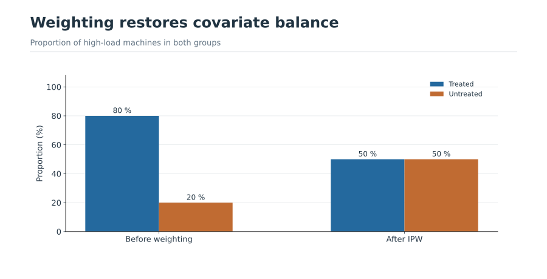

# M21-L3 – Matching, Propensity Scores and Weighting {#L3}

**Course area:** M21 – Causal Inference and Empirical Research

**Level:** Master · Elective/methods

**Prerequisites:** M17, M18.

**Learning objective:** Design and analyse observational studies using balance, overlap and weighting.

## Comparable units {#S1}

Matching seeks untreated counterparts for treated units with similar pre-treatment characteristics. Exact matching requires selected characteristics to agree; distance matching uses a metric, such as Euclidean distance between standardised features. A maximum allowable distance (caliper) can exclude poor matches. Matching without replacement avoids reusing controls but can depend on the order. Matching with replacement can rely heavily on a few controls. Excluding treated units with no comparable counterpart changes the target population; the resulting estimand is not automatically the original ATT.

## Propensity score and IPW {#S2}




*Figure: IPW balance across workload groups.*

The propensity score is $e(x)=P(A=1\mid X=x)$. With the correct score, the distribution of $X$ within score levels is independent of $A$. Under conditional exchangeability and positivity, this one-dimensional measure can be used for adjustment. For the ATE, the Horvitz–Thompson-type estimator is

$$\widehat\tau=\frac1n\sum_i\left(\frac{A_iY_i}{\widehat e(X_i)}-\frac{(1-A_i)Y_i}{1-\widehat e(X_i)}\right).$$

Conditional on $X=x$, the expectation of the first term is $\mathbb{E}[Y\mid A=1,X=x]$; similarly, the second yields the control mean. Alternatively, the Hájek estimator normalises each group by the sum of its weights; it is not identical to the estimator above in a finite dataset. For the ATT, treated units receive weight 1 and untreated units $e(X)/(1-e(X))$, with appropriate normalisation. This again requires identifiability.

| Load | Number | Treated | Treated mean | Untreated mean |
|---|---:|---:|---:|---:|
| low | 100 | 20 | 7 | 8 |
| high | 100 | 80 | 13 | 16 |

Before weighting, 80% of treated units have a high load, compared with 20% of controls. Using the known stratum-specific scores of 0.2 and 0.8 produces a weighted count of 100 per stratum in each group. The ATE is $-2$ and the crude difference is $11.8-9.6=2.2$. The diagram shows the change in the weighted distribution.

```python
import numpy as np
n=np.array([100,100]); t=np.array([20,80]); c=n-t; e=t/n
y1=np.array([7,13]); y0=np.array([8,16])
w1=t/e; w0=c/(1-e)
ate=(w1@y1-w0@y0)/n.sum(); naive=t@y1/t.sum()-c@y0/c.sum()
assert np.allclose([*w1,*w0,ate,naive],[100,100,100,100,-2,2.2])
print(ate,naive)
```

## Balance and overlap {#S3}

Examine the score distributions separately by group, the standardised mean difference (difference in means divided by the pooled standard deviation) for each important feature and, if necessary, higher moments. For a binary feature such as high load, the unweighted difference here is $0.6/0.4=1.5$ and is zero after weighting. A good treatment prediction model is not automatically a good balancing model. Scores close to zero or one produce extreme weights. The effective sample size $(\sum_i w_i)^2/\sum_i w_i^2$ per group can fall sharply. Capping weights reduces variance but may introduce bias; exclusion may change the population effect being estimated. Uncertainty must account for the sampling structure and the estimated scores; a simple unweighted t-test after matching is inappropriate.

## Exercise with solution {#S4}

A treated machine has $e=0.04$. What is its ATE weight, and approximately how many control machines with the same score correspond to this weight? Solution: $1/0.04=25$; one control has weight $1/0.96\approx1.042$, so 24 such controls correspond to the weight. The single treated observation has high leverage. When overlap is absent, greater model complexity cannot compensate for missing counterfactual information.

## Sources and further reading {#S5}

- [Cunningham: Causal Inference: The Remix, Chapter 5](https://mixtape.scunning.com/05-causal_cross_sectional_designs) · matching and weighting
