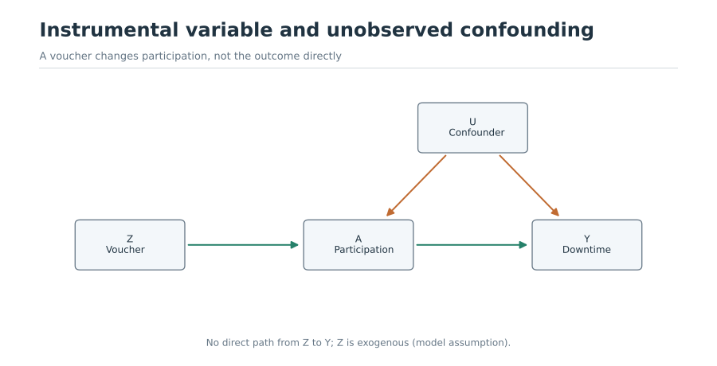

# M21-L4 – Instrumental Variables and Natural Experiments {#L4}

**Course area:** M21 – Causal Inference and Empirical Research

**Level:** Master · Elective/methods

**Prerequisites:** M17, M18.

**Learning objective:** Assess instruments and derive the local effect of a treatment from variation in assignment.

## An indirect intervention {#S1}




*Figure: Instrumental-variable assignment example.*

A factory randomly distributes vouchers for an optional maintenance programme. $Z$ denotes the voucher, $A$ actual participation and $Y$ downtime. A valid instrument $Z$ must have a measurable influence on $A$ (relevance), be independent of potential outcomes and compliance types (or satisfy suitable conditional independence), and meet the exclusion restriction: $Z$ affects $Y$ only through $A$. If voucher recipients also receive a diagnostic device that reduces downtime independently of participation, the exclusion restriction is violated. The diagram shows the permitted path and an unobserved common cause $U$ of treatment and outcome.

For a binary instrument and binary treatment, define $A(1), A(0)$. Compliers participate only with a voucher, always-takers in both cases, never-takers in neither case, and defiers only without a voucher. Monotonicity $A(1)\ge A(0)$ rules out defiers. Under these assumptions, the Wald ratio identifies the local average treatment effect for compliers (LATE):

$$\tau_{LATE}=\frac{\mathbb E[Y\mid Z=1]-\mathbb E[Y\mid Z=0]}{\mathbb E[A\mid Z=1]-\mathbb E[A\mid Z=0]}.$$

The numerator difference is the intention-to-treat effect on the outcome, and the denominator difference is the proportion of compliers. Under monotonicity, only these units change their behaviour, so the ratio isolates their average effect. With heterogeneous effects, LATE is generally not the ATE.

## Numerical example and 2SLS {#S2}

| Voucher | Machines | Participation rate | Mean hours of downtime |
|---|---:|---:|---:|
| no | 100 | 0.30 | 10.0 |
| yes | 100 | 0.70 | 8.4 |

The first stage is 0.40; the reduced form is $-1.6$ hours. The ratio is $-4$ hours. In the simple linear case with one instrument and an intercept, two-stage least squares (2SLS) produces the same ratio. First, $A$ is regressed on $Z$ (and exogenous controls if needed); then $Y$ is regressed on the predicted treatment value and those same controls. Standard errors require the correct IV covariance formula, not the naive second-stage OLS standard error.

```python
import numpy as np
z=np.repeat([0,1],100); a=np.r_[np.ones(30),np.zeros(70),np.ones(70),np.zeros(30)]
y=11.2-4*a # 10.0 und 8.4
wald=(y[z==1].mean()-y[z==0].mean())/(a[z==1].mean()-a[z==0].mean())
X=np.column_stack([np.ones(len(z)),z]); ahat=X@np.linalg.lstsq(X,a,rcond=None)[0]
beta=np.linalg.lstsq(np.column_stack([np.ones(len(z)),ahat]),y,rcond=None)[0][1]
assert np.allclose([wald,beta,y[z==0].mean(),y[z==1].mean()],[-4,-4,10,8.4])
print(wald,beta)
```

## Natural experiments and weak instruments {#S3}

An external allocation rule or an unexpected infrastructure change may also affect participation. Such events are not random by definition. It is necessary to examine whether other mechanisms simultaneously affect the outcome, whether groups were comparable before the event, and whether individuals or firms could influence assignment. The exclusion restriction typically cannot be established statistically alone. A small denominator amplifies random error and even small violations of the assumptions; instrument strength must be assessed. With weak instruments, inference procedures robust to weak identification (e.g. Anderson–Rubin tests in an appropriate linear model) are preferable.

## Exercise with solution {#S4}

A second voucher changes the participation rate only from 0.30 to 0.32, and mean downtime by $-0.08$ hours. The Wald estimate is also $-4$. Why is this less convincing? Solution: the denominator is twenty times smaller; an additional direct voucher effect of only $-0.04$ hours would bias the ratio by $-2$ hours. Without credible assumptions and an uncertainty analysis, the point estimate is not reliable evidence.

## Sources and further reading {#S5}

- [Cunningham: Causal Inference: The Remix, Chapter 7](https://mixtape.scunning.com/07-instrumental_variables) · IV and LATE
