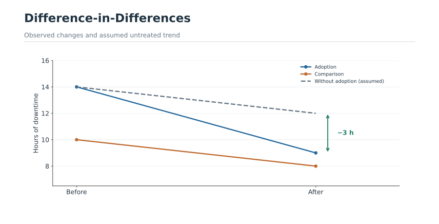

# M21-L5 – Difference-in-Differences and Regression Discontinuity {#L5}

**Course area:** M21 – Causal Inference and Empirical Research

**Level:** Master · Elective/methods

**Prerequisites:** M17, M18.

**Learning objective:** Identify causal effects from changes over time and threshold rules under explicit assumptions.

## Two groups and two time points {#S1}




*Figure: Difference-in-differences with parallel trends.*

One workshop introduces digital maintenance planning, while a comparable workshop does not initially do so. Let $\bar Y_{g,t}$ denote mean downtime in group $g$ and period $t$. The difference-in-differences (DiD) estimator is then

$$\widehat\tau=(\bar Y_{1,post}-\bar Y_{1,pre})-(\bar Y_{0,post}-\bar Y_{0,pre}).$$

| Group | Before | After | Change |
|---|---:|---:|---:|
| Adoption | 14 | 9 | −5 |
| Comparison | 10 | 8 | −2 |

The two groups start at different levels. Under parallel untreated trends, the value for the adopting group would have changed from 14 to 12 without the intervention. The effect is therefore $9-12=-3$ hours. The diagram represents the assumed untreated trend with a dashed line. The assumption concerns the unobserved outcome without intervention, not equal starting values. Further requirements include no anticipation of treatment, no relevant spillovers and a suitable composition of the groups. Pre-intervention periods, placebos and event studies help assess plausibility; a non-significant pre-trend does not prove parallel trends. With staggered adoption and changing effects, an ordinary two-way fixed-effects model may contain misleading comparisons. Group-time ATTs with suitable not-yet-treated or never-treated controls are an alternative. Standard errors should account for assignment and temporal dependence (often by clustering at group level; special methods are needed when there are few groups).

## Regression discontinuity (RD) {#S2}

Machines now receive an inspection from 100 operating hours onwards. Let $R$ be the assignment variable minus the threshold, so that $A=\mathbf{1}(R\ge0)$. In a sharp RD design, the local estimand is

$$\tau_{RD}=\lim_{r\downarrow0}\mathbb E[Y\mid R=r]-\lim_{r\uparrow0}\mathbb E[Y\mid R=r].$$

Continuity of the conditional means of the untreated and treated potential outcomes at the threshold, absence of other discontinuous changes and sufficient observations in its vicinity allow the difference to be interpreted as the effect at that threshold. Precise manipulation of the score can threaten this interpretation. In a fuzzy RD design, only the treatment probability jumps; under IV-like assumptions, the outcome discontinuity is divided by the discontinuity in treatment probability.

## Synthetic local regression {#S3}

For $R=-3,-2,-1$, let $Y=13+0.5R$; on the right, let $Y=11+0.2R$ for $R=1,2,3$. The lines fitted separately on the left and right have values of 13 and 11 at the threshold. The local effect is $-2$; a global comparison of means would be a different measure because of the slopes. Real RD analyses often use local linear estimation with kernel weighting, bandwidth selection and bias-corrected confidence intervals. Density tests, covariate continuity, alternative bandwidths and placebos are diagnostics, not proofs.

```python
import numpy as np
did=(9-14)-(8-10)
r=np.array([-3,-2,-1,1,2,3]); y=np.where(r<0,13+.5*r,11+.2*r)
left=np.polyfit(r[r<0],y[r<0],1); right=np.polyfit(r[r>0],y[r>0],1)
rd=right[1]-left[1]
assert np.allclose([did,rd],[-3,-2])
print(did,rd)
```

## Exercise with solution {#S4}

During the implementation period, a new sensor reduces downtime by one hour only in the treated workshop, independently of the programme. How does this change the interpretation of DiD? Solution: under additive effects, $-3=(-2)+(-1)$: the estimate includes an extraneous effect. In RD, a second measure introduced at the same threshold would be similarly problematic. These designs do not replace domain knowledge of the assignment process.

## Sources and further reading {#S5}

- [Cunningham: Causal Inference: The Remix, Chapter 9](https://mixtape.scunning.com/09-difference_in_differences) · DiD
- [Cunningham: Causal Inference: The Remix, Chapter 6](https://mixtape.scunning.com/06-regression_discontinuity) · RD
