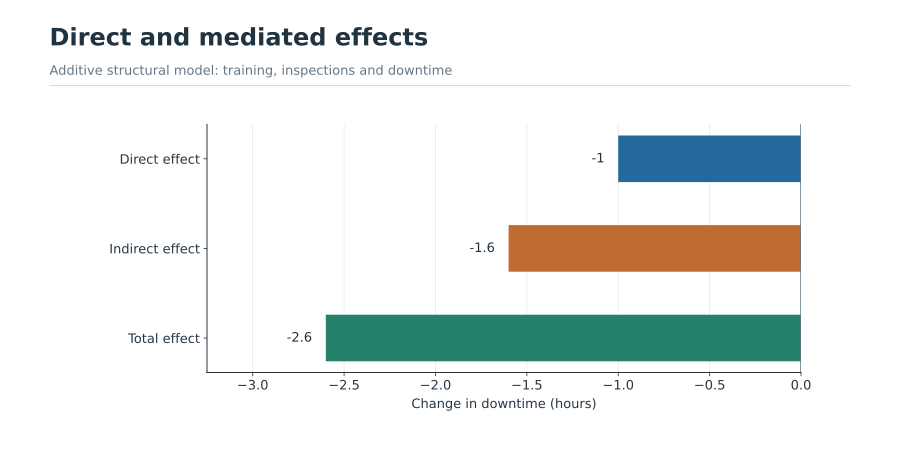

# M21-L6 – Mediation, Sensitivity Analysis and Causal Machine Learning {#L6}

**Course area:** M21 – Causal Inference and Empirical Research

**Level:** Master · Elective/methods

**Prerequisites:** M17, M18.

**Learning objective:** Decompose total effects, examine assumptions behind mechanisms and understand orthogonal estimation.

## Direct and mediated effects {#S1}




*Figure: Mediation and effect decomposition.*

A training programme $A$ increases the number of correctly performed inspections $M$; these reduce downtime $Y$. With $Y(a,m)$ denoting the potential outcome under specified treatment and mediator values, and $M(a)$ the potential mediator, the total effect is

$$TE=\mathbb E[Y(1,M(1))-Y(0,M(0))].$$

One possible decomposition adds and subtracts $Y(1,M(0))$. The natural indirect effect is then $\mathbb E[Y(1,M(1))-Y(1,M(0))]$, and the natural direct effect is $\mathbb E[Y(1,M(0))-Y(0,M(0))]$. Other reference levels yield different decompositions when there is interaction. In a linear additive structural model $M=2A+\epsilon_M$, $Y=10-A-0.8M+\epsilon_Y$ with suitably independent errors, the direct effect is $-1$, the indirect effect $2(-0.8)=-1.6$ and the total effect $-2.6$ hours. This is illustrated in the diagram. Natural effects require stronger identification assumptions than a randomised total effect, particularly regarding mediator–outcome confounding and possible treatment-induced confounders. Randomising $A$ does not randomise $M$. A controlled direct effect, by contrast, sets the same mediator value in both treatment situations.

## Sensitivity analysis {#S2}

Many causal assumptions are only partly testable. Suppose an unobserved binary feature $U$ increases downtime additively by $\delta$ hours and is associated with treatment after adjustment for measured variables. In a simple additive model within a covariate stratum, the residual bias is $B=\delta[P(U=1\mid A=1)-P(U=1\mid A=0)]$. With $\delta=4$ and a prevalence difference of 0.25, it is +1 hour. Under this assumption, an apparent effect of $-2$ corresponds to $-3$. Vary both quantities over ranges that are plausible in the domain. The results are scenarios, not estimates of the unknown bias. For mediation, a hypothetical correlation between structural errors can be examined; the appropriate sensitivity parameterisation depends on the model.

## Double machine learning (DML) {#S3}

In a partially linear model $Y=\theta A+g(X)+\epsilon$ with $\mathbb E[\epsilon\mid A,X]=0$, complex prior knowledge about $X$ can be incorporated using flexible models. Define $m(X)=\mathbb E[A\mid X]$ and $\ell(X)=\mathbb E[Y\mid X]$. The model implies $Y-\ell(X)=\theta(A-m(X))+\epsilon$. The residuals permit

$$\widehat\theta=\frac{\sum_i (A_i-\widehat m_i)(Y_i-\widehat\ell_i)}{\sum_i (A_i-\widehat m_i)^2}.$$

In cross-fitting, each observation is predicted exclusively by a nuisance model trained on other folds. The corresponding moment score $(A-m(X))(Y-\ell(X)-\theta(A-m(X)))$ is Neyman-orthogonal at the true model: small errors in nuisance quantities have no first-order effect on its expectation. This facilitates inference given sufficient convergence rates, adequate variation and appropriate sampling conditions. It remedies neither unmeasured confounding nor incorrect definitions of the estimand. With heterogeneous effects, the partially linear coefficient is generally not the unweighted ATE. Causal forests and other CATE methods also need identification assumptions and separate validation.

```python
import numpy as np
from sklearn.model_selection import KFold
from sklearn.ensemble import RandomForestRegressor
rng=np.random.default_rng(21); n=4000
x=rng.uniform(-2,2,(n,2)); p=1/(1+np.exp(-x[:,0]))
a=rng.binomial(1,p); y=-2*a+2*x[:,0]+x[:,1]**2+rng.normal(0,.5,n)
m=np.empty(n); ell=np.empty(n)
for train,test in KFold(5,shuffle=True,random_state=21).split(x):
    for target,out in [(a,m),(y,ell)]:
        model=RandomForestRegressor(n_estimators=60,min_samples_leaf=30,random_state=21,n_jobs=1)
        model.fit(x[train],target[train]); out[test]=model.predict(x[test])
u=a-m; v=y-ell; theta=u@v/(u@u)
assert abs(theta+2)<.25
print(round(theta,4),round(y[a==1].mean()-y[a==0].mean(),4))
```

The synthetic example has the constant true effect $-2$; the crude difference is biased because assignment depends on $X_1$. The test checks reproducibility, not the validity of confidence intervals. With real data, the report should include robustness analyses, a substantive justification for adjustment, uncertainty and possible spillovers.

## Exercise with solution {#S4}

With the mediator effect still $-0.8$, the effect of training on $M$ doubles from 2 to 4 in the linear example. The direct effect remains $-1$. Solution: indirect $-3.2$, total $-4.2$ hours. Can better predictive performance from a new ML model alone show that this decomposition is causal? No, because it does not test the missing counterfactuals and mediation assumptions.

## Sources and further reading {#S5}

- [Imai, Keele and Yamamoto (2010): Identification, Inference and Sensitivity Analysis for Causal Mediation Effects](https://imai.fas.harvard.edu/research/mediation/) · mediation identification and sensitivity
- [Didelez and Evans: Causal Inference, Chapter 20](https://www.stats.ox.ac.uk/~evans/APTS/double-machine-learning.html) · cross-fitting and Neyman orthogonality
- [Chernozhukov et al. (2018): Double/debiased machine learning for treatment and structural parameters](https://academic.oup.com/ectj/article/21/1/C1/5056401) · search excerpt
