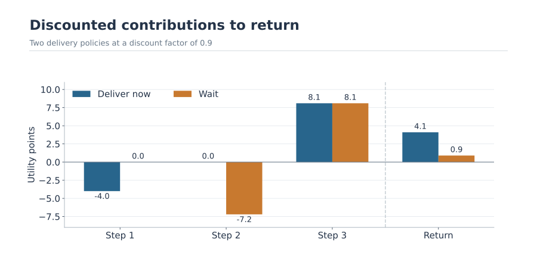

# M22-L1 – Markov Decision Processes and Rewards {#L1}

**Course area:** M22 – Reinforcement Learning and Sequential Decisions

**Level:** Master · Compulsory elective/models

**Prerequisites:** M13, M18, M19.

**Learning objective:** Formulate an MDP, calculate returns and explain the role of the policy.

## States, actions and feedback {#S1}

An automated material buffer can trigger a delivery immediately or wait until the next shift. An early delivery costs money; a late one may halt production. The action changes the future stock situation. A supervised model that merely predicts consumption in the next hour therefore does not yet decide when to order. Reinforcement learning (RL) seeks a decision rule with a good long-term outcome. The environment supplies the consequences of decisions rather than a list of correct actions.

A Markov decision process (MDP) consists of a state space $\mathcal S$, an action space $\mathcal A$ (possibly state-dependent), a transition and reward distribution $p(s',r\mid s,a)$ and a discount factor $\gamma$. In the discrete-time model, the agent observes $S_t$, chooses $A_t$, receives $R_{t+1}$ and moves to $S_{t+1}$. Markov means that the distribution of the next state and reward, given the state and action, does not additionally depend on the history. This holds only for a sufficient state representation. If information about deliveries already ordered is missing, for instance, the model can be treated as a partially observable process (POMDP) or the state can be augmented with relevant information. A history alone does not guarantee an exact Markov property.

## Discounted return and policy {#S2}




*Figure: Discounted returns for two delivery policies.*

The policy $\pi(a\mid s)$ describes the distribution of actions in state $s$. Under a deterministic policy, the selected action has probability one. An episode ends at time $T$; no further rewards arise thereafter. The return from step $t$ is

$$G_t=\sum_{k=0}^{T-t-1}\gamma^k R_{t+k+1},\qquad G_t=R_{t+1}+\gamma G_{t+1}.$$

With an infinite horizon and bounded rewards, $0\leq\gamma<1$ suffices for absolute convergence. In finite episodes, $\gamma=1$ is also possible. The factor is not a transition probability; it weights later feedback. A finite time limit can make the optimal action depend on the remaining time.

As a synthetic comparison of two fully known sequences, consider immediate delivery with rewards $(-4,0,10)$ and waiting with $(0,-8,10)$. The rewards are already scaled in common utility points. With $\gamma=0.9$, we obtain $G_0=-4+0+0.81\cdot10=4.1$ and $0-7.2+8.1=0.9$ respectively. With $\gamma=0.3$, the results are −3.1 and −1.5 respectively. Which alternative is preferred depends on the objective. The diagram shows the discounted contributions and sums for 0.9. In a stochastic environment, the expected return rather than an individual return is optimised.

```python
import numpy as np
r = np.array([[-4,0,10],[0,-8,10]])
for gamma in (.9,.3):
    g = r @ gamma**np.arange(3)
    print(g.round(3))
    assert np.allclose(g, [4.1,.9] if gamma==.9 else [-3.1,-1.5])
```

## Value functions and model limitations {#S3}

The state value $v_\pi(s)=\mathbb E_\pi[G_t\mid S_t=s]$ and action value $q_\pi(s,a)=\mathbb E_\pi[G_t\mid S_t=s,A_t=a]$ differ with respect to the first decision. Both assume that the specified policy is followed after that decision. The optimisation objective also depends on the initial state distribution. A new operating mode may change both the transitions and rewards; the previously learned policy then cannot be transferred without evaluation.

An MDP may be available as a known planning model or inferred from experience. Simulated feedback is meaningful in practice only if the simulation represents relevant mechanisms. The chosen reward is a proxy for an objective and is not automatically identical to the real quality of a decision. Safety limits and partial observability are addressed separately later.

## Exercise with solution {#S4}

At which discount factor are both sequences equivalent? Solution: the common final contribution cancels; $-4=-8\gamma$ gives $\gamma=0.5$. For larger values, immediate delivery is preferable in this deterministic comparison. A reward alone therefore does not describe the entire task.

## Sources and further reading {#S5}

- [Sutton and Barto (2018): Reinforcement Learning, 2nd ed.](https://mitpress.mit.edu/9780262039246/reinforcement-learning/) · book overview opened
- [OpenAI: Spinning Up, Part 1 – Key Concepts in RL](https://spinningup.openai.com/en/latest/spinningup/rl_intro.html) · concepts, returns, value functions and Bellman equations
- [David Silver: Reinforcement Learning, Advanced Topics 2015](https://davidstarsilver.wordpress.com/teaching/) · course overview with lectures 2–9 opened
