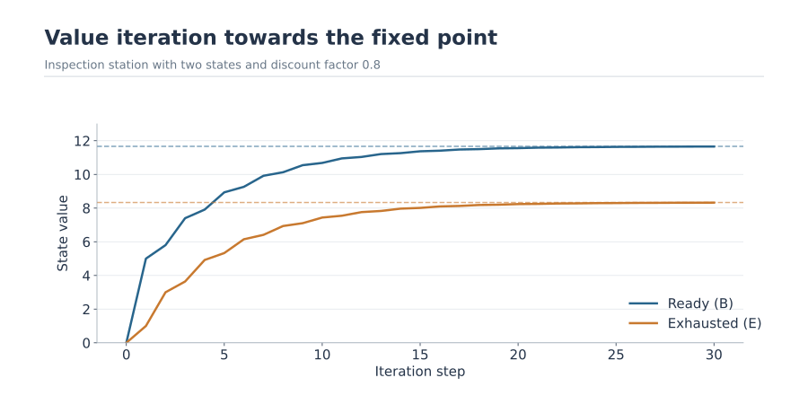

# M22-L2 – Bellman Equations and Dynamic Programming {#L2}

**Course area:** M22 – Reinforcement Learning and Sequential Decisions

**Level:** Master · Compulsory elective/models

**Prerequisites:** [M22-L1](M22-L1.md); M13, M18, M19.

**Learning objective:** Derive Bellman recursions and distinguish value iteration from policy iteration.

## Recursion rather than exhaustive future search {#S1}

If the transition model of a small MDP is known, future decisions can be calculated without writing out every infinitely long action sequence. Decomposing the return into the immediate reward and discounted remainder yields the Bellman expectation equation

$$v_\pi(s)=\sum_a\pi(a\mid s)\sum_{s',r}p(s',r\mid s,a)[r+\gamma v_\pi(s')].$$

In finite state and action spaces, a fixed policy can also be evaluated using a system of linear equations. Let $P_\pi$ be the transition matrix and $r_\pi$ the vector of expected immediate rewards. For $\gamma<1$ we have:

$$(I-\gamma P_\pi)v_\pi=r_\pi.$$

For an optimal policy, the Bellman optimality equation holds:

$$v_*(s)=\max_a\sum_{s',r}p(s',r\mid s,a)[r+\gamma v_*(s')].$$

Maximisation takes place outside the expectation: the decision is made before the random outcome of the action becomes visible. In finite discounted MDPs, a stationary deterministic optimal policy exists. Both the fixed-policy mapping and the optimality operator are contractions in the maximum norm with factor $\gamma$. Repeated application therefore converges from any finite initial value to the respective unique fixed point.

## Teaching example: operating an inspection station {#S2}




*Figure: Value iteration towards a Bellman fixed point.*

A station is either ready (B) or exhausted (E); the original state labels are retained. The permissible options in each state are work and rest. Transitions in this model world are deterministic:

| State | Action | Next state | Reward |
|---|---|---|---:|
| B | Work | E | 5 |
| B | Rest | B | 0 |
| E | Work | E | 1 |
| E | Rest | B | −1 |

With $\gamma=0.8$ and the policy work in B, rest in E, we obtain $v(B)=5+0.8v(E)$ and $v(E)=-1+0.8v(B)$. Solving yields $v(B)=4.2/0.36=11.\overline 6$ and $v(E)=8.\overline 3$. The alternative action in B gives $0.8v(B)=9.\overline 3$; in E it gives $1+0.8v(E)=7.\overline 6$. The policy under consideration is thus indeed optimal. The diagram shows how both values evolve under synchronous value iteration.

```python
import numpy as np
P = np.array([[0,1],[1,0]])
r = np.array([5,-1])
exact = np.linalg.solve(np.eye(2)-.8*P,r)
next_state = np.array([[1,0],[1,0]])
reward = np.array([[5,0],[1,-1]])
v=np.zeros(2)
for k in range(150):
    q=reward+.8*v[next_state]
    v=q.max(axis=1)
assert np.allclose(v,exact)
assert np.array_equal((reward+.8*v[next_state]).argmax(axis=1),[0,1])
print(v.round(5))
```

## Policy iteration, value iteration and cost {#S3}

Policy iteration alternates between complete (or sufficiently accurate) evaluation of a policy and its improvement by greedy selection. A fixed tie-breaking rule can prevent unnecessary switches. Value iteration combines the steps, performing an optimality backup each time. With synchronous backups, the error bound for $v_k$ is $\|v_k-v_*\|_\infty\leq\gamma^k\|v_0-v_*\|_\infty$. A verifiable Bellman residual $\|Tv-v\|_\infty$ also provides a bound on the distance to the fixed point by dividing by $1-\gamma$.

In the dense finite case, directly representing all transitions may require up to $O(|\mathcal S|^2|\mathcal A|)$ storage and work per value iteration step when expected rewards are available. Sparse or factorised models can be considerably cheaper. Large state spaces and unknown transitions motivate the sampling methods of the next lesson.

## Exercise with solution {#S4}

Suppose $v_0=(0,0)$. Calculate $v_1$ and $v_2$. Solution: $v_1=(5,1)$. In the second step, $v_2(B)=\max(5+0.8,4)=5.8$ and $v_2(E)=\max(1.8,-1+4)=3$. A greedy step using an inaccurate value function may therefore select a different policy from the one at the fixed point.

## Sources and further reading {#S5}

- [Sutton and Barto (2018): Reinforcement Learning, 2nd ed.](https://mitpress.mit.edu/9780262039246/reinforcement-learning/) · book overview opened
- [OpenAI: Spinning Up, Part 1 – Key Concepts in RL](https://spinningup.openai.com/en/latest/spinningup/rl_intro.html) · concepts, returns, value functions and Bellman equations
- [David Silver: Reinforcement Learning, Advanced Topics 2015](https://davidstarsilver.wordpress.com/teaching/) · course overview with lectures 2–9 opened
