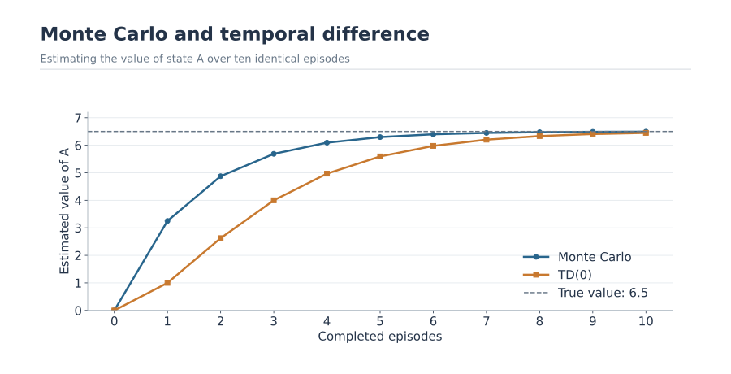

# M22-L3 – Monte Carlo and Temporal Difference {#L3}

**Course area:** M22 – Reinforcement Learning and Sequential Decisions

**Level:** Master · Compulsory elective/models

**Prerequisites:** [M22-L2](M22-L2.md); M13, M18, M19.

**Learning objective:** Calculate Monte Carlo, TD and multi-step targets and explain bootstrapping.

## Learning from episodes and transitions {#S1}

When transition probabilities are unknown, an agent can estimate values from observed sequences. Monte Carlo evaluation for a fixed policy uses complete episodes. In first-visit Monte Carlo, the return following the first visit to a state in each episode is included in its average. A sample mean estimate can be updated using $V(s)\leftarrow V(s)+\alpha(G_t-V(s))$. For the running mean of the $n$-th sample, $\alpha=1/n$. Independent restarts facilitate statistical arguments; repeated visits within an episode are not automatically independent.

Temporal difference (TD) updates before an episode ends. The one-step target and TD error are

$$Y_t=R_{t+1}+\gamma V(S_{t+1}),\qquad \delta_t=Y_t-V(S_t).$$

For TD(0), $V(S_t)\leftarrow V(S_t)+\alpha\delta_t$; a terminal state has value zero. Bootstrapping means that a current estimate forms part of the target. TD can thus learn earlier and does not require completed episodes. Early in learning, however, the target depends on the potentially inaccurate value estimate. MC and TD share the same desired fixed point under suitable conditions, but their sampling variability and transient biases differ.

## Comparing a particular episode {#S2}




*Figure: Monte Carlo and temporal-difference estimates.*

A diagnostic procedure passes through A → B → End, returning first 2 and then 6 points. With $\gamma=0.75$, $V(A)=V(B)=0$ and constant step size $\alpha=0.5$, the MC targets are $G_A=6.5$ and $G_B=6$. After one episode, the values are $(3.25,3)$. TD(0) updates A immediately with the initially uninformative value of B: $V(A)=1$. B is then set to 3. In the second identical episode, A learns from the already improved value of B. The diagram illustrates this difference across ten episodes.

```python
import numpy as np
mc=np.zeros(2); td=np.zeros(2)
for k in range(40):
    mc += .5*(np.array([6.5,6])-mc)
    td[0] += .5*(2+.75*td[1]-td[0])
    td[1] += .5*(6-td[1])
    if k==0:
        assert np.allclose(mc,[3.25,3]) and np.allclose(td,[1,3])
assert np.allclose(mc,[6.5,6]) and np.allclose(td,[6.5,6])
print(mc.round(5),td.round(5))
```

The difference in the first episode results from the timing of the update, not from generally inferior TD estimates. In stochastic tasks, distant rewards can generate considerable variability. TD then uses an estimated remaining value, whereas MC includes all remaining randomness in its target.

## Multi-step methods and eligibility traces {#S3}

An $n$-step return combines observed rewards and bootstrapping:

$$G_t^{(n)}=\sum_{k=0}^{n-1}\gamma^k R_{t+k+1}+\gamma^n V(S_{t+n}).$$

The sum ends earlier if a terminal state is reached first; the bootstrap term is then omitted. One-step TD and the complete episodic return are the two endpoints. TD($\lambda$) combines different backup lengths; eligibility traces assign current TD errors to recently visited states. For the simple tabular accumulating trace initialised at zero, $e_t(s)=\gamma\lambda e_{t-1}(s)+\mathbf 1\{S_t=s\}$ and $V(s)\leftarrow V(s)+\alpha\delta_t e_t(s)$. With linear or nonlinear function approximation, variants and convergence conditions must be considered separately.

## Exercise with solution {#S4}

What is the TD value of A after the second episode? Solution: the second target is $2+0.75\cdot3=4.25$. The update yields $1+0.5(4.25-1)=2.625$. B increases to 4.5. By contrast, the MC value of A increases to 4.875.

## Sources and further reading {#S5}

- [Sutton and Barto (2018): Reinforcement Learning, 2nd ed.](https://mitpress.mit.edu/9780262039246/reinforcement-learning/) · book overview opened
- [David Silver: Reinforcement Learning, Advanced Topics 2015](https://davidstarsilver.wordpress.com/teaching/) · course overview with lectures 2–9 opened
