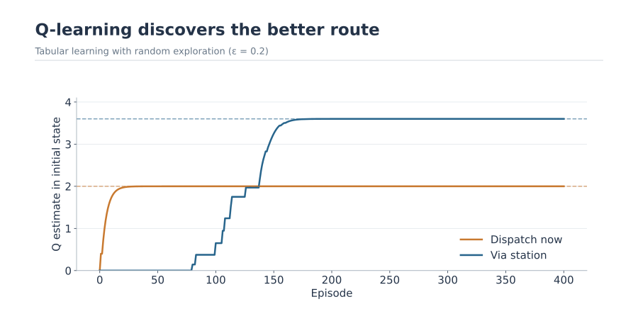

# M22-L4 – Q-Learning and Exploration {#L4}

**Course area:** M22 – Reinforcement Learning and Sequential Decisions

**Level:** Master · Compulsory elective/models

**Prerequisites:** [M22-L3](M22-L3.md); M13, M18, M19.

**Learning objective:** Explain Q-learning and SARSA, plan exploration and implement a tabular agent.

## Control learning and action values {#S1}

For control, evaluating a fixed policy is insufficient: the agent should develop a better rule. A tabular Q-learning step computes

$$Q(S_t,A_t)\leftarrow Q(S_t,A_t)+\alpha[R_{t+1}+\gamma\max_a Q(S_{t+1},a)-Q(S_t,A_t)].$$

For terminal transitions, the bootstrap term is omitted. Q-learning is off-policy: the behaviour policy generating a transition may differ from the greedy target policy. In contrast, SARSA (State–Action–Reward–State–Action) uses in its target the next action value actually selected by its behaviour policy. This may matter when exploration errors occur near costly states. Under suitable tabular assumptions (a finite stationary MDP, sufficient visits to all state–action pairs, appropriate stochastic approximation step sizes, bounded rewards and a discounted objective), Q-learning converges to the optimum. A constant learning rate does not generally provide this guarantee.

## Exploration in a fictional sorting facility {#S2}




*Figure: Q-learning discovers a better route.*

A parcel starts in S. Immediate dispatch ends with 2 points; an intermediate station Z is entered with 0 points. There, inspection ends the episode with 4 points, while returning the parcel gives −2. With $\gamma=0.9$, the two options in S have optimal values 2 and 3.6. Initially, however, all estimated values are zero. If an agent always selected the first maximal entry and immediately received 2 points, it would never try the alternative route.

$\varepsilon$-greedy selects uniformly from all available actions with probability $\varepsilon$, otherwise choosing a maximal Q entry. With a unique best action and two options, $\varepsilon=0.2$ gives probability 0.9 for the best and 0.1 for the other. The following small learning run uses a constant rate and fixed seed; all transitions are deterministic. The diagram tracks both Q estimates in S.

```python
import numpy as np
rng=np.random.default_rng(22)
q=np.zeros((2,2)); gamma=.9; alpha=.2; eps=.2
for episode in range(400):
    s=0
    while True:
        a=int(rng.integers(2)) if rng.random()<eps else int(q[s].argmax())
        done=(s==1 or a==0)
        r=(2 if a==0 else 0) if s==0 else (4 if a==0 else -2)
        target=r if done else r+gamma*q[1].max()
        q[s,a]+=alpha*(target-q[s,a])
        if done: break
        s=1
assert np.allclose(q,[[2,3.6],[4,-2]],atol=.02)
print(q.round(3))
```

## Exploration, data coverage and overestimation {#S3}

A temperature in softmax action selection can adjust action probabilities gradually; UCB methods augment bandit value estimates with uncertainty bonuses. A bandit considers immediate feedback and has no affected subsequent state. In an MDP, it is also crucial whether exploration adequately reaches distant states. Random actions may be impermissible in real systems; only authorised, safeguarded experiments belong in the learning process.

The maximum operator can introduce optimism with noisy value estimates. For two unbiased but variable Q estimators, the expected maximum is at least as large as the maximum of the expectations. Double Q-learning separates action selection from its evaluation using a second estimate; this reduces that mechanism, not every error. Off-policy learning with function approximation and bootstrapping introduces additional instability risks.

## Exercise with solution {#S4}

Let $Q(Z,\text{inspection})=3$, $Q(Z,\text{return})=-1$ and $Q(S,\text{intermediate station})=1.5$. Calculate the next Q-learning value after entering Z. Solution: target $=0+0.9\cdot3=2.7$, new value $=1.5+0.2(2.7-1.5)=1.74$. If returning the parcel were subsequently selected, SARSA would have target −0.9 and new value 1.02.

## Sources and further reading {#S5}

- [Sutton and Barto (2018): Reinforcement Learning, 2nd ed.](https://mitpress.mit.edu/9780262039246/reinforcement-learning/) · book overview opened
- [OpenAI: Spinning Up, Part 1 – Key Concepts in RL](https://spinningup.openai.com/en/latest/spinningup/rl_intro.html) · concepts, returns, value functions and Bellman equations
- [David Silver: Reinforcement Learning, Advanced Topics 2015](https://davidstarsilver.wordpress.com/teaching/) · course overview with lectures 2–9 opened
