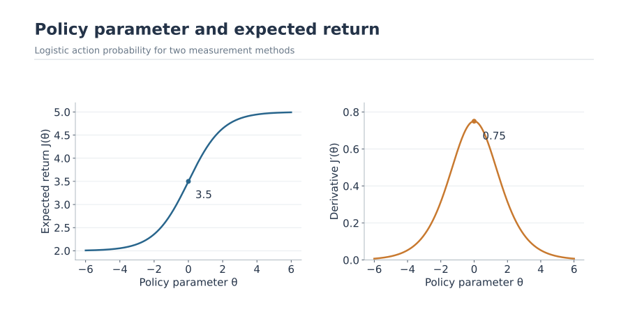

# M22-L5 – Policy Gradients and Actor-Critic {#L5}

**Course area:** M22 – Reinforcement Learning and Sequential Decisions

**Level:** Master · Compulsory elective/models

**Prerequisites:** [M22-L4](M22-L4.md); M13, M18, M19.

**Learning objective:** Derive a policy gradient and baseline; understand actor-critic as the coupling of a policy and value estimation.

## Optimising a policy directly {#S1}

Value-based methods derive decisions from value estimates. Policy-gradient methods, by contrast, parametrise the action distribution directly. This is particularly useful for stochastic decisions and continuous action spaces. Let $\pi_\theta(a\mid s)$ be differentiable and the initial state distribution independent of $\theta$. The probability of a trajectory contains the policy factors and the unknown environmental dynamics. Since the latter do not depend directly on $\theta$, their logarithmic derivative vanishes. For a finite episodic objective $J(\theta)=\mathbb E_\theta[G_0]$, the log-derivative trick yields, under regularity conditions,

$$\nabla J(\theta)=\mathbb E_\theta\left[\sum_{t=0}^{T-1}\gamma^t\,G_t\,\nabla_\theta\log\pi_\theta(A_t\mid S_t)\right].$$

Earlier rewards can be removed from the objective at each time step because they precede the relevant action. The discounting $\gamma^t$ outside the return belongs to the defined initial-state objective here. REINFORCE estimates this expression from samples and performs gradient ascent. Differentiable environmental transitions are not required, but the policy derivative is. For actions with continuous density, their log density is used.

## An analytical policy example {#S2}




*Figure: Policy parameter and expected reward.*

An inspection task permits a standard measurement (2 points) or a precision measurement (5 points). In this one-step model, the probability of precision measurement is $p=\sigma(\theta)=1/(1+\exp(-\theta))$. The expected value is $J(\theta)=2+3p$ and the derivative is $J'(\theta)=3p(1-p)$. At $\theta=0$ both actions are equally likely and the derivative is 0.75. The score of the Bernoulli policy for action $a\in\{0,1\}$ is $a-p$. A baseline can be $b=\mathbb E[R]=3.5$; for both actions, $(R-b)(a-p)=0.75$ then holds. Here the variance even falls to zero, which is not generally the case. The diagram shows the expected value and derivative as functions of the policy parameter.

```python
import numpy as np
sig=lambda x: 1/(1+np.exp(-x))
j=lambda x: 2+3*sig(x)
h=1e-5
fd=(j(h)-j(-h))/(2*h)
p=sig(0); a=np.array([0,1]); r=np.array([2,5])
g=(r-j(0))*(a-p)
assert np.isclose(fd,.75) and np.allclose(g,.75)
print(round(fd,6),g)
```

## Actor, critic and advantage {#S3}

A state-dependent, action-independent baseline may be subtracted from the return without changing the expected score gradient: $\sum_a\pi_\theta(a\mid s)\nabla_\theta\log\pi_\theta(a\mid s)=\nabla_\theta 1=0$. The difference $A_\pi(s,a)=q_\pi(s,a)-v_\pi(s)$ measures the advantage over the policy's average decision. Actor-critic combines an actor (policy) and a critic (value estimation). A common teaching example uses the TD error $r+\gamma V_\phi(s')-V_\phi(s)$ as an advantage estimate. The critic is trained on a value target, and the actor is updated in the direction of the log-policy gradient weighted by that estimate. During the actor step, the advantage estimate is treated as given. An inaccurate critic can introduce bias.

A2C refers to advantage actor-critic updates collected synchronously. PPO uses a clipped probability ratio to limit incentives for large policy changes; this is not a general guarantee of improvement or safety. Off-policy actor-critic methods also differ in data usage and corrections. An entropy bonus can encourage exploration, but with a fixed weight it changes the optimisation objective.

## Exercise with solution {#S4}

At $p=0.8$, $\theta=\log(4)$ and $J=4.4$. Calculate the gradient. Solution: $3\cdot0.8\cdot0.2=0.48$. Although the better task is already selected frequently, the slope remains positive. Near $p=1$, the logistic derivative becomes very small.

## Sources and further reading {#S5}

- [Sutton and Barto (2018): Reinforcement Learning, 2nd ed.](https://mitpress.mit.edu/9780262039246/reinforcement-learning/) · book overview opened
- [OpenAI: Spinning Up, Part 3 – Intro to Policy Optimization](https://spinningup.openai.com/en/latest/spinningup/rl_intro3.html) · policy-gradient derivation and baselines
