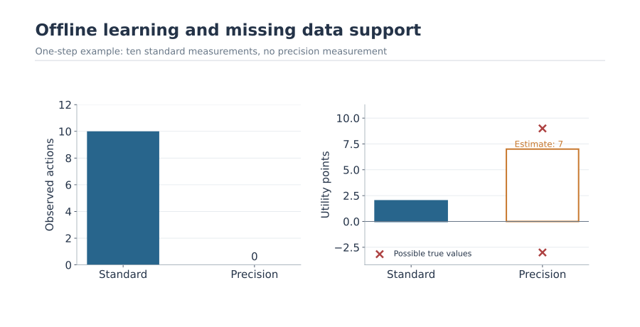

# M22-L6 – Deep RL, Offline RL and Imitation Learning {#L6}

**Course area:** M22 – Reinforcement Learning and Sequential Decisions

**Level:** Master · Compulsory elective/models

**Prerequisites:** [M22-L5](M22-L5.md); M13, M18, M19.

**Learning objective:** Calculate DQN targets and distinguish offline distribution shift from behaviour imitation.

## Deep action-value models {#S1}

With camera images, numerous sensors or continuous states, a table is usually impractical. Deep reinforcement learning uses neural networks to approximate a policy or value function. A deep Q-network (DQN) outputs estimated values for discrete actions. For a transition $(s,a,r,s',d)$, with $d=1$ for a genuine terminal state, a typical target is

$$y=r+\gamma(1-d)\max_{a'}Q_{\bar\theta}(s',a'),\qquad L(\theta)=\frac1B\sum_{i=1}^{B}(Q_\theta(s_i,a_i)-y_i)^2.$$

$\bar\theta$ denotes a temporarily fixed target network, and $B$ the batch size. The target is treated as constant during the gradient update. Experience replay stores transitions and draws batches from them; this reduces immediate temporal correlation and permits reuse. The samples are not thereby automatically independent or representative. Target networks reduce rapid feedback between target and estimate. DQN does not handle continuous action spaces without adaptation; actor-critic methods may be more suitable. Time limits that truncate an episode merely for data collection must be distinguished from genuine terminal states.

## Offline data and unobserved decisions {#S2}




*Figure: Offline RL and missing data support.*

In offline RL, the training dataset remains fixed. It was generated by an earlier policy; additional experiments during learning are excluded. A greedy policy may switch to actions for which little or no data exist. If the model overestimates their Q-values, bootstrapping may amplify the error. Conservative methods or restrictions to adequately supported actions aim to mitigate this. Support for the target policy in the logged data is also important for evaluating it.

In the simplified one-step case of an inspection device, there are two actions: standard S was observed ten times with 2 points; precision P was never performed. An extrapolating model estimates P at 7, but an unknown true utility could be −3 or +9 without changing these ten observations. The diagram separates observed support from model estimates. The following code calculates the DQN target value for three invented transitions; no network training takes place.

```python
import numpy as np
count=np.array([10,0]); est=np.array([2.,7.])
assert est.argmax()==1
supported=np.where(count>=1,est,-np.inf)
assert supported.argmax()==0
r=np.array([1,2,-1]); d=np.array([0,1,0]); nxt=np.array([[3,4],[9,8],[2,1]])
y=r+.9*(1-d)*nxt.max(axis=1)
q=np.array([3,2,0]); loss=np.mean((q-y)**2)
assert np.allclose(y,[4.6,2,.8]) and np.isclose(loss,3.2/3)
print(y,round(loss,6))
```

## Imitation and learning from demonstrations {#S3}

Behaviour cloning trains a policy as a supervised model from state–action pairs in demonstrations, for example by minimising the negative log-probability of the expert action. It requires no explicit numerical reward, but also imitates undesirable habits and can accumulate errors in unseen states. DAgger (Dataset Aggregation) collects states actually visited by the learning policy, queries an expert there and extends the training dataset. This is an interactive method, not purely offline learning. It requires accessible expert feedback and safeguarded data collection. Inverse reinforcement learning instead seeks a plausible reward function for observed behaviour. Several reward functions can explain the same behaviour; without additional assumptions, the result is not unique.

## Exercise with solution {#S4}

In the DQN example, the third transition is marked as genuinely terminal. What target and overall loss result? Solution: $y_3=-1$. The loss is $[(3-4.6)^2+0^2+(0+1)^2]/3=3.56/3\approx1.1867$. Incorrect terminal marking therefore changes the learning objective.

## Sources and further reading {#S5}

- [Mnih et al. (2015): Human-level control through deep reinforcement learning](https://pubmed.ncbi.nlm.nih.gov/25719670/) · abstract opened
- [Levine et al. (2020): Offline Reinforcement Learning: Tutorial, Review, and Perspectives on Open Problems](https://arxiv.org/abs/2005.01643) · preprint opened
- [Ross, Gordon and Bagnell (2011): A Reduction of Imitation Learning and Structured Prediction to No-Regret Online Learning](https://proceedings.mlr.press/v15/ross11a.html) · abstract opened
- [Sutton and Barto (2018): Reinforcement Learning, 2nd ed.](https://mitpress.mit.edu/9780262039246/reinforcement-learning/) · book overview opened
