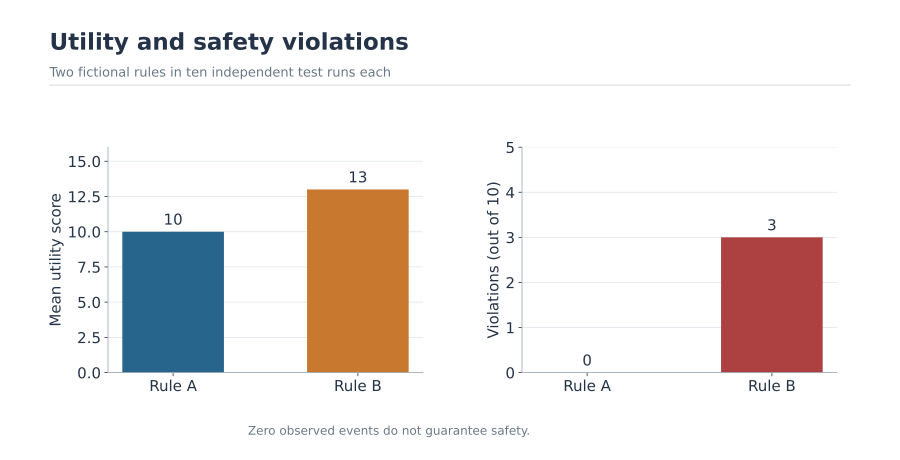

# M22-L7 – Safe Evaluation, Reward Design and Multi-Agent Learning {#L7}

**Course area:** M22 – Reinforcement Learning and Sequential Decisions

**Level:** Master · Compulsory elective/models

**Prerequisites:** [M22-L6](M22-L6.md); M13, M18, M19.

**Learning objective:** Distinguish reward misspecification, risk criteria, evaluation and multi-agent problems.

## Performance is not equivalent to safety {#S1}

A learning agent transporting materials receives one point for each component delivered. If a sensor counts each repeated delivery of the same component again, a policy can achieve high rewards without fulfilling the actual task. Exploitation of this proxy criterion is an example of reward misspecification. A test must therefore measure actual goal achievement, errors and safety violations separately from the training reward. Merely adjusting reward weights may be insufficient if certain actions must never be permitted.

A constrained MDP may have a cost variable $C_{t+1}$ in addition to the utility measure. One possible objective is

$$\max_\pi\mathbb E_\pi[G_0]\quad\text{subject to}\quad\mathbb E_\pi\left[\sum_{t\geq0}\gamma^t C_{t+1}\right]\leq c_{\max}.$$

A Lagrange multiplier can incorporate this constraint into optimisation. An upper bound on expected costs, however, does not protect every individual trajectory. Hard safety requirements necessitate additional action restrictions, monitored emergency mechanisms and appropriate test design. The requirement must apply during learning as well if real interactions occur then.

## Synthetic evaluation of a policy {#S2}




*Figure: Reward versus safety violations.*

Two transport rules A and B were each evaluated in ten comparable independent test runs (using artificially generated metrics here). The utility scores are $[8,10,11,12,9,10,8,12,9,11]$ for A and $[14,12,13,15,12,14,11,15,13,11]$ for B. There are 0/10 and 3/10 safety violations respectively. The means are 10 and 13 respectively. Suppose a pre-defined acceptance rule in a teaching test requires no observed safety violation. B fails despite its higher mean utility. A also receives no safety guarantee: with ten independent Bernoulli trials and zero events, the exact one-sided 95% upper bound for event probability is $1-0.05^{1/10}\approx0.259$. With dependent runs, this interval is not necessarily valid. The diagram presents the two criteria side by side.

```python
import numpy as np
a=np.array([8,10,11,12,9,10,8,12,9,11])
b=np.array([14,12,13,15,12,14,11,15,13,11])
upper=1-.05**(1/10)
assert a.mean()==10 and b.mean()==13 and .258<upper<.260
print(a.mean(),b.mean(),round(upper,4))
```

In RL benchmarks, not only evaluation episodes but also training runs vary. Multiple seeds, separate test environments and confidence intervals for the actual unit of aggregation of interest are necessary. Repeated selection based on the test set introduces optimistic bias. Importance sampling is one approach for offline evaluation: for complete episodes, the product $\prod_t \pi(A_t\mid S_t)/\mu(A_t\mid S_t)$ is a weight for converting from the behaviour policy $\mu$ to the target policy. This requires support and an appropriate dynamics and logging model. Long products can produce extreme variance; an offline estimate therefore does not replace a safety assessment.

## Multiple learning agents {#S3}

If two transport robots operate simultaneously, each action also influences the other's environment. In a cooperative Markov game, both can receive a shared reward; with competing or mixed incentives, they have individual rewards. If another agent is continuously updated, its behaviour appears non-stationary from the perspective of an independent learner. Centralised training with decentralised execution can use shared state information during training and replace it with locally available information at execution time. Coordination, information limits and credit assignment for a shared reward remain distinct problems. Test partners should therefore be separated from training partners, and unfavourable combinations should also be investigated.

## Exercise with solution {#S4}

How many independent event-free test runs are needed at a minimum for the exact one-sided 95% upper bound to be at most 5%? Solution: $1-0.05^{1/n}\leq0.05$ gives $n\geq\log(0.05)/\log(0.95)\approx58.4$, hence 59. Even this result applies only to the defined test population and the assumed independent sampling.

## Sources and further reading {#S5}

- [García and Fernández (2015): A Comprehensive Survey on Safe Reinforcement Learning](https://www.jmlr.org/papers/v16/garcia15a.html) · abstract opened
- [Agarwal et al. (2021): Deep Reinforcement Learning at the Edge of the Statistical Precipice](https://papers.nips.cc/paper/2021/hash/f514cec81cb148559cf475e7426eed5e-Abstract.html) · abstract opened
- [Levine et al. (2020): Offline Reinforcement Learning: Tutorial, Review, and Perspectives on Open Problems](https://arxiv.org/abs/2005.01643) · preprint opened
- [Deep multiagent reinforcement learning: challenges and directions (2022)](https://link.springer.com/article/10.1007/s10462-022-10299-x) · review opened
