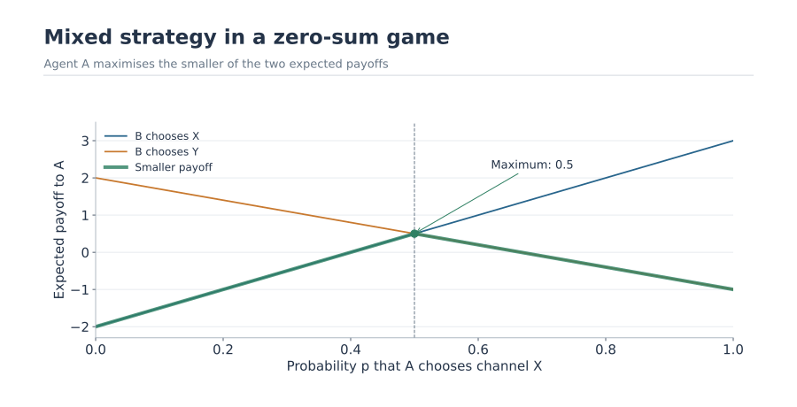

# M22-L8 – Game-Theoretic Models for Interacting Agents {#L8}

**Course area:** M22 – Reinforcement Learning and Sequential Decisions

**Level:** Master · Advanced elective

**Prerequisites:** M13, [M22-L1](M22-L1.md), [M22-L7](M22-L7.md); basic linear algebra.

**Learning objective:** Determine Nash equilibria and minimax solutions in small games and explain the transition to Markov games.

## Strategic interaction {#S1}

In an MDP, the best action depends on the environment and the agent's own objective. Once other decision-making agents pursue their own objectives, the best action may depend on their decisions. A finite normal-form game contains players, their action sets and payoff functions $u_i(a_1,\ldots,a_n)$. A pure strategy specifies an action; a mixed strategy is a distribution over actions. At a Nash equilibrium, no individual player can improve their expected payoff by switching unilaterally:

$$u_i(\sigma_i^*,\sigma_{-i}^*)\geq u_i(\sigma_i,\sigma_{-i}^*)\quad\text{for all }i,\sigma_i.$$

Here, for mixed strategies, $u_i$ denotes the expected payoff under independent randomisation. Equilibrium represents strategic stability, not necessarily high collective welfare. Finite normal-form games have at least one mixed Nash equilibrium, which may also be pure. Multiple equilibria are possible. In the two-player zero-sum case, the players' payoffs are opposites, making minimax methods applicable.

## Mixed equilibrium in a test game {#S2}




*Figure: Mixed strategies in a zero-sum game.*

Two fictional agents play an abstract load-distribution task. The planning agent A chooses channel X or Y; B chooses one of two test cases X or Y. The payoff to A is shown; B receives its negative:

|  | B: X | B: Y |
|---|---:|---:|
| A: X | 3 | −1 |
| A: Y | −2 | 2 |

If A plays X with probability $p$, its expected payoff against B:X is $3p-2(1-p)=5p-2$ and against B:Y is $-p+2(1-p)=2-3p$. B minimises, so A should maximise the smaller of the two results. The intersection occurs at $5p-2=2-3p$, giving $p=1/2$ and a game value of 0.5. The diagram shows the two lines and their lower envelope. If B plays X with probability $q$, A receives $4q-1$ from X and $2-4q$ from Y. Equating them gives $q=3/8$, again with value 0.5. In none of the four pure strategy combinations are both players simultaneously best-responding.

```python
import numpy as np
M=np.array([[3,-1],[-2,2]])
p=np.array([.5,.5]); q=np.array([.375,.625])
assert np.allclose(p@M,[.5,.5]) and np.allclose(M@q,[.5,.5])
grid=np.linspace(0,1,1001)
low=np.minimum(5*grid-2,2-3*grid)
assert np.isclose(grid[low.argmax()],.5)
print(p@M@q)
```

## Beyond zero-sum games {#S3}

In general games, both players can receive positive or negative payoffs. Consider two providers each choosing data format A or B. If both choose A, each receives 4; if both choose B, each receives 2; if they choose different formats, both receive 0. Both diagonal entries are pure Nash equilibria; the inferior stable outcome cannot be left by switching unilaterally. A coordinated change could improve both players' outcomes. Pareto efficiency and Nash stability are therefore different criteria. Correlated strategies allow shared random signals, provided recommendations offer incentives to comply; they are not the same as an independently mixed strategy profile.

Markov games extend the static representation to states, joint actions and transitions. Each policy can account for future payoffs, so the equilibrium depends on entire strategies rather than only current actions. Independent Q-learning does not guarantee a Nash equilibrium in general Markov games. In zero-sum Markov games, however, under suitable finite, discounted assumptions, a minimax backup can be considered for each state. Self-playing agents should not be evaluated exclusively against their own latest policy, since cyclic best responses and poor generalisation are possible.

## Exercise with solution {#S4}

In the test game, A always chooses X. What is B's best response, and how much improvement does A obtain from the mixed-strategy minimum guarantee? Solution: B:Y gives A −1, which is optimal from B's perspective. With $p=1/2$, A guarantees at least 0.5 in expectation, an improvement of 1.5 in the guaranteed payoff. An individual move can nevertheless yield −2.

## Sources and further reading {#S5}

- [MIT 6.7980: Setting and equilibria – the Nash equilibrium](https://www.mit.edu/~6.7980/nfgs_nash.html) · teaching page opened
- [Deep multiagent reinforcement learning: challenges and directions (2022)](https://link.springer.com/article/10.1007/s10462-022-10299-x) · review opened
