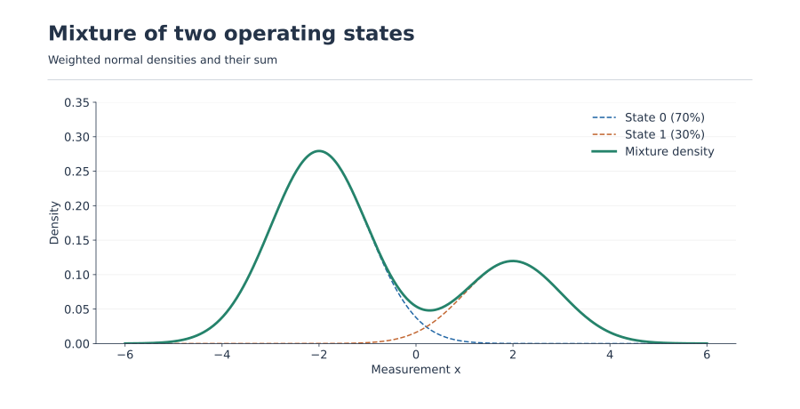

# M23-L1 – Generative Probabilistic Models and Sampling {#L1}

**Course area:** M23 – Generative Models

**Level:** Master · Compulsory elective/models

**Prerequisites:** M18, M19.

**Learning objective:** Distinguish generative modelling from classification and investigate a mixture distribution analytically and through sampling.

## From observations to a distribution {#S1}

Quality control produces measurements originating from two unknown operating states. Rather than merely classifying a measurement as normal or unusual, we want to describe the distribution of measurements and simulate new plausible values. A model $p_\theta(x)$ is therefore fitted to a sample. A conditional model $p_\theta(x\mid c)$ generates data for a specified context $c$. By contrast, a discriminative model might estimate $p(y\mid x)$; it need not model the distribution of the inputs.

Three goals may diverge: high test likelihood, realistic samples and useful latent features. Some models provide an evaluable density, whereas others only specify a method for generating samples. For continuous variables, a density is not a point probability. It is defined with respect to a reference measure; only its integral gives a probability.

## A bimodal measurement distribution {#S2}




*Figure: Mixture of two operating-state densities.*

Let $Z\in\{0,1\}$ be a latent state with $P(Z=1)=0.3$. Conditional on $Z$, suppose $X\mid Z=0\sim\mathcal N(-2,1)$ and $X\mid Z=1\sim\mathcal N(2,1)$. The second parameter denotes the variance. Marginalising gives

$$p(x)=0.7\,\varphi(x+2)+0.3\,\varphi(x-2),$$

where $\varphi$ is the standard normal density. The diagram shows the weighted components and their sum. Sampling is straightforward: first draw the state, then add standard normal noise. The laws of total expectation and total variance give $E[X]=-0.8$ and $\operatorname{Var}(X)=1+0.7\cdot0.3\cdot4^2=4.36$. Despite these moments, the mixture is not normally distributed.

```python
import numpy as np
rng=np.random.default_rng(23)
z=rng.random(200000)<.3
x=np.where(z,2.,-2.)+rng.normal(size=len(z))
assert abs(x.mean()+.8)<.03 and abs(x.var()-4.36)<.06
print(round(x.mean(),3),round(x.var(),3))
```

## Learning and model comparison {#S3}

When the density is accessible, maximum likelihood typically minimises the mean negative log-likelihood on training data. At population level, under suitable integrability conditions, this is equivalent to minimising $D_{KL}(p_{\mathrm{data}}\|p_\theta)$ up to a parameter-independent term. The direction matters: missing probability mass where data occur is heavily penalised. Implicit models without an evaluable density need different criteria. Energy-based models $p_\theta(x)\propto\exp(-E_\theta(x))$ can likewise be difficult to train and sample from because their normalising constant is unknown. MCMC from M18 is one possible component.

Separate fitting, hyperparameter selection and final evaluation. A model may reproduce training examples rather than capture the underlying structure. Testing rare states and new operating conditions is therefore useful alongside average performance.

## Exercise with solution {#S4}

Set the weight of the second state to 0.5. What are the resulting moments? Solution: $E[X]=0$ and $\operatorname{Var}(X)=1+0.25\cdot16=5$. The density is symmetric; symmetry alone does not imply a normal distribution. A generator sampling only from the first component loses an entire operating state.

## Sources and further reading {#S5}

- [Grover: Deep Generative Models – Introduction](https://deepgenerativemodels.github.io/notes/introduction/) · teaching chapter opened
