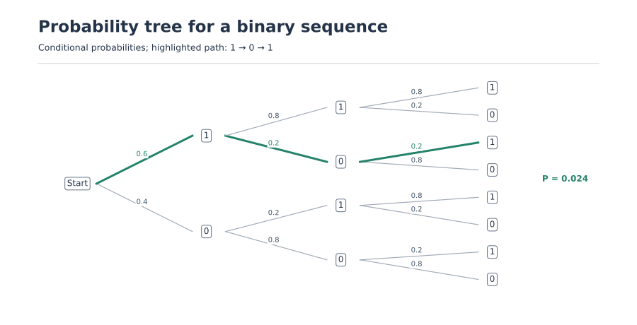

# M23-L2 – Autoregressive Models and Likelihood {#L2}

**Course area:** M23 – Generative Models

**Level:** Master · Compulsory elective/models

**Prerequisites:** [M23-L1](M23-L1.md); M18, M19.

**Learning objective:** Factorise a joint distribution into conditional distributions and calculate log-likelihood and sampling probabilities.

## Chain rule and modelling {#S1}

For a vector $x=(x_1,\ldots,x_d)$, the chain rule gives

$$p_\theta(x)=\prod_{i=1}^d p_\theta(x_i\mid x_{<i}).$$

This is initially an identity, not a conditional independence assumption. However, the variable order, context window and parameterisation affect learnability. In text, the variables are tokens; in measurement series, time points; and in images, for example, ordered pixels or discrete image tokens. Every conditional distribution must be normalised. Consequently, their product is also normalised, as can be seen by successively summing or integrating from the last entry back to the first.

During training, the actual preceding values are available. Causal masking prevents a network from seeing the variable it must predict or any later values. During generation, only the prefix generated so far is available; errors may therefore propagate.

## Three binary measurement decisions {#S2}




*Figure: Probability tree for a binary sequence.*

A sensor log contains three binary states. Suppose $P(X_1=1)=0.6$, $P(X_i=1\mid X_{i-1}=1)=0.8$ and $P(X_i=1\mid X_{i-1}=0)=0.2$ for $i=2,3$. This is a deliberately restricted first-order Markov model. The diagram shows its probability tree. The sequence $(1,0,1)$ has probability $0.6\cdot0.2\cdot0.2=0.024$. Its negative log-likelihood is $-\log(0.024)\approx3.7297$ nats. In bits per variable, it is $-\log_2(0.024)/3\approx1.794$.

```python
from itertools import product
from math import log,log2,isclose
p=lambda b,q:q if b else 1-q
def prob(x):
    return p(x[0],.6)*p(x[1],.8 if x[0] else .2)*p(x[2],.8 if x[1] else .2)
a={x:prob(x) for x in product((0,1),repeat=3)}
assert isclose(sum(a.values()),1) and isclose(a[1,0,1],.024)
print(round(-log(a[1,0,1]),4),round(-log2(a[1,0,1])/3,4))
```

## Training and generation strategies {#S3}

For a collection of sequences, the sum of the log conditional probabilities is maximised. Given consistent tokenisation, mean negative log-likelihood per token can be converted to perplexity $\exp(\mathrm{NLL}_{\mathrm{Token}})$. Comparing different tokenisations without further normalisation is problematic. Variable sequence lengths require an explicit stopping rule, such as an end-of-sequence token; padding tokens are masked when calculating the loss.

Ancestral sampling draws successively from the conditional distributions. Greedy decoding instead takes the maximum at every step; in general it is neither an unbiased sample nor the globally most probable sequence. Temperature $T>0$ modifies probabilities through $\operatorname{softmax}(l/T)$, where $l$ denotes the logits. Top-k and top-p further restrict the candidate set. All three interventions change the generated distribution. Computing training logits in parallel does not remove the sequential dependence of ordinary sampling.

## Exercise with solution {#S4}

Calculate $P(1,1,1)$ and $P(0,0,0)$. Solution: $0.6\cdot0.8^2=0.384$ and $0.4\cdot0.8^2=0.256$, respectively. Together, these two sequences are more probable than all six sequences involving a transition. Three independent uniform random numbers suffice to draw a sequence, each compared against the appropriate conditional probability.

## Sources and further reading {#S5}

- [Grover: Deep Generative Models – Autoregressive Models](https://deepgenerativemodels.github.io/notes/autoregressive/) · teaching chapter opened
