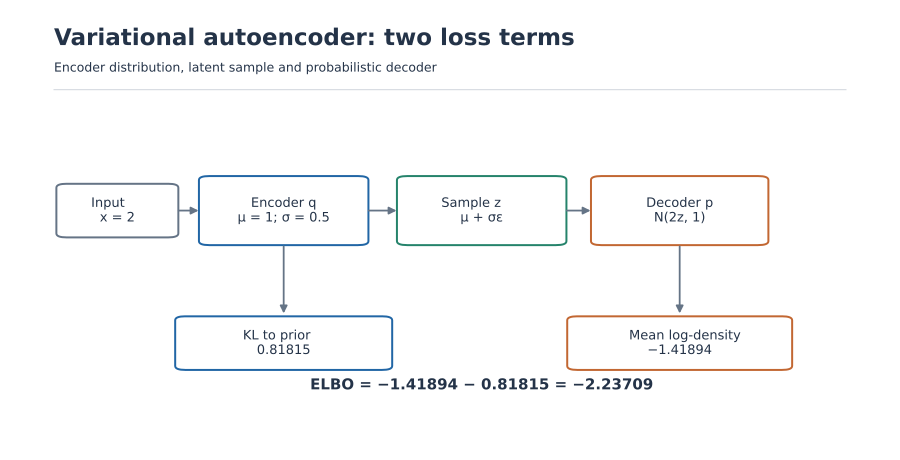

# M23-L3 – Variational Autoencoders {#L3}

**Course area:** M23 – Generative Models

**Level:** Master · Compulsory elective/models

**Prerequisites:** [M23-L2](M23-L2.md); M18, M19.

**Learning objective:** Derive a variational autoencoder's ELBO and distinguish the reconstruction, KL term and reparameterisation.

## Latent variables and the evidence bound {#S1}

A VAE models data using a latent vector $z$ with prior $p(z)$ and decoder $p_\theta(x\mid z)$. The marginal likelihood $p_\theta(x)=\int p(z)p_\theta(x\mid z)\,dz$ is often difficult to evaluate with nonlinear decoders. An encoder $q_\phi(z\mid x)$ approximates the posterior. Substituting the joint model into the definition of KL divergence yields

$$\log p_\theta(x)=\mathcal L(\theta,\phi;x)+D_{KL}(q_\phi(z\mid x)\|p_\theta(z\mid x)),$$

$$\mathcal L=E_{q_\phi}[\log p_\theta(x\mid z)]-D_{KL}(q_\phi(z\mid x)\|p(z)).$$

Because the final KL term in the first equation is non-negative, $\mathcal L$ is a lower bound (ELBO). Maximising it improves the bound, but does not guarantee an exact posterior approximation when the encoder family is restricted.

## A one-dimensional VAE teaching example {#S2}




*Figure: Variational autoencoder and two objective terms.*

For $q(z\mid x)=\mathcal N(1,0.25)$ and $p(z)=\mathcal N(0,1)$, the KL term can be determined by integrating the two log normal densities:

$$D_{KL}=\tfrac12(\mu^2+\sigma^2-1-\log\sigma^2)\approx0.81815.$$

Let the decoder be $p(x\mid z)=\mathcal N(2z,1)$ and the observation $x=2$. Then $E[(x-2z)^2]=1$, so $E[\log p(x\mid z)]=-\tfrac12(\log(2\pi)+1)\approx-1.41894$. The ELBO is approximately $-2.23709$. Here, the model even has an analytical marginal distribution $X\sim\mathcal N(0,5)$, giving $\log p(2)\approx-2.12366$; the gap is positive. The diagram arranges the encoder, latent sample, decoder and both loss terms.

```python
import numpy as np
mu,var=1.,.25
kl=.5*(mu**2+var-1-np.log(var))
rec=-.5*(np.log(2*np.pi)+(2-2*mu)**2+4*var)
true=-.5*(np.log(2*np.pi*5)+4/5)
elbo=rec-kl
assert elbo<=true and np.isclose(kl,.81814718056)
print(round(kl,5),round(elbo,5),round(true,5))
```

## Differentiable sampling and limitations {#S3}

For a diagonal Gaussian encoder, write $z=\mu_\phi(x)+\sigma_\phi(x)\odot\epsilon$ with $\epsilon\sim\mathcal N(0,I)$. This separates randomness from trainable parameters. The decoder loss can then be differentiated along this computational path. For example, a positive standard deviation can be calculated from the predicted log variance. This Gaussian trick does not apply directly to discrete latent variables.

The decoder distribution determines the reconstruction loss: a Gaussian density with fixed variance gives squared errors up to constants; a Bernoulli distribution gives binary cross-entropy. Arbitrary weighting of the KL term (as in a $\beta$-VAE) changes the objective. A very powerful decoder may ignore the latent variables (posterior collapse). Unconditional generation samples new latent values from the prior, not from the encoder for a particular training observation.

## Exercise with solution {#S4}

Set $\mu=0$ and $\sigma^2=1$. Then $q=p$ and the KL term is zero. In the decoder example above, however, $E[(2-2z)^2]=8$, so the average reconstruction is considerably worse. A small KL term alone is therefore not a quality measure.

## Sources and further reading {#S5}

- [Kingma and Welling (2014): Auto-Encoding Variational Bayes](https://arxiv.org/abs/1312.6114) · article text opened
