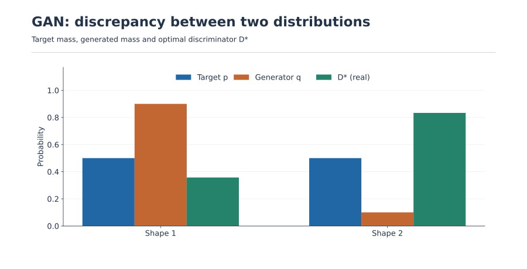

# M23-L4 – Generative Adversarial Networks {#L4}

**Course area:** M23 – Generative Models

**Level:** Master · Compulsory elective/models

**Prerequisites:** [M23-L3](M23-L3.md); M18, M19.

**Learning objective:** Formulate the adversarial game, calculate an optimal discriminator and recognise mode collapse.

## Two coupled learning objectives {#S1}

A GAN transforms random input $z\sim p_z$ into data using a generator $G_\theta(z)$. A discriminator $D_\psi(x)\in(0,1)$ distinguishes generated samples from real data. The original minimax game is

$$\min_\theta\max_\psi V=E_{p_{\mathrm{data}}}[\log D_\psi(X)]+E_{p_z}[\log(1-D_\psi(G_\theta(Z)))].$$

The parameter sets are updated alternately. During a discriminator step, the generator is held fixed, and vice versa. Often the generator instead minimises $-E_z[\log D(G(z))]$ (the non-saturating variant). This provides a more favourable learning signal when discriminator outputs are very small, but it is not the same objective. The generator need not provide an evaluable density.

## Two modes as a discrete teaching example {#S2}




*Figure: GAN distribution mismatch.*

Suppose the target distribution over two component shapes is $p=(0.5,0.5)$ and the generator distribution is $q=(0.9,0.1)$. With the generator fixed, an unconstrained discriminator can maximise the contribution $p_i\log D_i+q_i\log(1-D_i)$ in each state. Setting the derivative to zero and checking the negative second derivative gives $D_i^*=p_i/(p_i+q_i)$ when the total mass is positive. Thus $D_1^*=5/14\approx0.3571$ and $D_2^*=5/6\approx0.8333$. The diagram shows that the seldom-generated second shape is more frequently judged real by the discriminator.

Substituting $D^*$ gives $V(D^*,G)=-\log4+2\,JS(p,q)$. Here $JS(p,q)=\tfrac12 D_{KL}(p\|m)+\tfrac12 D_{KL}(q\|m)$, where $m=(p+q)/2$, is the Jensen–Shannon divergence. At the idealised optimum $p=q$, $D^*=1/2$ on the common support. This says nothing about convergence of finite neural-network training.

```python
import numpy as np
p=np.array([.5,.5]); q=np.array([.9,.1]); d=p/(p+q); m=(p+q)/2
js=.5*np.sum(p*np.log(p/m)+q*np.log(q/m))
v=np.sum(p*np.log(d)+q*np.log1p(-d))
assert np.allclose(d,[5/14,5/6]) and np.isclose(v,-np.log(4)+2*js)
print(d,round(js,5),round(v,5))
```

## Stability and variants {#S3}

A generator that almost always produces the same convincing shape may have little diversity. With mode collapse, important regions of the target distribution are missing. An overly strong discriminator, poorly coordinated learning rates and non-stationary interactions between networks can make optimisation difficult. Monitoring only one loss value is insufficient. Use fixed latent test samples, independent real comparison data and coverage metrics.

Wasserstein GANs replace binary classification with a real-valued critic subject to a Lipschitz constraint. The corresponding distance is explored in [M23-L8](M23-L8.md). Practical approximations of Lipschitz constraints, such as gradient penalties, are not exact global guarantees.

## Exercise with solution {#S4}

For $q=(0.5,0.5)$, $D^*=0.5$ in both states and $V=-\log 4$. If instead a discriminator outputs a constant 0.5 even when $p\ne q$, its loss alone is misleading: a poorly trained discriminator is not evidence that the generator distribution matches the target.

## Sources and further reading {#S5}

- [Goodfellow et al. (2014): Generative Adversarial Nets](https://proceedings.neurips.cc/paper/2014/hash/f033ed80deb0234979a61f95710dbe25-Abstract.html) · abstract opened
- [Grover: Deep Generative Models – Generative Adversarial Networks](https://deepgenerativemodels.github.io/notes/gan/) · teaching chapter opened
