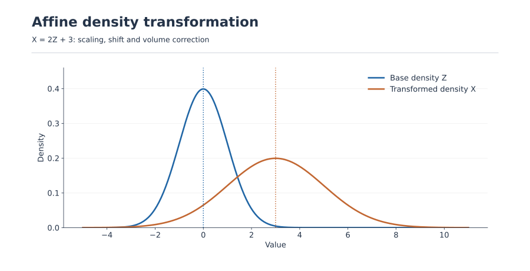

# M23-L5 – Normalising Flows {#L5}

**Course area:** M23 – Generative Models

**Level:** Master · Compulsory elective/models

**Prerequisites:** [M23-L4](M23-L4.md); M18, M19.

**Learning objective:** Apply the change-of-variables formula, analyse an invertible flow and understand the role of the Jacobian determinant.

## Invertible transformations {#S1}

A normalising flow defines $X=f_\theta(Z)$ for an easily evaluated base density $p_Z$ and a bijective, differentiable mapping with a differentiable inverse. The dimension remains unchanged. Probability mass is preserved, but local volume changes. The density must therefore be corrected by the determinant of the inverse Jacobian:

$$\log p_X(x)=\log p_Z(f^{-1}(x))+\log|\det J_{f^{-1}}(x)|.$$

Alternatively, the second term can be written as $-\log|\det J_f(z)|$. For a composition of transformations, the log determinants add along the sequence of intermediate states. To sample, transformations are applied forward; to evaluate density, they are applied in reverse.

## Affine transformation as a teaching example {#S2}




*Figure: Affine transformation of a probability density.*

Let $Z\sim\mathcal N(0,1)$ and $X=2Z+3$. The inverse mapping is $(x-3)/2$, with derivative $1/2$. The density is $p_X(x)=\varphi((x-3)/2)/2$. The mean becomes 3 and the variance 4. At the peak $x=3$, the density is $1/(2\sqrt{2\pi})\approx0.19947$. The diagram shows the broadened and shifted density. If the factor 1/2 is omitted, the curve integrates to 2 rather than 1.

```python
import numpy as np
from scipy.integrate import quad
phi=lambda z:np.exp(-z*z/2)/np.sqrt(2*np.pi)
f=lambda z:2*z+3
inv=lambda x:(x-3)/2
px=lambda x:phi(inv(x))/2
v=quad(px,-np.inf,np.inf)[0]
assert np.isclose(v,1) and np.allclose(inv(f(np.array([-2,0,2]))),[-2,0,2])
print(round(px(3),5),round(v,8))
```

## Efficient coupling layers {#S3}

An affine coupling layer splits a vector into $z_a,z_b$ and sets $x_a=z_a$ and $x_b=z_b\odot\exp(s(z_a))+t(z_a)$. The first subset remains unchanged and supplies the parameters for the rest. To invert, subtract $t(x_a)$ and multiply by $\exp(-s(x_a))$. The Jacobian is block triangular, so $\log|\det J_f|=\sum_j s_j(z_a)$. Alternating partitions and permutations can affect every component. Extremely large scaling factors can cause numerical problems.

Flow models permit exact likelihood evaluation within the specified model when inversion and determinants can be evaluated exactly. They do not guarantee good semantic modelling. A continuous density for discrete pixels also needs an appropriate discretisation or dequantisation method. The class of ordinary bijective flows has topological limitations: for example, it cannot map a connected support to two exactly disconnected supports.

## Exercise with solution {#S4}

For $x_1=z_1$, $x_2=3z_2+z_1$, the Jacobian is $J_f=\begin{pmatrix}1&0\\1&3\end{pmatrix}$. Its determinant is 3, and the log correction when evaluating density is $-\log3$. For $x=(2,8)$, we obtain $z=(2,2)$. Substitution into the forward mapping returns the original point.

## Sources and further reading {#S5}

- [Papamakarios et al. (2021): Normalizing Flows for Probabilistic Modeling and Inference](https://www.jmlr.org/papers/v22/19-1028.html) · abstract opened
- [Grover: Deep Generative Models – Normalizing Flow Models](https://deepgenerativemodels.github.io/notes/flow/) · teaching chapter opened
