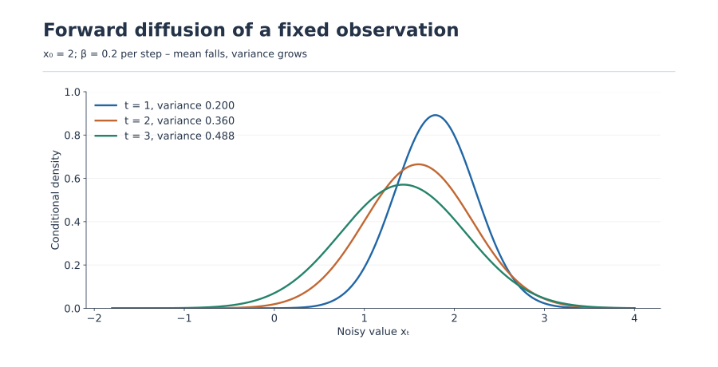

# M23-L6 – Diffusion Models and Score Matching {#L6}

**Course area:** M23 – Generative Models

**Level:** Master · Compulsory elective/models

**Prerequisites:** [M23-L5](M23-L5.md); M18, M19.

**Learning objective:** Understand a DDPM forward process, its noise-prediction objective and the score through an analytical example.

## Gradual addition of noise {#S1}

A discrete diffusion model defines a Markov chain that gradually mixes data $x_0$ with Gaussian noise. For $0<\beta_t<1$, $\alpha_t=1-\beta_t$ and $\bar\alpha_t=\prod_{s=1}^t\alpha_s$, we have

$$q(x_t\mid x_{t-1})=\mathcal N(\sqrt{\alpha_t}x_{t-1},\beta_t I),$$

$$x_t=\sqrt{\bar\alpha_t}x_0+\sqrt{1-\bar\alpha_t}\epsilon,\qquad \epsilon\sim\mathcal N(0,I).$$

The second equation follows by combining independent, normally distributed noise contributions: their variances add. When $\bar\alpha_T$ is sufficiently small, the final distribution approximates a standard normal distribution under suitable assumptions about the data. The reverse direction is approximated by trainable transitions. The system does not preserve an individual original data point; instead, it models a distribution of possible data.

## Signal, noise component and score {#S2}




*Figure: Forward diffusion for a fixed observation.*

For three teaching steps with constant $\beta=0.2$, $\bar\alpha_3=0.512$. At $x_0=2$, $X_3\mid x_0$ has mean $2\sqrt{0.512}\approx1.4311$ and variance 0.488. Taking $\epsilon=-1$ gives $x_3\approx0.7325$. The score of a density is its spatial log gradient; for the conditional density, $s(x_t\mid x_0)=-(x_t-\sqrt{\bar\alpha_t}x_0)/(1-\bar\alpha_t)=-\epsilon/\sqrt{1-\bar\alpha_t}$. At this sample point, it is approximately 1.4315. The diagram shows conditional densities for the three steps; this short chain does not yet give a useful terminal prior.

```python
import numpy as np
b=.2; a=(1-b)**3; x0=2.; e=-1.
x=np.sqrt(a)*x0+np.sqrt(1-a)*e
s=-(x-np.sqrt(a)*x0)/(1-a)
assert np.isclose(s,-e/np.sqrt(1-a))
rng=np.random.default_rng(23); u=np.full(150000,x0)
for _ in range(3): u=np.sqrt(1-b)*u+np.sqrt(b)*rng.normal(size=len(u))
assert abs(u.mean()-np.sqrt(a)*x0)<.015 and abs(u.var()-(1-a))<.015
print(round(x,4),round(s,4),round(u.var(),4))
```

## Learning noise and generating in reverse {#S3}

A common DDPM training objective selects a time $t$ from the training steps, creates artificial noise and trains a network $\epsilon_\theta(x_t,t)$ with mean squared error $E[\|\epsilon-\epsilon_\theta(x_t,t)\|^2]$. The optimal predictor under squared loss is the conditional expectation of the noise given $x_t,t$. This yields an estimator of the marginal score $\nabla_{x_t}\log q_t(x_t)$, not the score conditioned on an individual known $x_0$. Distinguish forward training noise from reverse-time sampling.

A common parameterisation of the reverse mean is $\mu_\theta(x_t,t)=\alpha_t^{-1/2}(x_t-\beta_t\epsilon_\theta(x_t,t)/\sqrt{1-\bar\alpha_t})$. The reverse variance must be set or modelled separately. Generation can start with normally distributed noise and repeatedly apply reverse steps. Score-based SDE models express the same underlying idea in continuous time. Numerical methods and the number of steps affect both runtime and quality. Latent diffusion works in a learned representation space; its decoder introduces another possible source of error.

## Exercise with solution {#S4}

Calculate the signal-to-noise variance ratio $\bar\alpha_t/(1-\bar\alpha_t)$ for the three steps, assuming standardised data variance. Solution: 4, $0.64/0.36\approx1.778$ and $0.512/0.488\approx1.049$. The relative signal contribution decreases. It must decrease further to obtain an approximately normal terminal prior.

## Sources and further reading {#S5}

- [Ho et al. (2020): Denoising Diffusion Probabilistic Models](https://proceedings.neurips.cc/paper/2020/hash/4c5bcfec8584af0d967f1ab10179ca4b-Abstract.html) · abstract opened
- [Song et al. (2021): Score-Based Generative Modeling through Stochastic Differential Equations](https://arxiv.org/abs/2011.13456) · article text opened
