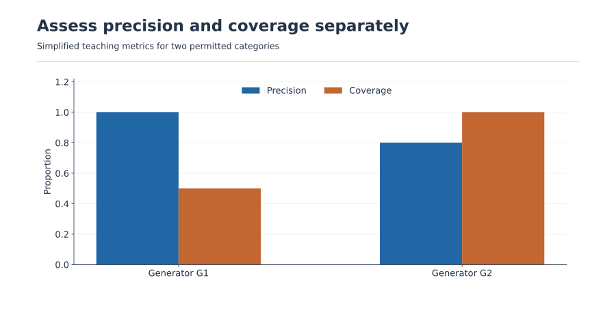

# M23-L7 – Evaluation, Conditioning and Limitations of Generative Models {#L7}

**Course area:** M23 – Generative Models

**Level:** Master · Compulsory elective/models

**Prerequisites:** [M23-L6](M23-L6.md); M18, M19.

**Learning objective:** Assess conditional generation, density and sample metrics, quality limitations and privacy risks separately.

## Conditioning and guidance {#S1}

A condition $c$ may be a class, a text, a measurement or a partially observed vector. A conditional generative model should represent $p_\theta(x\mid c)$. During training, data and conditions must be correctly paired. A model that ignores conditions may produce globally plausible samples and nevertheless fail the task. Classifier-based guidance in diffusion uses $\nabla_x\log p_t(x\mid c)=\nabla_x\log p_t(x)+\nabla_x\log p_t(c\mid x)$; this identity holds for consistent densities and positive probabilities. Classifier-free guidance combines conditional and unconditional network predictions without requiring a separately trained classifier. Extrapolating guidance factors alter the generated distribution and can reduce diversity.

## Two models, different quality characteristics {#S2}




*Figure: Generative precision and coverage.*

In a synthetic teaching example, real data comprise two allowed categories, A and B, both occurring with positive frequency. Generator G1 produces only A; G2 produces A and B as well as an invalid category C, with probabilities 0.4, 0.4 and 0.2. Here, deliberately simplified precision is the generated probability mass on the allowed support; simplified coverage is the proportion of real categories produced at all. G1 achieves 1 and 0.5, whereas G2 achieves 0.8 and 1. The diagram shows that the two aspects of quality favour different model choices. This is not an implementation of image-based precision–recall using neighbourhood sets.

```python
import numpy as np
q=np.array([[1.,0,0],[.4,.4,.2]])
precision=q[:,:2].sum(axis=1)
coverage=(q[:,:2]>0).mean(axis=1)
assert np.allclose(precision,[1,.8]) and np.allclose(coverage,[.5,1])
# One-dimensional Gaussian feature distance, analogous to FID
m1,m2,s1,s2=0,1,2,1
fd=(m1-m2)**2+(s1-s2)**2
assert fd==2
print(precision,coverage,fd)
```

## Comparable and reproducible evaluation {#S3}

FID compares means and covariances of features from real and generated images under a Gaussian approximation:

$$\|\mu_r-\mu_g\|_2^2+\operatorname{tr}(\Sigma_r+\Sigma_g-2(\Sigma_r^{1/2}\Sigma_g\Sigma_r^{1/2})^{1/2}).$$

In one dimension, this simplifies to $(\mu_r-\mu_g)^2+(\sigma_r-\sigma_g)^2$. With means of 0 and 1 and standard deviations of 2 and 1, the result is 2. A lower FID indicates a better match only in this feature-and-moment representation, not necessarily images that look better to humans. The feature extractor, preprocessing and sample size must be held constant in comparisons. Log-likelihood is a different quantity and is not directly available for every model.

An evaluation report should give samples, coverage, error classes, repetitions and uncertainty for each condition. Separate similarity and privacy tests are needed to detect memorised training data; synthetic data are not automatically anonymous. Text and code require technically verified content and functional tests. Plausible-sounding prose does not establish truth. Mark artificially generated test cases and check whether they are permissible for later use.

## Exercise with solution {#S4}

For G2, discard C after generation without changing anything else. What distribution results among accepted samples? Solution: $P(A\mid\text{accepted})=0.4/0.8=0.5$, and likewise for B. The acceptance rate is 0.8. Simplified precision increases to 1; with other weights or rare categories, however, filtering can introduce new biases.

## Sources and further reading {#S5}

- [Song et al. (2021): Score-Based Generative Modeling through Stochastic Differential Equations](https://arxiv.org/abs/2011.13456) · article text opened
- [Heusel et al. (2017): GANs Trained by a Two Time-Scale Update Rule Converge to a Local Nash Equilibrium](https://proceedings.neurips.cc/paper_files/paper/2017/hash/8a1d694707eb0fefe65871369074926d-Abstract.html) · abstract opened
- [Kynkäänniemi et al. (2019): Improved Precision and Recall Metric for Assessing Generative Models](https://proceedings.neurips.cc/paper/2019/hash/0234c510bc6d908b28c70ff313743079-Abstract.html) · abstract opened
