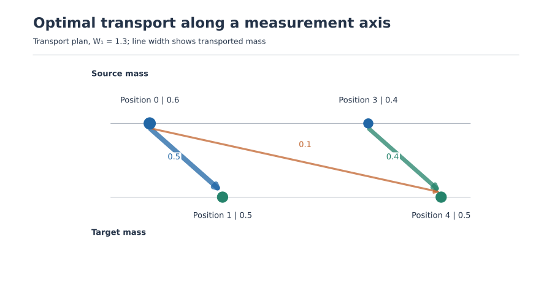

# M23-L8 – Optimal Transport and Distances between Distributions {#L8}

**Course area:** M23 – Generative Models

**Level:** Master · Advanced elective

**Prerequisites:** [M23-L7](M23-L7.md); M18, M19.

**Learning objective:** Formulate a discrete transport problem, interpret the Wasserstein distance geometrically and explain regularisation.

## From probability mass to transport plans {#S1}

KL divergences compare probabilities at the same location. Optimal transport additionally accounts for the geometry of the space: how much mass must move, and how far, to transform one distribution into another? For discrete distributions with weights $a_i,b_j\ge0$, each summing to 1, let $C_{ij}=d(x_i,y_j)^p$ for a metric $d$ and $p\ge1$. A transport plan $\pi_{ij}$ has marginals $\sum_j\pi_{ij}=a_i$, $\sum_i\pi_{ij}=b_j$ and non-negative entries. Then

$$W_p(a,b)=\left(\min_{\pi\ge0,\,\pi\mathbf1=a,\,\pi^T\mathbf1=b}\sum_{ij}C_{ij}\pi_{ij}\right)^{1/p}.$$

The discrete problem is a linear optimisation problem in the plan variables. A coupling can split mass, unlike a deterministic transport mapping. On general spaces, $W_p$ requires finite $p$th moments.

## Transport along a measurement axis {#S2}




*Figure: Discrete optimal transport along a line.*

The source distribution places mass 0.6 at location 0 and 0.4 at location 3. The target places 0.5 at each of locations 1 and 4. For $p=1$ and absolute distance, the cost matrix is $C=\begin{pmatrix}1&4\\2&1\end{pmatrix}$. Writing $u=\pi_{11}$, the marginal constraints give $\pi_{12}=0.6-u$, $\pi_{21}=0.5-u$ and $\pi_{22}=u-0.1$. Feasibility requires $0.1\le u\le0.5$. The cost is $3.3-4u$, minimised at $u=0.5$. The optimal plan is $\begin{pmatrix}0.5&0.1\\0&0.4\end{pmatrix}$ and $W_1=1.3$. The diagram displays the mass flow between four locations; line widths represent transported mass.

```python
import numpy as np
from scipy.optimize import linprog
from scipy.stats import wasserstein_distance
C=np.array([[1,4],[2,1]])
A=np.array([[1,1,0,0],[0,0,1,1],[1,0,1,0],[0,1,0,1]])
r=linprog(C.ravel(),A_eq=A,b_eq=[.6,.4,.5,.5],bounds=(0,None),method='highs')
assert r.success and np.allclose(r.x.reshape(2,2),[[.5,.1],[0,.4]])
w=wasserstein_distance([0,3],[1,4],[.6,.4],[.5,.5])
assert np.isclose(r.fun,w) and np.isclose(w,1.3)
print(r.x.reshape(2,2),w)
```

## Entropic regularisation and links to modelling {#S3}

Large cost matrices are computationally expensive. One common approximation minimises $\langle C,\pi\rangle+\varepsilon\sum_{ij}\pi_{ij}(\log\pi_{ij}-1)$ under the same marginal constraints, with $\varepsilon>0$ in units of cost and the convention $0\log0=0$. Under suitable positive weights, the solution is a scaled matrix $\operatorname{diag}(u)K\operatorname{diag}(v)$ with $K_{ij}=\exp(-C_{ij}/\varepsilon)$. Sinkhorn iterations alternately adjust the scaling vectors to fit the two marginals. Small regularisation can cause numerical underflow; log-domain implementations help. Regularised transport costs are not exactly the Wasserstein distance, and self-costs in particular can be non-zero.

Under suitable assumptions, $W_1$ obeys Kantorovich–Rubinstein duality $W_1(P,Q)=\sup_{\|f\|_{\mathrm{Lip}}\le1}(E_P[f]-E_Q[f])$. This motivates a Lipschitz critic in generative models. Unlike KL divergence, the distance between two point masses at different locations remains finite and accounts for their separation. Its meaning nevertheless depends on the chosen metric or feature representation; estimating it from high-dimensional samples can be difficult.

## Exercise with solution {#S4}

Compare point masses at 0 and 2 with point masses at 0 and 10. Their respective $W_1$ distances are 2 and 10, as the entire unit mass must be moved. In both cases the KL divergence in the direction of the first point mass is infinite, because the second distribution assigns no mass at 0. The Wasserstein distance therefore distinguishes the two cases geometrically.

## Sources and further reading {#S5}

- [Peyré and Cuturi (2019): Computational Optimal Transport](https://optimaltransport.github.io/book/) · book overview opened
