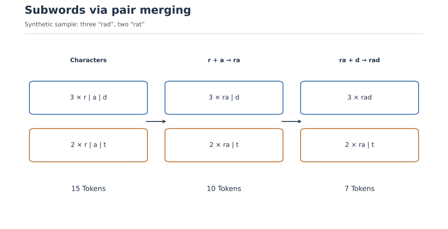

# M24-L1 – Text Representation, Tokenisation and Linguistic Features {#L1}

**Course area:** M24 – Natural Language Processing and Information Retrieval

**Level:** Master · Compulsory elective/models

**Prerequisites:** M12, M19.

**Learning objective:** Distinguish tokenisation, lexical and linguistic features, and recognise information lost through a representation.

## Text is not yet a numerical vector {#S1}

A search system for repair reports should recognise related topics in “Die Pumpen liefen nicht” (“The pumps were not running”) and “Pumpe läuft” (“Pump running”), but must not lose the distinction between a failure and normal operation. Unicode normalisation (e.g. NFC) standardises canonically equivalent character strings. Case distinctions may be unnecessary for some search tasks but informative for names and abbreviations. Words are not always delimited unambiguously by spaces: hyphens, technical identifiers and languages written without spaces between words require suitable processing rules.

Lemmatisation maps an inflected word form to its lexical base form. Stemming generally uses coarser truncation rules. Part of speech (POS), morphological features, syntactic dependencies and named entities provide additional information. A bag-of-words vector, by contrast, contains only counts, so negation and syntax may be lost. Character n-grams help with spelling variants. Subword approaches such as Byte Pair Encoding (BPE) learn frequently adjacent units and can represent rare words using smaller components. With subword tokenisers offering complete byte-level coverage, every byte sequence is representable, but not necessarily efficiently.

## Building a miniature vocabulary {#S2}




*Figure: Byte-pair merges for subword tokenisation.*

Consider the artificial word forms “rad”, “rad”, “rad”, “rat”, “rat”. Initially, these consist of characters. The pair r–a occurs five times, a–d three times and a–t twice. The first BPE step merges r–a into “ra”, and the second merges ra–d into “rad”. The diagram shows both steps. Real training must account for word boundaries, repetitions, a stopping criterion and deterministic tie-breaking. BPE does not guarantee linguistically meaningful morphemes.

```python
from collections import Counter
words=[list(w) for w in ['rad','rad','rad','rat','rat']]
for _ in range(2):
    counts=Counter(p for w in words for p in zip(w,w[1:]))
    a,b=max(counts,key=counts.get)
    out=[]
    for w in words:
        v=[]; i=0
        while i<len(w):
            if w[i:i+2]==[a,b]: v.append(a+b); i+=2
            else: v.append(w[i]); i+=1
        out.append(v)
    words=out
assert words==[['rad']]*3+[['ra','t']]*2
print(words)
```

## Features for different tasks {#S3}

An index can store the original text separately from its normalised analytical form. For sentiment analysis or diagnosis of operating states, removing “nicht” (“not”) is risky. A neural language model uses a fixed token-ID table and trainable embeddings; the numeric token ID has no intrinsic numerical meaning. The tokeniser must remain compatible with the model. Changing the vocabulary after training is not a trivial preprocessing operation.

## Exercise with solution {#S4}

How many tokens remain after the two steps? There are 15 initially, 10 after the first merge and seven after the second. The German texts “Motor läuft nicht” and “Motor nicht läuft” produce the same term-frequency vector. Position features or contextual representations can distinguish them.

## Sources and further reading {#S5}

- [Sennrich et al. (2016): Neural Machine Translation of Rare Words with Subword Units](https://arxiv.org/abs/1508.07909) · abstract accessed
- [Elastic: How full-text search works](https://www.elastic.co/docs/solutions/search/full-text/how-full-text-works) · documentation accessed
- [Jurafsky and Martin: Speech and Language Processing, 3rd ed., online manuscript](https://web.stanford.edu/~jurafsky/slp3/index.html) · search snippet only
