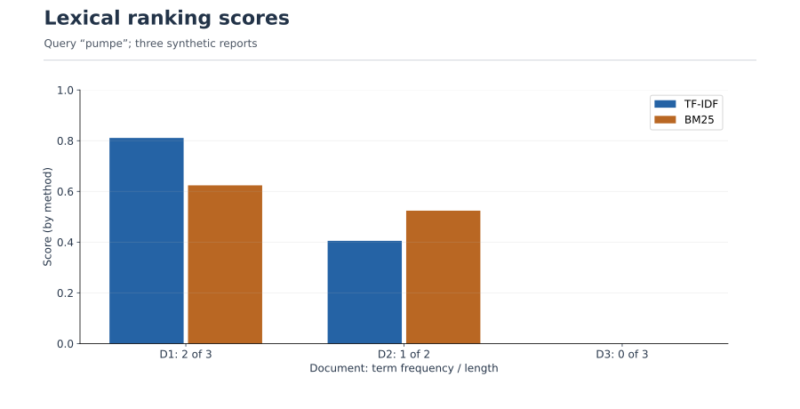

# M24-L2 – Inverted Indexes, TF-IDF and BM25 {#L2}

**Course area:** M24 – Natural Language Processing and Information Retrieval

**Level:** Master · Compulsory elective/models

**Prerequisites:** M12, M19.

**Learning objective:** Construct an inverted index and calculate TF-IDF and BM25 for the same query.

## From a text collection to candidate documents {#S1}

An inverted index maps each term to a postings list containing document IDs, potentially together with frequencies and positions. Intersecting two lists answers an AND query. Ranked retrieval also considers documents that match only some query terms. Positional information supports phrase search. Documents and queries must be analysed consistently so that their terms are meaningfully comparable.

One definition of TF-IDF is $w_{td}=f_{td}\log(N/df_t)$: $f_{td}$ counts term occurrences, $df_t$ counts documents containing the term and $N$ is the number of documents. Other variants exist (logarithmic TF, smoothed IDF and vector normalisation). BM25 reduces the effect of repeated terms and adjusts for document length. For distinct query terms, we use this positive-IDF variant:

$$s(q,d)=\sum_{t\in q}\log\left(1+\frac{N-df_t+0.5}{df_t+0.5}\right)\frac{(k_1+1)f_{td}}{f_{td}+k_1(1-b+b|d|/\overline L)}.$$

Here $k_1>0$ controls saturation, $b\in[0,1]$ controls length normalisation and $\overline L$ is the mean document length. Other IDF and query variants are available. The score is not a calibrated probability.

## Three workshop reports {#S2}




*Figure: Lexical relevance scores.*

D1 = “pumpe pumpe dichtung”, D2 = “pumpe ventil”, D3 = “filter motor ventil”. For “pumpe”, $df=2$, $N=3$ and $\overline L=8/3$. The postings list contains D1:2 and D2:1. Unnormalised TF-IDF gives approximately 0.811 and 0.405. With $k_1=1.2$ and $b=0.75$, BM25 gives approximately 0.624 and 0.524. The second report benefits from being short, while the first benefits from its higher term frequency. The diagram compares scores within each method.

```python
from math import log
D=[['pumpe','pumpe','dichtung'],['pumpe','ventil'],['filter','motor','ventil']]
f=[d.count('pumpe') for d in D]; N=len(D); df=sum(x>0 for x in f)
L=sum(map(len,D))/N; k=1.2; b=.75
idf=log(1+(N-df+.5)/(df+.5))
s=[idf*(k+1)*x/(x+k*(1-b+b*len(d)/L)) for x,d in zip(f,D)]
assert s[0]>s[1]>s[2]==0
print([round(x*log(N/df),3) for x in f],[round(x,3) for x in s])
```

## Ranking in practice {#S3}

A search engine may weight fields differently, apply filters before or after retrieval, and rerank candidates. Exact matching is often more reliable than statistical token search for specific part numbers. Test collections need genuine user queries or realistic tasks and independent relevance judgements. Compare variants using the same collection; changes to the collection also affect IDF values.

## Exercise with solution {#S4}

What is the effect of $b=0$? Length dependence disappears. With $f=1$ the score equals IDF; with $f=2$ it is $2(2.2)/(3.2)=1.375$ times IDF. Even infinitely many term repetitions give at most a factor of $k_1+1$, not unbounded growth.

## Sources and further reading {#S5}

- [Elastic: How full-text search works](https://www.elastic.co/docs/solutions/search/full-text/how-full-text-works) · documentation accessed
- [Robertson and Zaragoza (2009): The Probabilistic Relevance Framework: BM25 and Beyond](https://www.emerald.com/ftinr/article-abstract/4/1-2/1/1326508/The-Probabilistic-Relevance-Framework-BM25-and?redirectedFrom=fulltext) · abstract accessed
- [Manning et al. (2008): Introduction to Information Retrieval](https://www-nlp.stanford.edu/IR-book/) · search snippet only
