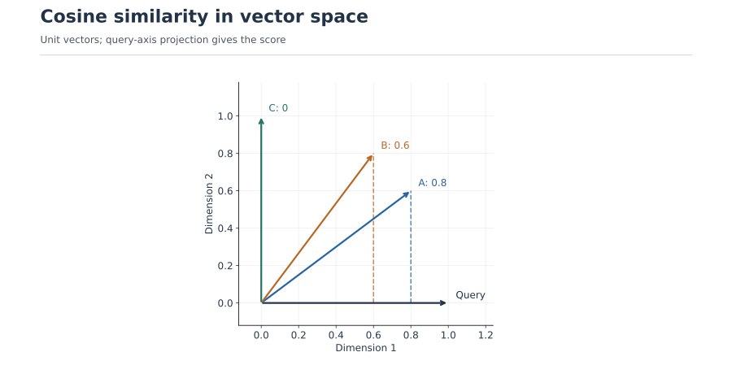

# M24-L3 – Embeddings, Semantic Search and Ranking {#L3}

**Course area:** M24 – Natural Language Processing and Information Retrieval

**Level:** Master · Compulsory elective/models

**Prerequisites:** M12, M19.

**Learning objective:** Understand dense vector retrieval, reranking and the evaluation of ordered search results.

## From words to semantic similarity {#S1}

A dual encoder computes $u=f(q)$ and $v=g(d)$ separately for a query and document. Document vectors can be stored offline. For non-zero vectors, cosine similarity is

$$c(u,v)=\frac{u^\top v}{\|u\|_2\|v\|_2}.$$

For normalised vectors this equals the dot product; the squared Euclidean distance is then $2-2c$. An encoder may be trained contrastively on suitable query–document pairs and negative examples. False negatives (documents that are actually relevant) distort the training signal. Similarity is not the same as logical entailment or factual agreement.

## Three synthetic document vectors {#S2}




*Figure: Cosine similarity in embedding space.*

For $u=(1,0)$, let A=(0.8, 0.6), B=(0.6, 0.8) and C=(0, 1) be three unit vectors. Their scores are 0.8, 0.6 and 0. The diagram shows the vectors and their projection onto the query axis. Independently, suppose B and C are relevant but A is not. Precision@2 and Recall@2 both equal 1/2, as does the reciprocal rank of the first relevant document. For graded relevance $r_i$, $DCG@k=\sum_{i=1}^k(2^{r_i}-1)/\log_2(i+1)$; dividing by the ideally ranked DCG yields nDCG (provided IDCG is positive). With binary judgements, nDCG@2 is approximately 0.387 here.

```python
import numpy as np
u=np.array([1,0]); V=np.array([[.8,.6],[.6,.8],[0,1]])
s=V@u/(np.linalg.norm(V,axis=1)*np.linalg.norm(u))
r=np.array([0,1,1])[np.argsort(-s)][:2]
discount=1/np.log2(np.arange(2,4))
ndcg=(r@discount)/discount.sum()
assert np.allclose(s,[.8,.6,0]) and abs(ndcg-.38685)<.0001
print(s,round(ndcg,4))
```

## Multi-stage retrieval {#S3}

For large collections, approximate nearest-neighbour indexes reduce query latency at the potential cost of missing relevant results. Hybrid retrieval combines lexical and dense candidates, for example through rank fusion rather than by adding uncalibrated scores. A cross-encoder jointly scores a query and document but is more expensive per pair. In a two-stage architecture, the initial index limits the recall achievable by subsequent reranking. Latency, memory, quality and filtering policies must be tested together. Semantic similarity alone must not permit a document to bypass access controls.

## Exercise with solution {#S4}

What is the distance between u and A? $\sqrt{2-1.6}=\sqrt{0.4}\approx0.6325$. Even a perfect reranking of the existing top two can only move B into first place; it cannot recover C if C was never retrieved as a candidate.

## Sources and further reading {#S5}

- [Reimers and Gurevych (2019): Sentence-BERT](https://arxiv.org/abs/1908.10084) · abstract accessed
- [Huang et al. (2025): A Survey on Hallucination in Large Language Models](https://arxiv.org/abs/2311.05232) · abstract accessed
- [Manning et al. (2008): Introduction to Information Retrieval](https://www-nlp.stanford.edu/IR-book/) · search snippet only
