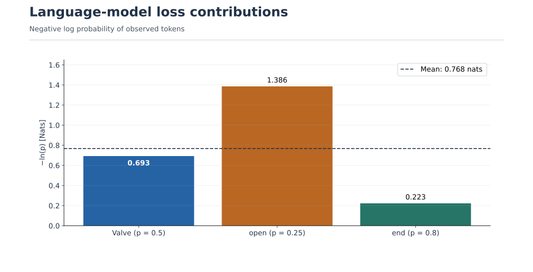

# M24-L4 – Language Modelling and Autoregressive Training {#L4}

**Course area:** M24 – Natural Language Processing and Information Retrieval

**Level:** Master · Compulsory elective/models

**Prerequisites:** M12, M19.

**Learning objective:** Calculate autoregressive factorisation, teacher forcing, cross-entropy and decoding outcomes.

## A sequence as a probability {#S1}

By the chain rule, a language model assigns a probability to a token sequence $x_{1:T}$:

$$p_\theta(x_{1:T})=\prod_{t=1}^{T}p_\theta(x_t\mid x_{<t})$$

An initial token or context supplies the first conditioning input; an end-of-sequence token can also model sequence length. N-gram models limit the history to a few tokens, whereas neural models use learned representations of the preceding context up to their context limit. The training task for a causal model is next-token prediction. With teacher forcing, the preceding inputs come from the observed sequence rather than the model's own sampled outputs. The causal mask introduced in M19 prevents access to future target positions.

## Three prediction steps {#S2}




*Figure: Token loss contributions in language modelling.*

For the synthetic token sequence “Ventil öffnen Ende” (“valve open end”), suppose the model assigns probabilities 0.5, 0.25 and 0.8 to the tokens actually observed. Their joint probability is 0.1, the negative log-likelihood is $-\log(0.1)\approx2.3026$ and the mean cross-entropy is $H=0.7675$ nats per token. Perplexity $\exp(H)\approx2.1544$ is an effective measure of uncertainty. The diagram shows the individual loss contributions. Comparing perplexities requires the same tokeniser, data and masking procedure.

```python
import numpy as np
p=np.array([.5,.25,.8]); loss=-np.log(p)
assert np.isclose(p.prod(),.1) and np.isclose(np.exp(loss.mean()),10**(1/3))
print(round(loss.mean(),4),round(np.exp(loss.mean()),4))
```

## Generation is not training {#S3}

At generation time, the current sequence is extended. Greedy decoding selects the most probable next token, whereas sampling draws from a probability distribution. With logits $z_i$ and temperature $\tau>0$, $p_i\propto\exp(z_i/\tau)$; lower temperatures concentrate probabilities without adding factual knowledge. Top-k limits selection to k tokens, while top-p chooses the smallest high-probability set with sufficient cumulative mass. The resulting distribution is then renormalised. Beam search explores several partial sequences but is still approximate, and its preference for certain sequence lengths needs checking. Locally good decisions do not necessarily yield the best complete sequence. A plausible sentence is not necessarily true.

## Exercise with solution {#S4}

Two tokens have probabilities 0.8 and 0.2. At half the temperature, their weights are squared and renormalised: $0.64/(0.64+0.04)=16/17$. The more probable token becomes likelier, but not certain.

## Sources and further reading {#S5}

- [Brown et al. (2020): Language Models are Few-Shot Learners](https://arxiv.org/abs/2005.14165) · abstract accessed
- [Vaswani et al. (2017): Attention Is All You Need](https://arxiv.org/abs/1706.03762) · abstract accessed
- [Jurafsky and Martin: Speech and Language Processing, 3rd ed., online manuscript](https://web.stanford.edu/~jurafsky/slp3/index.html) · search snippet only
