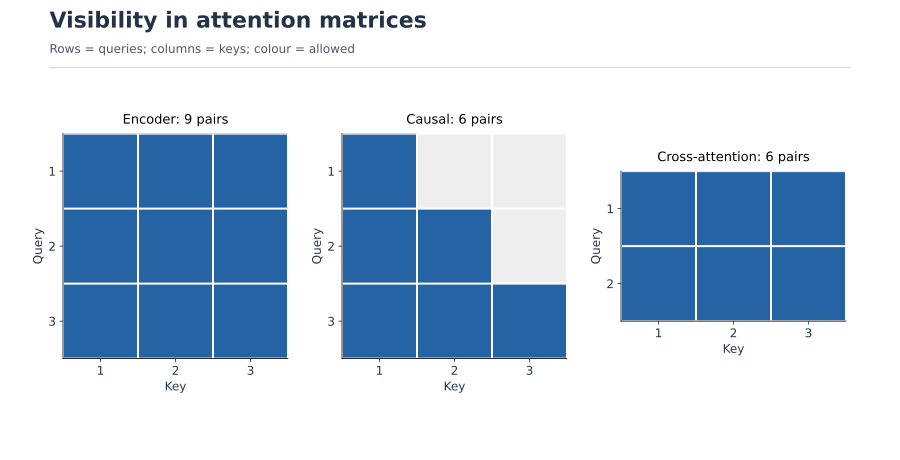

# M24-L5 – Encoders, Decoders and Transformer Language Models {#L5}

**Course area:** M24 – Natural Language Processing and Information Retrieval

**Level:** Master · Compulsory elective/models

**Prerequisites:** M12, M19.

**Learning objective:** Select encoder, decoder and encoder–decoder models on the basis of their information flow.

## Different architectures, different objectives {#S1}

The attention components introduced in M19 can be connected in different ways. An encoder such as BERT typically processes input tokens with bidirectional self-attention. In masked language modelling, selected token positions are altered and their original contents predicted. An encoder therefore suits classification, feature extraction and token labelling, but it is not automatically an autoregressive generator. A decoder-only model uses causal self-attention for next-token prediction. An encoder–decoder model first processes the input bidirectionally; the decoder additionally uses cross-attention over encoder outputs and causal self-attention over preceding target tokens. Architecture alone does not determine every training objective.

## Visibility in three matrices {#S2}




*Figure: Attention visibility patterns.*

The diagram uses three input tokens and two target positions. An unrestricted encoder mask permits $3^2=9$ pairs. The causal decoder mask (including the diagonal, with shifted target inputs) permits $3(3+1)/2=6$ pairs for three positions. Cross-attention from two target positions to three input positions permits six pairs, provided no padding masks apply. For an attention head with $Q\in\mathbb R^{n_q\times d_k}$, $K\in\mathbb R^{n_k\times d_k}$ and $V\in\mathbb R^{n_k\times d_v}$, the result is $\operatorname{softmax}(QK^\top/\sqrt{d_k}+M)V$, of shape $n_q\times d_v$. Softmax operates row by row; disallowed pairs are masked before it.

```python
import numpy as np
E=np.ones((3,3),dtype=bool); D=np.tril(E); C=np.ones((2,3),dtype=bool)
assert (E.sum(),D.sum(),C.sum())==(9,6,6)
q=np.ones((2,4)); k=np.ones((3,4)); v=np.arange(6).reshape(3,2)
z=q@k.T/2; a=np.exp(z-z.max(1,keepdims=True)); a/=a.sum(1,keepdims=True)
assert np.allclose(a@v,[[2,3],[2,3]])
print(a@v)
```

## Choosing and deploying a model {#S3}

An encoder may be sufficient for searching reports for operating-state labels. A causal model suits free text continuation. Encoder–decoder architecture is a natural, though not exclusive, choice for translation. With dense self-attention, the score matrix grows quadratically with sequence length. Caching keys and values can reduce repeated computation during autoregressive generation, at the cost of additional memory. Context length, data quality, training objective and evaluation task are distinct decision factors.

## Exercise with solution {#S4}

How many causally permitted pairs are there for four positions? $1+2+3+4=10$ out of 16. If two of five input positions are padding, each ordinary cross-attention row retains three valid key positions.

## Sources and further reading {#S5}

- [Devlin et al. (2019): BERT](https://arxiv.org/abs/1810.04805) · article text accessed
- [Vaswani et al. (2017): Attention Is All You Need](https://arxiv.org/abs/1706.03762) · abstract accessed
- [Raffel et al. (2020): Exploring the Limits of Transfer Learning with a Unified text-to-text Transformer](https://arxiv.org/abs/1910.10683) · abstract accessed
- [Brown et al. (2020): Language Models are Few-Shot Learners](https://arxiv.org/abs/2005.14165) · abstract accessed
