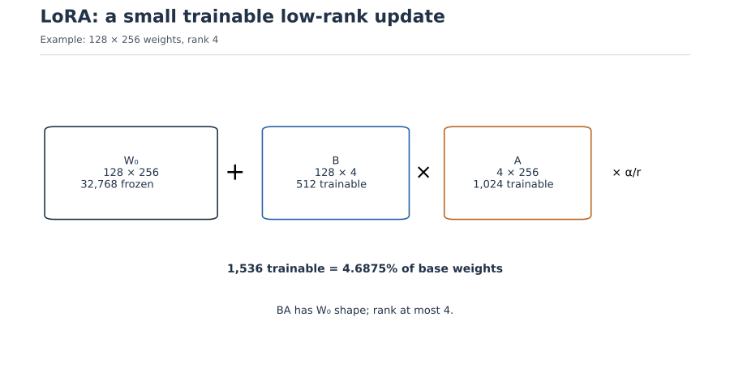

# M24-L6 – Fine-Tuning, PEFT and Preference Optimisation {#L6}

**Course area:** M24 – Natural Language Processing and Information Retrieval

**Level:** Master · Compulsory elective/models

**Prerequisites:** M12, M19.

**Learning objective:** Distinguish full fine-tuning, parameter-efficient fine-tuning and preference learning, and calculate LoRA parameter counts.

## Adapting a model to a task {#S1}

A pretrained model can be adapted to examples of desired responses through supervised fine-tuning (SFT). In many applications, the loss is computed only for response tokens, not for the input. Full fine-tuning updates all weights selected for training. Parameter-efficient fine-tuning (PEFT) limits the trainable degrees of freedom, for example through inserted adapters, trainable prompt vectors or Low-Rank Adaptation (LoRA). In-context learning is different: examples appear in the context without triggering a weight update.

## A low-rank factorisation {#S2}




*Figure: LoRA low-rank parameter update.*

Let $W_0\in\mathbb R^{128\times256}$ be a frozen matrix, with $A\in\mathbb R^{r\times256}$ and $B\in\mathbb R^{128\times r}$. LoRA uses $W=W_0+(\alpha/r)BA$. With $r=4$, the update needs $4(128+256)=1536$ trainable matrix elements rather than 32768, or 4.6875% (excluding biases and other layers). The diagram shows the shapes and sizes. The rank of BA is at most r; this does not guarantee that any particular learning task can be solved adequately with that rank. Frozen weights still incur computation and memory costs.

## Learning from preferences {#S3}

Preference learning seeks to favour preferred responses $y_w$ over rejected responses $y_l$ for the same input x. One RLHF approach first learns a reward model from comparisons and then optimises a policy with regularisation towards a reference policy. Direct Preference Optimisation (DPO) instead uses a pairwise loss with a frozen reference model:

$$\ell=-\log\sigma\left(\beta\left[\log\frac{\pi_\theta(y_w|x)}{\pi_{ref}(y_w|x)}-\log\frac{\pi_\theta(y_l|x)}{\pi_{ref}(y_l|x)}\right]\right).$$

Here $\sigma(z)=1/(1+e^{-z})$ and $\beta>0$. For log ratios 0.4 and −0.2 with $\beta=1$, the loss is about 0.4375. Preference datasets can contain social biases and unreliable judgements. Separate evaluation on domain questions, safety cases and previously demonstrated abilities tests for undesirable side effects.

```python
from math import log1p,exp
r=4; train=r*(128+256); total=128*256
loss=log1p(exp(-(.4-(-.2))))
assert train==1536 and train/total==.046875 and abs(loss-.437488)<1e-6
print(train,round(loss,6))
```

## Exercise with solution {#S4}

How does the parameter count change at r=8? It becomes 3072, or 9.375%. If the two DPO log ratios are equal, $\ell=\log2$ regardless of their common value.

## Sources and further reading {#S5}

- [Hu et al. (2022): LoRA](https://arxiv.org/abs/2106.09685) · article text accessed
- [Rafailov et al. (2023): Direct Preference Optimization](https://arxiv.org/abs/2305.18290) · abstract accessed
- [Brown et al. (2020): Language Models are Few-Shot Learners](https://arxiv.org/abs/2005.14165) · abstract accessed
