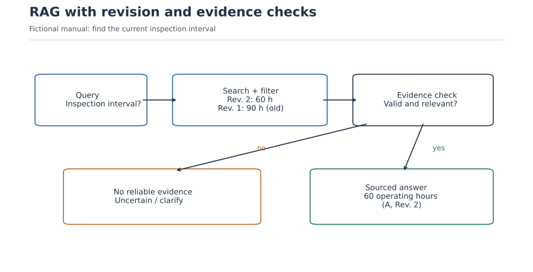

# M24-L7 – Retrieval-Augmented Generation and Source Verification {#L7}

**Course area:** M24 – Natural Language Processing and Information Retrieval

**Level:** Master · Compulsory elective/models

**Prerequisites:** M12, M19.

**Learning objective:** Model a RAG pipeline and evaluate retrieval quality, evidence faithfulness and source verification separately.

## Adding external knowledge {#S1}

A workshop wants to query its manuals even though maintenance intervals can change. A language model has parametric knowledge; retrieval-augmented generation (RAG) additionally provides selected external passages during generation. Documents are ingested with provenance, validity dates and access-control metadata, divided into suitable chunks and indexed. Chunks that are too small lose context; those that are too large dilute relevance. Overlap may help but increases redundancy. When splitting tables, their headings and units must be retained.

## Two revisions, one answer {#S2}




*Figure: RAG with source and version verification.*

Our fictional manual A, revision 2, effective from 1 June 2026, specifies for device P: “Check filter after 60 operating hours.” Revision 1 specifies 90 hours. Another passage describes cleaning the device. The query requests the current inspection interval. The retriever must consider access permissions and validity first, then return candidates; reranking prioritises a current, precisely relevant passage. The diagram shows the process, including abstention when evidence is absent. The answer “60 operating hours (A, Rev. 2)” is supported here. “Every 60 days” would be wrong despite containing the correct number. An old manual alone does not justify a claim about current requirements.

```python
from datetime import date
rows=[('A1','2025-01-01',90),('A2','2026-06-01',60)]
asof=date(2026,11,20)
valid=[r for r in rows if date.fromisoformat(r[1])<=asof]
chosen=max(valid,key=lambda r:r[1],default=None)
assert chosen==('A2','2026-06-01',60)
print(chosen)
```

The example assumes that each new revision supersedes the previous one for the same device and that no revision is withdrawn. In real applications, scope, withdrawal and version history must be modelled explicitly.

## Evaluation and trust {#S3}

Evaluate retrieval recall for evidentiary passages, answer correctness, source precision (supported references among cited references), and source coverage (supported claims among claims requiring citations) separately. A correctly retrieved passage can still be interpreted incorrectly. Even a verbatim match may itself be wrong or outdated. Documents are data, not authorised instructions: embedded requests for tool calls or disclosure must not override system rules. Access checks must be enforced before content is passed to the model. When sources conflict or evidence is missing, the system should express uncertainty, ask a focused question or abstain.

## Exercise with solution {#S4}

Three claims need supporting evidence, and two are supported by valid passages. Of four inserted references, three are relevant. Under the counting rules defined here, source coverage is 2/3 and reference precision is 3/4. These values say nothing by themselves about external truth or the currency of every source.

## Sources and further reading {#S5}

- [Lewis et al. (2020): Retrieval-Augmented Generation for Knowledge-Intensive NLP Tasks](https://arxiv.org/abs/2005.11401) · abstract accessed
- [Huang et al. (2025): A Survey on Hallucination in Large Language Models](https://arxiv.org/abs/2311.05232) · abstract accessed
- [Jurafsky and Martin: Speech and Language Processing, 3rd ed., online manuscript](https://web.stanford.edu/~jurafsky/slp3/index.html) · search snippet only
