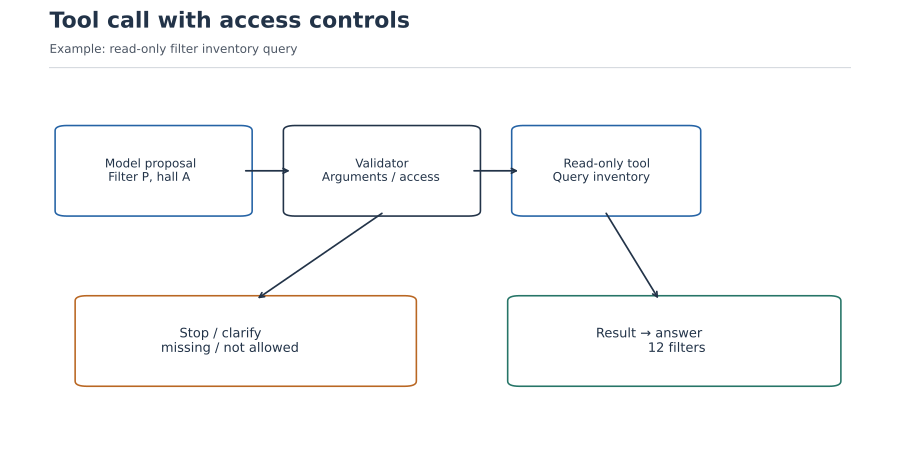

# M24-L8 – Dialogue Systems, Tool Use and Evaluation {#L8}

**Course area:** M24 – Natural Language Processing and Information Retrieval

**Level:** Master · Compulsory elective/models

**Prerequisites:** M12, M19.

**Learning objective:** Design dialogue state, tool calls and end-to-end evaluation with controlled side effects.

## From a language model to a system {#S1}

A dialogue system manages conversational context, the task, potentially long-term preferences and the available tools. Traditional task-oriented systems separate intent recognition, slot filling, dialogue policy and response formulation. A language model may combine some of these functions, but explicit state, permissions and boundaries are still required. A tool call is a structured proposal, not evidence that an action has been successfully executed. Argument validation, authorisation and interpretation of the actual return value belong to the wider system.

## A controlled tool loop {#S2}




*Figure: Access checks for model tool calls.*

A fictional workshop query asks “How many P filters are stored in hall A?” The model proposes read_stock(Artikel=P, Halle=A). A backend validator checks recognised item codes and authorised halls, calls only the read-only function and returns the stock count as data. Moving items between locations would require additional permissions and confirmed parameters. The diagram shows proposal, validation, tool, observation and response. A missing or ambiguous parameter triggers a clarification question. Timeouts, limits on the number of calls, repeatable read operations and idempotency keys for writes prevent uncontrolled loops and duplicate effects.

```python
stock={('P','A'):12,('P','B'):4}
def read_stock(args,allowed):
    if set(args)!={'article','hall'} or args['hall'] not in allowed:
        raise ValueError('unzulässig')
    key=(args['article'],args['hall'])
    if key not in stock:
        raise ValueError('unbekannte Kombination')
    return stock[key]
assert read_stock({'article':'P','hall':'A'},{'A'})==12
try:
    read_stock({'article':'P','hall':'B'},{'A'})
except ValueError:
    print('Zugriff verweigert')
else:
    raise AssertionError('Zugriffsschutz fehlt')
```

## More than linguistic quality {#S3}

Measure task completion, correctly validated calls, attempted unauthorised actions, cost, latency, clarification questions and error handling. Evaluate at dialogue level rather than only per message if every step is necessary to complete a task. Test missing arguments, manipulated documents, contradictory results, network errors and repeated proposals. Automated language-model judges can make mistakes; human sampling and reproducible tool states help make evaluations reliable. A simulated tool tests orchestration, not real backend security.

## Exercise with solution {#S4}

Of 20 dialogues, 15 end successfully. Three of the five remaining dialogues lack a required field, while two fail technically. The completion rate is 75%, the missing-slot rate 15% and the technical failure rate 10% of this sample. An action that was merely proposed does not count as completed.

## Sources and further reading {#S5}

- [Yao et al. (2023): ReAct](https://arxiv.org/abs/2210.03629) · article text accessed
- [Lewis et al. (2020): Retrieval-Augmented Generation for Knowledge-Intensive NLP Tasks](https://arxiv.org/abs/2005.11401) · abstract accessed
- [Huang et al. (2025): A Survey on Hallucination in Large Language Models](https://arxiv.org/abs/2311.05232) · abstract accessed
