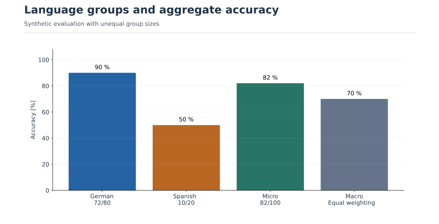

# M24-L9 – Multilinguality, Hallucinations and System Limitations {#L9}

**Course area:** M24 – Natural Language Processing and Information Retrieval

**Level:** Master · Compulsory elective/models

**Prerequisites:** M12, M19.

**Learning objective:** Measure multilingual performance, hallucinations and uncertainty separately, and make limitations transparent.

## Multilinguality is not a uniform capability {#S1}

A jointly trained model can learn cross-lingual representations. Differences in performance depend, among other factors, on the quantity of training data, domain, script, tokenisation and evaluation quality. Multilingual sentence vectors can be aligned in a shared space using parallel texts or distillation. Similarity scores for translation pairs indicate quality but do not guarantee a correct translation. Proper names, numbers, decimal separators, units, negation and specialist terminology require targeted checks. An English-only benchmark is insufficient.

## Per-language measurement and abstention {#S2}




*Figure: Multilingual and aggregate accuracy.*

In a synthetic evaluation, there are 80 German questions and 20 Spanish questions. The system answers 72 German and 10 Spanish questions correctly; initially, it answers every question. Micro-accuracy = 82/100 = 82%, while macro-accuracy = (90% + 50%)/2 = 70%. The diagram shows the two language groups and both aggregated measures. Micro-accuracy conceals poorer performance in one language. Sample size, domain and uncertainty must also be reported. Selective answering may reduce risk when evidence is uncertain. In a separate second evaluation, a system answers 60 of 100 questions, with 54 correct: coverage is 60%, accuracy among answered questions is 90%, and the error rate among answered questions is 10%. Coverage and risk should be reported together.

```python
import numpy as np
n=np.array([80,20]); ok=np.array([72,10]); per=ok/n
micro=ok.sum()/n.sum(); macro=per.mean()
assert np.allclose([micro,macro,54/60],[.82,.70,.9])
print(per,micro,macro)
```

## Hallucinations and limitations {#S3}

A model may invent a claim that contradicts a reliable source, add an unsupported detail or fail to follow summarisation instructions. Factual correctness and faithfulness to the input are different dimensions. An unsupported claim is not necessarily demonstrably false. Token probabilities measure the model's preference for text continuations, not the probability that a statement is true. Checking sources, calibrating uncertainty on an appropriate test set, using tools and involving human review can limit risks, but cannot guarantee universal freedom from error. Distribution shift and manipulated inputs can degrade calibration. Also check context limits, truncated documents, privacy-sensitive content and the distribution of errors across user groups.

## Exercise with solution {#S4}

A third language is added with ten questions and eight correct answers. Micro-accuracy = 90/110 ≈ 81.82%; macro-accuracy = (0.9+0.5+0.8)/3 ≈ 73.33%. The choice of aggregation must depend on the application and be justified before evaluation.

## Sources and further reading {#S5}

- [Reimers and Gurevych (2020): Making Monolingual Sentence Embeddings Multilingual using Knowledge Distillation](https://arxiv.org/abs/2004.09813) · abstract accessed
- [Huang et al. (2025): A Survey on Hallucination in Large Language Models](https://arxiv.org/abs/2311.05232) · abstract accessed
- [Brown et al. (2020): Language Models are Few-Shot Learners](https://arxiv.org/abs/2005.14165) · abstract accessed
