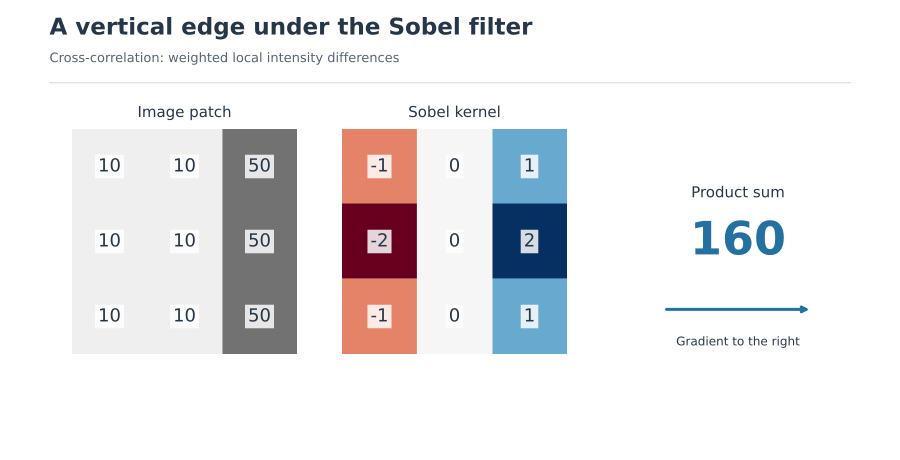

# M25-L1 – Image Representation, Filters and Features {#L1}

**Course area:** M25 – Computer Vision and Multimodal Learning

**Level:** Master · Compulsory elective/models

**Prerequisites:** M18, M19.

**Learning objective:** Treat digital images as discrete signals and interpret filter responses.

## From light to a matrix {#S1}

A camera at the end of a production line records a metal plate. The digital image is not a direct list of objects but a grid of measured values. A greyscale image has shape $H\times W$, whereas an RGB image might have shape $H\times W\times 3$. An 8-bit channel can represent 256 discrete values. Sampling causes spatial information above the representable frequency to be lost or to appear as a spurious pattern (aliasing). An appropriate low-pass filter helps before downsampling. Quantisation, by contrast, concerns the available intensity levels. RGB channel values in sRGB are not directly proportional to physical light power.

## Edges from local differences {#S2}




*Figure: Vertical edge detected by the Sobel filter.*

A filter combines neighbouring pixels. For discrete convolution, $(I*K)[i,j]=\sum_{u,v} I[i-u,j-v]K[u,v]$. Many CNN libraries instead implement cross-correlation, without reversing the kernel. For an edge test, we explicitly use cross-correlation with the horizontal Sobel kernel:

$$K=\begin{pmatrix}-1&0&1\\-2&0&2\\-1&0&1\end{pmatrix}.$$

For a patch consisting of three identical rows $(10,10,50)$, this gives $G_x=160$. The corresponding vertical kernel gives $G_y=0$. The edge magnitude $\sqrt{G_x^2+G_y^2}$ is 160; the intensity gradient points to the right and the edge runs vertically. The diagram shows precisely this patch and its weighting. A filter response is not constrained to the input intensity range. Absolute values and, where needed, normalisation are for display, not part of the mathematical filter itself.

```python
import numpy as np
I=np.tile([10,10,50],(3,1))
K=np.array([[-1,0,1],[-2,0,2],[-1,0,1]])
gx=(I*K).sum(); gy=(I*K.T).sum()
assert (gx,gy)==(160,0)
print(gx,gy,np.hypot(gx,gy))
```

## From edges to features {#S3}

Smoothing reduces noise but also blurs narrow defects. Corners exhibit intensity changes in several directions and are often better than long straight edges for matching points between images. Local descriptors summarise the surroundings of a feature point and can be designed to withstand certain changes in illumination, rotation or scale. Robustness always depends on assumptions. A neural network learns such representations from examples rather than having them entirely specified in advance. For inspection, pixel resolution must be sufficient for the smallest relevant defect. Boundary handling (padding), illumination and camera settings therefore belong in the experimental specification.

## Exercise with solution {#S4}

What happens to a constant image patch with intensity 40? The sum of the Sobel weights is zero, so the response is zero. Adding 20 to every pixel in the original patch without saturation leaves the response at 160. Doubling all values without clipping, by contrast, doubles it to 320.

## Sources and further reading {#S5}

- [Szeliski (2022): Computer Vision: Algorithms and Applications, 2nd ed.](https://link.springer.com/book/10.1007/978-3-030-34372-9) · book overview and table of contents accessed
