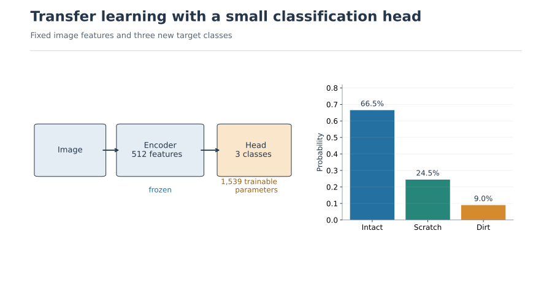

# M25-L2 – Image Classification and Transfer Learning {#L2}

**Course area:** M25 – Computer Vision and Multimodal Learning

**Level:** Master · Compulsory elective/models

**Prerequisites:** M18, M19.

**Learning objective:** Adapt pretrained representations to a target task while avoiding data leakage.

## From image features to a class {#S1}

An inspection station must classify surface images as intact, scratched or dirty. The output is one label per image, not the defect's location. A CNN uses shared local filters; residual blocks augment a mapping with a shortcut, for example $h_{l+1}=h_l+F_l(h_l)$ when dimensions are compatible. A Vision Transformer may instead process image patches as tokens. Both architecture families can pretrain features on large image collections.

## A small new classification head {#S2}




*Figure: Transfer learning with a small classification head.*

A frozen encoder produces a vector $z\in\mathbb R^{512}$. For three classes, an affine layer $a=Wz+b$ with $W\in\mathbb R^{3\times512}$ and $b\in\mathbb R^3$ is a sufficient starting point. Only $3(512+1)=1539$ parameters are trainable. With logits $a=(2,1,0)$, the softmax probability of the first class is $e^2/(e^2+e+1)\approx0.66524$. The cross-entropy for the correct first class is approximately 0.40761. The diagram shows the probabilities and the distinction between the frozen encoder and the trainable head.

```python
import numpy as np
z=np.array([2.,1.,0.]); q=np.exp(z-z.max()); q/=q.sum()
assert np.isclose(q[0],.66524096)
assert 3*(512+1)==1539
print(q.round(5),round(-np.log(q[0]),5))
```

## When should more layers be trained? {#S3}

Linear probing tests whether fixed features suffice for the target task. Fine-tuning updates some or all encoder parameters, often at a lower learning rate than the new head. Switching from ordinary photographs to microscopic images introduces a domain difference; training a larger portion of the model may help, but can lead to overfitting with few examples. Even frozen models must be placed in the appropriate training or evaluation mode, for example because of batch normalisation. Augmentations must not change the class. Mirroring may be inappropriate for direction-dependent defects.

Split images by component, acquisition time or production site before generating augmented copies. Randomly dividing almost identical image sequences overestimates generalisation. For rare defects, per-class recall, a confusion matrix and calibration matter more than a single accuracy figure. Select the model on validation data and make the final estimate on the untouched test set.

## Exercise with solution {#S4}

How many new parameters does the head need for five classes? $5(512+1)=2565$. Recall drops sharply after moving to a different factory. Adjusting the decision threshold alone may help if the ranking remains sound; if the image features have changed, however, representative target data and possibly fine-tuning are needed. Both measures must be evaluated on independent data.

## Sources and further reading {#S5}

- [Szeliski (2022): Computer Vision: Algorithms and Applications, 2nd ed.](https://link.springer.com/book/10.1007/978-3-030-34372-9) · book overview and table of contents accessed
- [He et al. (2015): Deep Residual Learning for Image Recognition](https://arxiv.org/abs/1512.03385) · abstract accessed
