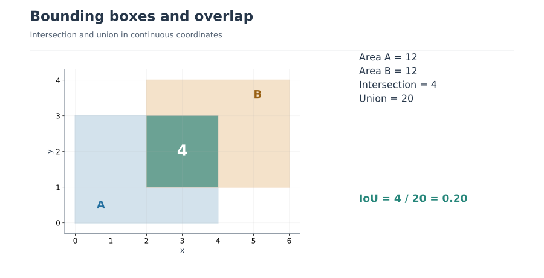

# M25-L3 – Object Detection and Segmentation {#L3}

**Course area:** M25 – Computer Vision and Multimodal Learning

**Level:** Master · Compulsory elective/models

**Prerequisites:** M18, M19.

**Learning objective:** Distinguish bounding boxes from masks and calculate overlap metrics.

## What spatial output is required? {#S1}

A warehouse camera image contains several boxes. For each detected object, a detector provides a class, a location represented by a bounding box and a score. A two-stage method first proposes candidate regions and then classifies or refines them. One-stage methods estimate classes and boxes more directly. Modern set-based detectors can model objects without conventional anchors. Semantic segmentation assigns a category to every pixel; instance segmentation additionally distinguishes individual objects within the same category. Panoptic segmentation combines countable instances and region-like categories into a consistent covering.

## Overlap in a worked rectangle example {#S2}




*Figure: Bounding boxes and intersection over union.*

For regions $A$ and $B$, Intersection over Union (IoU) is

$$\operatorname{IoU}(A,B)=\frac{|A\cap B|}{|A\cup B|}.$$

In continuous image coordinates, let reference box $A=[0,4]\times[0,3]$ and predicted box $B=[2,6]\times[1,4]$. Each area is 12, the intersection area is $2\cdot2=4$, and the union area is 20. IoU is 0.20. The diagram displays the areas. For binary masks, the Dice coefficient $2|A\cap B|/(|A|+|B|)$ may also be calculated; it equals $1/3$ in this geometric example.

```python
import numpy as np
a=np.array([0,0,4,3]); b=np.array([2,1,6,4])
area=lambda x: np.prod(x[2:]-x[:2])
inter=np.prod(np.maximum(0,np.minimum(a[2:],b[2:])-np.maximum(a[:2],b[:2])))
iou=inter/(area(a)+area(b)-inter)
assert np.isclose(iou,.2)
print(inter,iou,2*inter/(area(a)+area(b)))
```

## Training and evaluation {#S3}

Detectors typically combine a classification loss and a localisation loss. Non-maximum suppression ranks boxes by score and suppresses strongly overlapping lower-scoring candidates, often separately for each class. Excessively aggressive suppression may remove neighbouring real objects. Segmentation networks must combine fine spatial detail with broader context; decoders and skip connections are typical tools. Class imbalance and small target masks call for deliberate loss weighting.

Average Precision (AP) summarises the precision–recall curve under a specified matching and IoU protocol. mAP averages over defined classes and, where applicable, IoU thresholds. Under the usual detection protocol, multiple assignments to one reference object do not count as multiple true positives. Mask metrics are evaluated separately; empty masks require a clearly specified convention.

## Exercise with solution {#S4}

Instead, shift $B$ to $[1,5]\times[0,3]$. The intersection area is 9, the union is 15 and IoU is 0.60. At a matching threshold of 0.50, the shifted box would be geometrically eligible, but the original would not. Class, score and unique matching must also agree.

## Sources and further reading {#S5}

- [Szeliski (2022): Computer Vision: Algorithms and Applications, 2nd ed.](https://link.springer.com/book/10.1007/978-3-030-34372-9) · book overview and table of contents accessed
- [Ren et al. (2015): Faster R-CNN](https://arxiv.org/abs/1506.01497) · abstract and article page accessed
- [Long et al. (2014): Fully Convolutional Networks for Semantic Segmentation](https://arxiv.org/abs/1411.4038) · abstract and article page accessed
