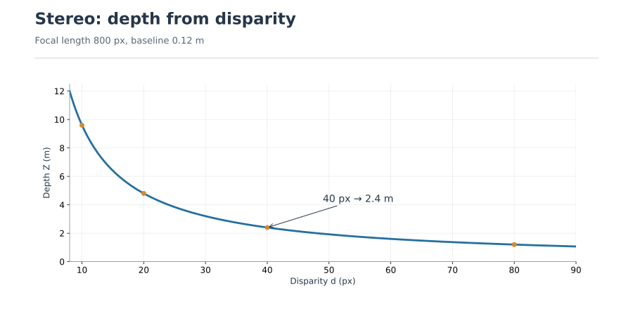

# M25-L4 – Camera Geometry, Stereo and Depth Estimation {#L4}

**Course area:** M25 – Computer Vision and Multimodal Learning

**Level:** Master · Compulsory elective/models

**Prerequisites:** M18, M19.

**Learning objective:** Derive the projection model and triangulation, and assess depth errors.

## Projection and calibration {#S1}

The pinhole camera model maps a point $(X,Y,Z)$ in camera coordinates with $Z>0$ to pixel coordinates:

$$u=f_xX/Z+c_x,\qquad v=f_yY/Z+c_y.$$

$f_x,f_y$ are focal lengths in pixels, and $(c_x,c_y)$ is the principal point. Intrinsic parameters describe the camera; extrinsic parameters rotate and translate world coordinates into the camera frame. Radial and tangential lens distortion must be modelled or corrected for precise measurements. Without further information, a single image does not provide unique absolute depth, because proportionally larger, more distant scenes may yield the same projection.

## Stereo through horizontal displacement {#S2}




*Figure: Stereo depth from disparity.*

Two parallel, rectified cameras have the same focal length $f$, identical principal-point coordinates and a horizontal baseline $B$. For the same scene, $u_L-c_x=fX/Z$ and $u_R-c_x=f(X-B)/Z$. Subtraction gives disparity $d=u_L-u_R=fB/Z$ and hence

$$Z=fB/d.$$

For $f=800\,\text{px}$, $B=0.12\,\text{m}$ and $d=40\,\text{px}$, depth is 2.4 m. The diagram shows depth decreasing as disparity increases. The derivative $\partial Z/\partial d=-fB/d^2$ equals −0.06 m/px here; at $d=10$ px, it equals −0.96 m/px. Small disparity errors become particularly costly at large distances.

```python
import numpy as np
f,B=800,.12
d=np.array([10.,20.,40.,80.]); Z=f*B/d
assert np.allclose(Z,[9.6,4.8,2.4,1.2])
assert np.isclose(-f*B/40**2,-.06)
print(Z)
```

## Correspondences and limitations {#S3}

Epipolar geometry constrains the search for matching image points. After rectification, ideal correspondences lie on the same image row. Textureless walls, periodic patterns, reflective surfaces and occlusions complicate matching. Left–right consistency checks help identify some incorrect correspondences. Under this convention, nonpositive or invalid disparities are not ordinary depth measurements. Monocular neural methods can estimate depth from learned size and scene cues, but metric scale depends on the model and training data. Camera poses and consistent coordinate frames are crucial for 3D reconstruction.

## Exercise with solution {#S4}

What depth range corresponds to 39–41 px? $96/41\approx2.341$ m to $96/39\approx2.462$ m. The range is slightly asymmetric. Linear error propagation of approximately ±0.06 m is plausible here, but often inadequate for very small disparities.

## Sources and further reading {#S5}

- [Szeliski (2022): Computer Vision: Algorithms and Applications, 2nd ed.](https://link.springer.com/book/10.1007/978-3-030-34372-9) · book overview and table of contents accessed
