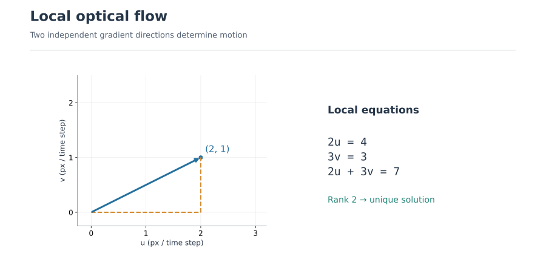

# M25-L5 – Video, Optical Flow and Tracking {#L5}

**Course area:** M25 – Computer Vision and Multimodal Learning

**Level:** Master · Compulsory elective/models

**Prerequisites:** M18, M19.

**Learning objective:** Distinguish local image motion from object trajectories and estimate motion.

## Moving images as a time series {#S1}

A camera monitors a conveyor belt. Video combines spatial and temporal sampling; frame rate affects how far an object moves between successive frames. Optical flow describes apparent image motion, not necessarily motion in three dimensions. Changes in illumination, reflections and motion blur can mislead flow methods. Tracking links observations across times so that a box retains its identity even if it is temporarily undetected.

## Brightness constancy and the aperture problem {#S2}




*Figure: Local optical flow.*

Under the local brightness-constancy assumption, $I(x+u\Delta t,y+v\Delta t,t+\Delta t)\approx I(x,y,t)$. Linearisation gives

$$I_xu+I_yv+I_t=0.$$

$u,v$ are velocities in pixels per unit of time. One equation cannot determine two unknowns: along a long straight edge, only motion perpendicular to the edge is observable. A local Lucas–Kanade-style model assumes common flow within a small window and solves a least-squares problem. Our synthetic window contains gradients $(2,0),(0,3),(2,3)$ and temporal derivatives $(-4,-3,-7)$. The system has solution $(u,v)=(2,1)$. An arrow in the diagram shows the estimated flow and its components.

```python
import numpy as np
A=np.array([[2,0],[0,3],[2,3]],float); b=np.array([4,3,7])
w=np.linalg.lstsq(A,b,rcond=None)[0]
assert np.allclose(w,[2,1]) and np.linalg.matrix_rank(A)==2
print(w)
```

## Tracking beyond individual frames {#S3}

A tracking-by-detection system combines a motion-model prediction with the assignment of new detections. A Kalman filter (see M20) can propagate position, velocity and uncertainty. Assignment costs may be based on distance, IoU or appearance features; global assignment prevents several tracks from claiming the same detection. The risk of an identity switch increases during longer occlusions. Frame-level detection metrics alone do not measure this failure. Identity continuity, missed objects and false tracks must be evaluated separately. Camera ego-motion should be compensated where necessary.

## Exercise with solution {#S4}

What happens if all gradients point only along the x direction? The second matrix column becomes zero, and its rank is at most one. The y component is not identifiable. A pseudoinverse result of $v=0$ would be a numerical choice, not evidence of no motion.

## Sources and further reading {#S5}

- [Szeliski (2022): Computer Vision: Algorithms and Applications, 2nd ed.](https://link.springer.com/book/10.1007/978-3-030-34372-9) · book overview and table of contents accessed
