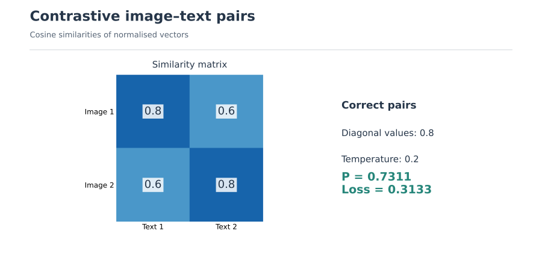

# M25-L7 – Multimodal Embeddings and Fusion {#L7}

**Course area:** M25 – Computer Vision and Multimodal Learning

**Level:** Master · Compulsory elective/models

**Prerequisites:** M18, M19.

**Learning objective:** Distinguish shared representation spaces from modality fusion.

## Different measurement channels, one task {#S1}

Technical support receives a photograph of a faulty component and a written description. Text and images differ in structure and resolution but can describe the same situation. Two encoders can map them to vectors in the same space. High similarity in the learned space indicates a close match, not necessarily a true statement about the object. A multimodal model can additionally process audio, video and sensor data, provided timing and data availability are accounted for.

## Contrastive image–text matching {#S2}




*Figure: Contrastive image–text matching.*

For normalised image vectors $v_i$ and text vectors $t_j$, $s_{ij}=v_i^\top t_j$ is cosine similarity. In a batch of $n$ correctly paired image–text examples, a symmetric contrastive loss can be used:

$$L=-\frac1{2n}\sum_i\left(\log\frac{e^{s_{ii}/\tau}}{\sum_j e^{s_{ij}/\tau}}+\log\frac{e^{s_{ii}/\tau}}{\sum_j e^{s_{ji}/\tau}}\right).$$

$\tau>0$ is the temperature. For two orthogonal image vectors $(1,0),(0,1)$ and text vectors $(0.8,0.6),(0.6,0.8)$, we obtain the similarity matrix shown in the diagram. At $\tau=0.2$, the probability of the correct partner in each direction is $e^4/(e^4+e^3)\approx0.73106$ and $L\approx0.31326$. In real batches, several texts may correctly describe the same object; treating them as necessarily negative pairs is a limitation.

```python
import numpy as np
V=np.eye(2); T=np.array([[.8,.6],[.6,.8]])
S=V@T.T; A=np.exp(S/.2)
P=A/A.sum(1,keepdims=True); Q=A/A.sum(0,keepdims=True)
loss=-(np.log(P.diagonal()).mean()+np.log(Q.diagonal()).mean())/2
assert np.isclose(loss,.3132616875)
print(S,round(loss,5))
```

## Fusion rather than retrieval alone {#S3}

Dual encoders enable fast search using precomputed vectors. Early fusion combines input signals or early features; intermediate fusion may link text and image tokens through cross-attention; late fusion combines separate predictions. A joint model can evaluate finer-grained relationships but often requires more computation. If the photograph is missing, a defined fallback must be available. When modalities disagree, asking for clarification can be more useful than averaging. Splitting data by object rather than by image–text pair prevents recognition of the same motif across splits. Retrieval Recall@k, modality ablation and tests with deliberately misleading descriptions evaluate different capabilities.

## Exercise with solution {#S4}

At $\tau=0.1$, the ratio of exponential weights becomes $e^{(0.8-0.6)/0.1}=e^2$. The correct-pair probability increases to approximately 0.8808 and the loss decreases to 0.1269. A smaller temperature does not by itself improve the ranking and can exaggerate confidence.

## Sources and further reading {#S5}

- [Radford et al. (2021): Learning Transferable Visual Models From Natural Language Supervision](https://arxiv.org/abs/2103.00020) · abstract and article page accessed
