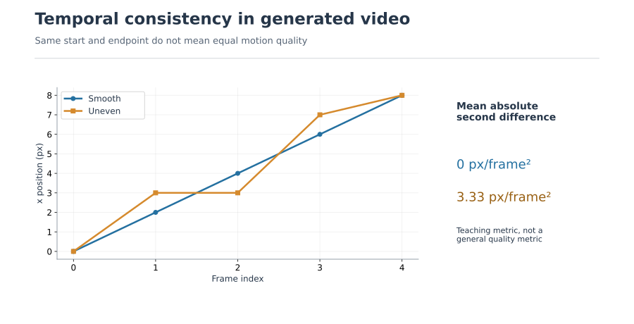

# M25-L8 – Image and Video Generation as Applications of Generative Models {#L8}

**Course area:** M25 – Computer Vision and Multimodal Learning

**Level:** Master · Compulsory elective/models

**Prerequisites:** M18, M19.

**Learning objective:** Evaluate latent image representations and temporal consistency in generative methods.

## From a generative model to a visible image {#S1}

M23 introduced generative models and diffusion methods. Image generation may use an autoencoder to map an image into a smaller latent representation. A diffusion model then learns a reverse process for the addition of noise in that space; a decoder reconstructs pixels. Text, reference images or spatial conditions can guide generation. Compression saves computational resources, but may limit reconstruction of the finest details. A conditional model approximates a distribution of possible results, not the single correct depiction of a scene.

## Memory and motion sequences as a worked example {#S2}




*Figure: Temporal consistency in generated video.*

A synthetic 512×512 RGB frame contains 786432 scalar components. An assumed latent format with a spatial downsampling factor of eight and four channels has $64\cdot64\cdot4=16384$ components. The ratio is 48:1. With equal data types this also holds for the raw tensors alone, not for training memory or model runtime. A four-second clip at 12 frames/s contains 48 frames. The temporal component increases resource demands; no model-dependent temporal compression is assumed here.

The diagram also shows a synthetically moving point with x positions $(0,2,4,6,8)$ and a less regular sequence $(0,3,3,7,8)$. Both reach the same endpoint. Mean absolute second difference $J=\frac1{T-2}\sum_{t=1}^{T-2}|x_{t+1}-2x_t+x_{t-1}|$ is zero for the first sequence and $(3+4+3)/3=10/3$ pixels per frame² for the second (with unit time steps). This simple smoothness indicator is not a general quality metric: real accelerations are legitimate.

```python
import numpy as np
pix=512*512*3; latent=64*64*4
x=np.array([0,2,4,6,8]); y=np.array([0,3,3,7,8])
J=lambda z: np.abs(np.diff(z,n=2)).mean()
assert pix/latent==48 and np.isclose(J(y),10/3) and J(x)==0
print(pix,latent,pix/latent,J(x),J(y))
```

## Temporal dependencies and evaluation {#S3}

Generating each frame independently easily leads to flickering textures and changing object identities. Video architectures therefore model spatial and temporal dependencies together, for example through temporal attention or convolutions. A reference image, camera path and prompt can act as conditions, but physically correct motion is not guaranteed. Autoregressive continuation can propagate errors over time. Image quality, semantic alignment, motion coherence and diversity require separate evaluation. FID and video-based distribution metrics depend on reference data, feature models and sample size; they do not replace targeted visual inspection. Realistic depictions of people and events require attention to provenance labelling, consent and usage rights. In scientific images, plausible generated additions must not be confused with measured structures.

## Exercise with solution {#S4}

How many latent scalars would the clip have without temporal compression? $48\cdot16384=786432$. This equals the number in one RGB frame of the chosen format. It does not imply identical runtime: temporal modelling, the decoder and intermediate tensors can require substantially more resources.

## Sources and further reading {#S5}

- [Rombach et al. (2022): High-Resolution Image Synthesis with Latent Diffusion Models](https://arxiv.org/abs/2112.10752) · abstract accessed
- [Ho et al. (2022): Video Diffusion Models](https://arxiv.org/abs/2204.03458) · abstract accessed
