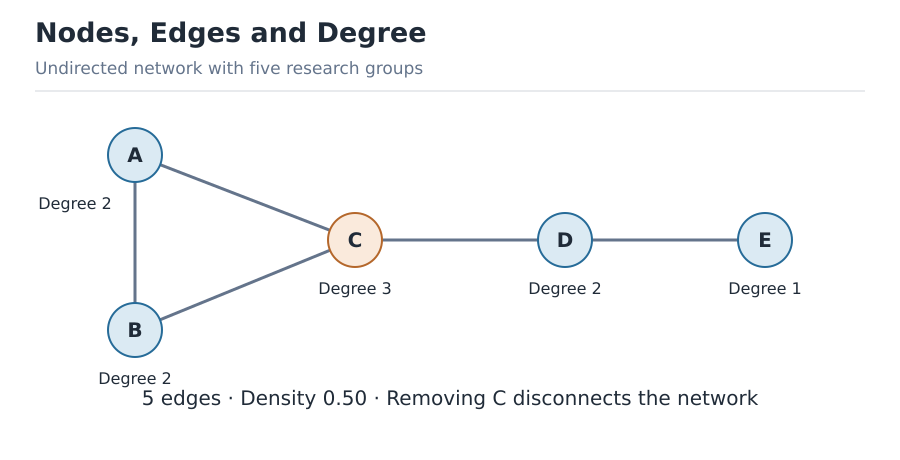

# M26-L1 – Graph Representation and Network Analysis {#L1}

**Course area:** M26 – Graphs, Recommender Systems and Structured Data

**Level:** Master · Compulsory elective/models

**Prerequisites:** M12, M17, M19.

**Learning objective:** Describe graphs using different data representations and interpret local and global structural measures.

## Relationships rather than isolated rows {#S1}

A library wants to analyse which research groups share equipment. Nodes represent groups; an undirected edge means that two groups used at least one piece of equipment jointly during the month under study. A graph $G=(V,E)$ consists of a node set $V$ and an edge set $E$. Direction, weight, timestamp and edge type are modelling decisions: a bank transfer is directed, whereas joint equipment use is symmetric. Multiple events can be stored as separate edges in a multigraph or as the weight of an aggregated edge. These variants answer different questions. Here, a missing edge means that no joint use was observed, not necessarily that there was no contact.

For $n$ nodes, a dense adjacency matrix $A$ has dimensions $n\times n$. For a simple undirected graph, $A_{ij}=A_{ji}$ and the diagonal is zero. When there are few edges, edge lists or sparse matrices require considerably less storage; an adjacency list provides direct access to outgoing edges. For very large graphs, partitioning and memory access therefore often dominate computation time.

## A network with five groups {#S2}




*Figure: Nodes, edges and node degrees.*

Groups A, B and C form a triangle; C connects to D, and D to E. The five nodes have degrees $2,2,3,2,1$. From $\sum_i d_i=2|E|$ we obtain $|E|=5$. The density of a simple undirected graph is $2|E|/[n(n-1)]=0.5$. The local clustering coefficient is $C_i=2T_i/[d_i(d_i-1)]$ for $d_i\ge2$, where $T_i$ is the number of edges between a node's neighbours. For C it is $1/3$; for A and B it is 1 in each case. Here, we define the coefficient as zero when the degree is below two. The mean of the five local values is $7/15$. The figure shows the connections and each node's degree.

```python
import numpy as np
A=np.zeros((5,5),int)
for i,j in [(0,1),(0,2),(1,2),(2,3),(3,4)]:
    A[i,j]=A[j,i]=1
d=A.sum(1)
tri=np.diag(A@A@A)//2
c=np.divide(2*tri,d*(d-1),out=np.zeros(5),where=d>=2)
assert d.tolist()==[2,2,3,2,1]
assert np.isclose(c.mean(),7/15)
print(d,c,c.mean())
```

## Centrality and its limitations {#S3}

High degree means many direct relationships, but not necessarily a bridging role. Betweenness counts what proportion of shortest paths between other nodes pass through the node being examined. If C is removed, our graph splits into two components: C is an articulation point. Removing A breaks the triangle but does not disconnect the graph. PageRank, by contrast, models visits by a random surfer who sometimes jumps to a new node; weights and direction must be chosen appropriately. High centrality is neither proof of causation nor a judgement about the person represented by a node. When comparing time windows, the node population and recording rules must remain consistent.

## Exercise with solution {#S4}

Add the edge E–A. The density rises to $6/10=0.6$. C is no longer an articulation point: after its removal, A–E–D connects the remaining parts, and B is connected to A. This example shows how a single bridging edge can change fault tolerance.

## Sources and further reading {#S5}

- [Hamilton (2020): Graph Representation Learning](https://www.cs.mcgill.ca/~wlh/grl_book/) · book overview and table of contents, Chapters 2–7
