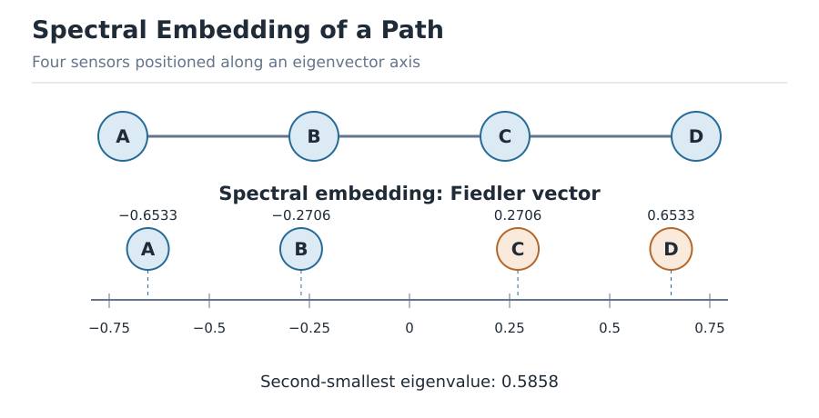

# M26-L2 – Graph Embeddings and Spectral Methods {#L2}

**Course area:** M26 – Graphs, Recommender Systems and Structured Data

**Level:** Master · Compulsory elective/models

**Prerequisites:** M12, M17, M19.

**Learning objective:** Derive the graph Laplacian, interpret spectral embeddings and distinguish them from random-walk methods.

## Learning coordinates from relationships {#S1}

A network of coupled sensors has no natural coordinate axis comparable to a tabular feature. We want to represent nodes by short real-valued vectors so that, for example, similar monitoring stations can be analysed together. An embedding is a mapping $z:V\to\mathbb R^k$. Similarity in embedding space must express the desired structural property: immediate proximity, membership of the same community or a similar role in different parts of the network. These objectives are not equivalent.

For an undirected graph with symmetric non-negative weights, $D_{ii}=\sum_j A_{ij}$ and $L=D-A$. Expanding the expression for a real node vector $x$ gives the energy

$$x^\top Lx=\frac12\sum_{i,j} A_{ij}(x_i-x_j)^2.$$

The sum is non-negative, so $L$ is positive semidefinite. Every constant vector belongs to its null space. For a connected graph the null space is one-dimensional. The eigenvector associated with the second-smallest eigenvalue minimises the energy subject to unit norm and orthogonality to the constant vector. It is called the Fiedler vector. When degrees differ considerably, the normalised variant $I-D^{-1/2}AD^{-1/2}$ may be more appropriate (assuming positive degrees here).

## Four sensors in a chain {#S2}




*Figure: Spectral embedding of a path graph.*

A–B–C–D is an unweighted path. The eigenvalues of the combinatorial Laplacian are $0,2-\sqrt2,2,2+\sqrt2$. Up to its arbitrary sign, the Fiedler vector is approximately $(-0.6533,-0.2706,0.2706,0.6533)$. Its signs separate A and B from C and D; the figure shows this one-dimensional embedding on a number line. The sensors' actual physical positions were not used.

```python
import numpy as np
A=np.diag(np.ones(3),1)+np.diag(np.ones(3),-1)
L=np.diag(A.sum(1))-A
w,U=np.linalg.eigh(L)
z=U[:,1]
if z[0]>0: z=-z
assert np.allclose(w,[0,2-np.sqrt(2),2,2+np.sqrt(2)])
assert np.isclose(z@L@z,w[1])
print(w.round(6),z.round(4))
```

## Random walks and comparison {#S3}

In a simple random walk, a neighbour is selected uniformly at each node; the transition matrix is $P=D^{-1}A$. Sequences of visited nodes can serve as training contexts for embeddings. node2vec changes transition weights according to the preceding node, allowing it to emphasise local or more distant contexts differently. Unlike the deterministic eigenvector approach, training involves stochastic decisions and an optimisation objective for context prediction. The resulting vectors are not automatically interpretable one by one. With new nodes, many pure lookup embeddings require updating; feature-based inductive models can instead process new nodes under suitable assumptions. Link-prediction evaluation must not use held-out edges when constructing the training representation.

## Exercise with solution {#S4}

Calculate the energy for $x=(1,1,-1,-1)^\top$. Only the edge B–C contributes: $(1-(-1))^2=4$. The squared norm is also 4, giving a Rayleigh quotient of 1, which is greater than $2-\sqrt2$. Thus the optimal real-valued embedding need not be a step function.

## Sources and further reading {#S5}

- [Hamilton (2020): Graph Representation Learning](https://www.cs.mcgill.ca/~wlh/grl_book/) · book overview and table of contents, Chapters 2–7
- [Grover and Leskovec (2016): node2vec: Scalable Feature Learning for Networks](https://arxiv.org/abs/1607.00653) · article opened
