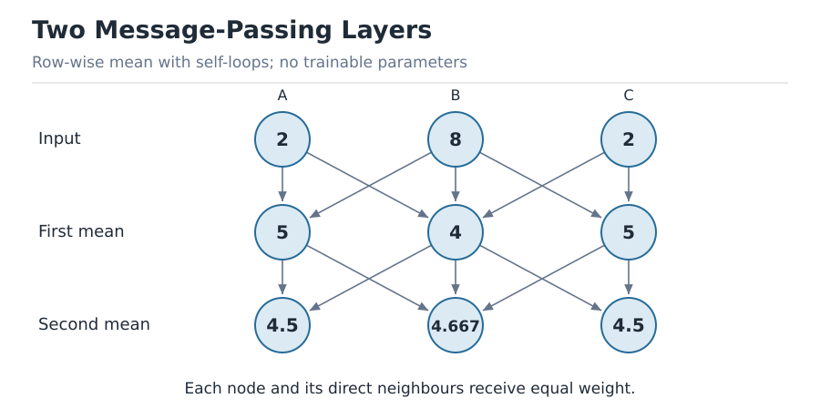

# M26-L3 – Graph Neural Networks and Message Passing {#L3}

**Course area:** M26 – Graphs, Recommender Systems and Structured Data

**Level:** Master · Compulsory elective/models

**Prerequisites:** M12, M17, M19.

**Learning objective:** Calculate a message-passing layer and assess receptive range, permutation behaviour and model limitations.

## Neighbourhoods as learnable inputs {#S1}

In a logistics network, each warehouse has a utilisation value and other features. Predicting a bottleneck should also take neighbouring sites into account. A graph neural network (GNN) computes representations on the network using shared parameters. A common scheme consists of messages $m_{j\to i}=\phi(h_i,h_j,e_{ji})$, an aggregation $a_i=\operatorname{AGG}_{j\in N(i)}m_{j\to i}$ and an update $h'_i=\psi(h_i,a_i)$. Summation, averaging or suitably defined attention processes neighbours independently of their order. A node index is generally not a meaningful feature in its own right.

In node classification, each node receives an output. In graph classification, invariant pooling combines node representations into one graph representation. Link prediction instead uses a scoring function on pairs or relation triples. These tasks require different target variables and test splits.

## Calculating a layer by hand {#S2}




*Figure: Two message-passing layers.*

The three warehouses A–B–C form a chain. The initial features are $h=(2,8,2)^\top$. A deliberately simple layer averages each node's own value with all its direct neighbours, without any trainable transformation. For the end nodes, the result is $(2+8)/2=5$; for the middle node, $(2+8+2)/3=4$. After another layer, we obtain $(4.5,14/3,4.5)^\top$. The figure shows information flow and the outputs of both steps. More generally, a GCN with self-loops uses $\tilde A=A+I$, $\tilde D_{ii}=\sum_j\tilde A_{ij}$ and

$$H'=\sigma(\tilde D^{-1/2}\tilde A\tilde D^{-1/2}HW).$$

Symmetric normalisation differs from our row-wise mean. $W$ transforms the features, and non-linear activations enable more complex functions. For the row-mean variant we additionally check permutation equivariance: renumbering the nodes changes only the order of the outputs.

```python
import numpy as np
A=np.array([[0,1,0],[1,0,1],[0,1,0]])
H=np.array([2.,8.,2.]); B=A+np.eye(3)
P=B/B.sum(1,keepdims=True)
h1=P@H; h2=P@h1
idx=[2,0,1]
assert np.allclose(h1,[5,4,5])
assert np.allclose(h2,[4.5,14/3,4.5])
assert np.allclose(P[np.ix_(idx,idx)]@H[idx],h1[idx])
print(h1,h2)
```

## Training and problematic depth {#S3}

For supervised tasks, a loss function is optimised using the available training labels. The network may use unlabelled neighbours as input if the evaluation definition permits it. Transductive evaluation on a known graph is not the same as inductive prediction for sites added in the future. In particular, a temporal split must exclude future edges and features. After $k$ local layers, the receptive field extends no more than $k$ edges. Repeated averaging can reduce differences (oversmoothing); many distant signals may also be compressed into vectors that are too small (oversquashing). Residual connections, sampling and a suitable architecture may help, depending on the task, but do not replace comparison with a non-graph-based model.

## Exercise with solution {#S4}

What influence does C have on A after exactly one of the defined averaging layers? None, because the nodes are not adjacent. After two layers, the coefficient is $(P^2)_{AC}=P_{AB}P_{BC}=1/6$. Increasing C's new measurement by six units therefore raises A's output after two layers by exactly one unit.

## Sources and further reading {#S5}

- [Hamilton (2020): Graph Representation Learning](https://www.cs.mcgill.ca/~wlh/grl_book/) · book overview and table of contents, Chapters 2–7
- [Kipf (2016): Graph Convolutional Networks](https://tkipf.github.io/graph-convolutional-networks/) · tutorial page opened
