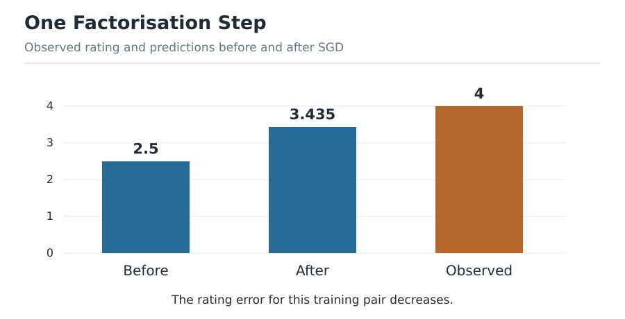

# M26-L4 – Collaborative Filtering and Matrix Factorisation {#L4}

**Course area:** M26 – Graphs, Recommender Systems and Structured Data

**Level:** Master · Compulsory elective/models

**Prerequisites:** M12, M17, M19.

**Learning objective:** Distinguish explicit from implicit interactions and follow a regularised factorisation update.

## Learning from shared behaviour {#S1}

An educational portal offers short exercises in statistics and programming. Ratings are available for some users, but only clicks for others. Content-based recommendations use features of the exercises; collaborative methods use common patterns of interaction. Neighbourhood methods may identify similar users or similar exercises. However, high estimated similarity from only a few shared observations is unreliable. Moreover, a click is not a direct measure of satisfaction. Exercises that were never opened may never have been shown; missing ratings must not simply be treated as zeros.

## Latent factors and one training step {#S2}




*Figure: One step of matrix factorisation.*

For user $u$ and exercise $i$, we use the prediction $\hat r_{ui}=\mu+b_u+b_i+p_u^\top q_i$. Here, $\mu$ is a global level, $b_u,b_i$ are deviations and the $k$-dimensional vectors $p_u,q_i$ represent latent factors. A simple squared-error objective over the observed pairs $\Omega$ is

$$J=\frac12\sum_{(u,i)\in\Omega}(r_{ui}-\hat r_{ui})^2+\frac\lambda2\left(\sum_u\|p_u\|^2+\sum_i\|q_i\|^2\right).$$

Consider the single case without biases: $p=(1,0.5)$, $q=(2,1)$ and observed rating $r=4$. Then $\hat r=2.5$. With $e=r-\hat r=1.5$, $\lambda=0.1$ and learning rate $\eta=0.1$, we have $p'=p+\eta(e q-\lambda p)$ and $q'=q+\eta(e p-\lambda q)$. Both updates use the old values. We therefore obtain $p'=(1.29,0.645)$ and $q'=(2.13,1.065)$. The new predicted rating is $3.434625$. The figure shows the observed value and both predictions. The step reduces the error for this one pair; it does not imply improved generalisation.

```python
import numpy as np
p=np.array([1.,.5]); q=np.array([2.,1.]); e=4-p@q
pp=p+.1*(e*q-.1*p); qq=q+.1*(e*p-.1*q)
assert np.allclose(pp,[1.29,.645]) and np.allclose(qq,[2.13,1.065])
assert np.isclose(pp@qq,3.434625)
print(p@q,pp@qq)
```

## Training and the cold-start problem {#S3}

Stochastic gradient descent processes individual observations or mini-batches. Alternating least squares optimises either user factors or item factors while keeping the other side fixed. For implicit interactions, positive events may receive higher weights, or a model may learn preferences between item pairs. The choice of negative examples affects the result; randomly selected unobserved pairs are not guaranteed negative labels. New exercises have no interaction data yet (item cold start). Content features, editorial recommendations or controlled exploration can mitigate this. RMSE is useful for rating scales, whereas ranking metrics are often more direct for top-k recommendations. The latent axes can change under a common orthogonal transformation without changing the dot products, so verbal labels should not be attached to individual factors uncritically.

## Exercise with solution {#S4}

A second exercise has $q_2=(0.5,2)$. Before the update, $p^\top q_2=1.5$; afterwards, $p'^\top q_2=1.935$. Even exercises not involved in the update may receive new scores because the user's representation has changed. Selecting one training example therefore affects many later recommendations.

## Sources and further reading {#S5}

- [Koren, Bell and Volinsky (2009): Matrix Factorization Techniques for Recommender Systems](https://doi.org/10.1109/MC.2009.263) · publisher record
- [Hamilton (2020): Graph Representation Learning](https://www.cs.mcgill.ca/~wlh/grl_book/) · book overview and table of contents, Chapters 2–7
