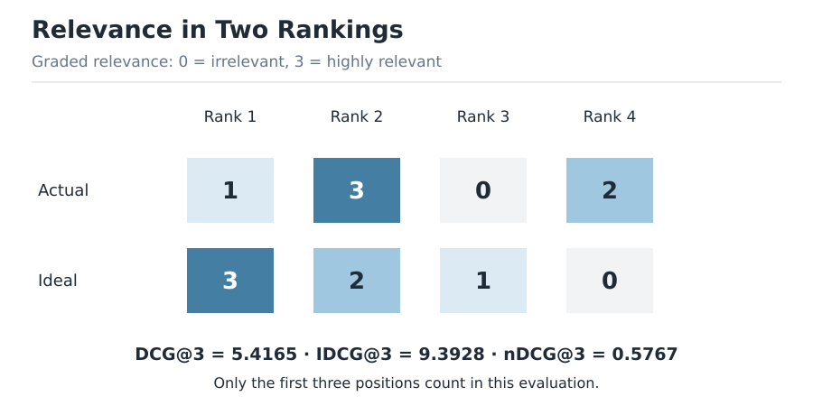

# M26-L5 – Ranking, Recommendations and Feedback Loops {#L5}

**Course area:** M26 – Graphs, Recommender Systems and Structured Data

**Level:** Master · Compulsory elective/models

**Prerequisites:** M12, M17, M19.

**Learning objective:** Measure ranking quality and distinguish feedback, exposure bias and evaluation design.

## Selection and ordering {#S1}

An educational portal contains a thousand exercises. A candidate generator first selects a smaller set of suitable exercises, a ranker orders them, and the interface displays a subset. Candidate generation, ranking and presentation jointly determine which interactions can be observed. Even the best rating predictor is insufficient if relevant exercises were already excluded in the first stage. Offline metrics measure quality relative to known test relevance labels. For binary relevance, Precision@k is the number of relevant hits among the first $k$ items divided by $k$; Recall@k divides by the total number of test items known to be relevant. Both require meaningfully defined candidates and test labels.

## Graded relevance and nDCG {#S2}




*Figure: Relevance of two ranked lists.*

A user is offered four exercises. Their graded test relevances in displayed order are $(1,3,0,2)$. Using a gain function $g(r)=2^r-1$ and a logarithmic rank discount, we define

$$DCG@k=\sum_{j=1}^k\frac{2^{r_j}-1}{\log_2(j+1)},\qquad nDCG@k=\frac{DCG@k}{IDCG@k}.$$

$IDCG$ is the value for the ideal ordering of the same candidates. For $k=3$, we obtain $DCG=1+7/\log_2 3\approx5.4165$ and $IDCG=7+3/\log_2 3+1/2\approx9.3928$. The nDCG is approximately 0.5767. The figure compares the two rankings. If there are no relevant items, the denominator is zero; the treatment of such cases must be documented for each benchmark.

```python
from math import log2
r=[1,3,0,2]
def dcg(r,k):
    return sum((2**v-1)/log2(j+2) for j,v in enumerate(r[:k]))
a=dcg(r,3); b=dcg(sorted(r,reverse=True),3)
assert 0.576<a/b<0.577
print(round(a,5),round(b,5),round(a/b,5))
```

## Feedback in data collection {#S3}

The portal frequently shows popular exercises, receives more interactions with them as a result, and subsequently trains on those interactions. Popularity may be reinforced while new exercises remain unseen. A high score on later data produced by the same display policy does not necessarily demonstrate improved learning outcomes. Users can interact only with content that was displayed. Where possible, record candidates, impressions, time, position and the policy used, subject to data-minimisation requirements. With randomised exploration and known positive selection probabilities, inverse probability weights can evaluate a differently distributed target policy; very small probabilities, however, lead to high variance. An A/B test needs a well-defined learning objective, duration and guardrail metrics. Diversity, dropout rates, longer-term learning outcomes and fair exposure can matter alongside clicks. A temporal split prevents future information leakage but does not remove selection bias.

## Exercise with solution {#S4}

Of 100 random impressions for a new type of exercise, 20 lead to clicks; for an older type, 90 of 900 impressions lead to clicks. The older type receives more clicks, but the observed click-through rates are 10% versus 20%. Even this is not reliable evidence of a causal difference without comparable audiences and positions. Compare under equal randomised exposure and with a separate measure of actual learning progress.

## Sources and further reading {#S5}

- [Chaney, Stewart and Engelhardt (2018): How Algorithmic Confounding in Recommendation Systems Increases Homogeneity and Decreases Utility](https://arxiv.org/abs/1710.11214) · article opened
- [Koren, Bell and Volinsky (2009): Matrix Factorization Techniques for Recommender Systems](https://doi.org/10.1109/MC.2009.263) · publisher record
