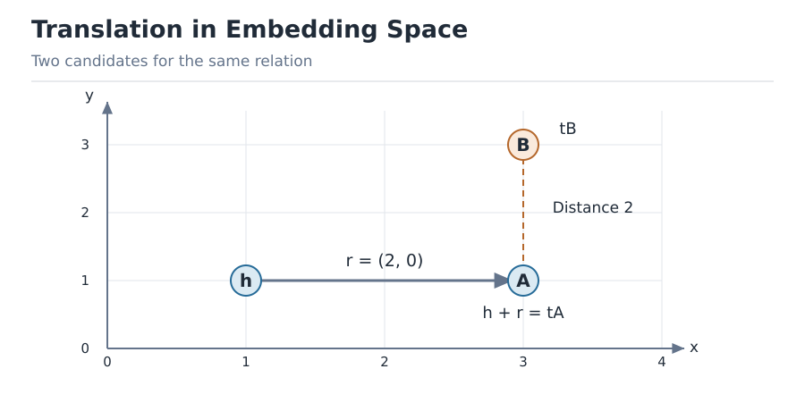

# M26-L6 – Knowledge Graphs and Neuro-Symbolic Approaches {#L6}

**Course area:** M26 – Graphs, Recommender Systems and Structured Data

**Level:** Master · Compulsory elective/models

**Prerequisites:** M12, M17, M19.

**Learning objective:** Distinguish relation triples, symbolic inferences and neural scores, and combine them appropriately.

## Structured statements and inference {#S1}

A workshop database needs to establish which component belongs to which machine. A knowledge graph stores typed relations, such as $(Motor7,\text{TeilVon},Pumpe2)$ and $(Pumpe2,\text{TeilVon},Anlage4)$. Unlike a simple untyped graph, it distinguishes entities and different predicates. A schema can define permitted entity types, relations and constraints. If the relation TeilVon ('part of') is explicitly defined as transitive in the model, $(Motor7,\text{TeilVon},Anlage4)$ follows logically. Not every relation is transitive: two maintenance orders, for example, do not automatically imply a third. Under an open-world assumption, a statement that is not stored is not automatically false; negating it requires additional information. Provenance and time are essential when facts can change.

## Vector scores for possible relations {#S2}




*Figure: Translation in embedding space.*

An embedding model such as TransE scores triples by comparing a head vector $h$, relation vector $r$ and tail vector $t$. One possible error score is $s(h,r,t)=\|h+r-t\|_2$, where smaller values mean greater plausibility according to the model. Set $h=(1,1)$, $r=(2,0)$, and consider candidates $t_A=(3,1)$ and $t_B=(3,3)$. The errors are 0 and 2. The figure illustrates the translation and the remaining distance. This is a teaching configuration, not a trained representation. Among other limitations, TransE struggles with certain one-to-many or symmetric relations; other embedding families model relations more flexibly. Training needs, for example, positive triples and deliberately corrupted triples; unobserved triples may still be true.

```python
import numpy as np
h=np.array([1,1]); r=np.array([2,0]); T=np.array([[3,1],[3,3]])
s=np.linalg.norm(h+r-T,axis=1)
assert np.allclose(s,[0,2])
facts={('Motor7','Pumpe2'),('Pumpe2','Anlage4')}
closure=facts.copy()
while True:
    extra={(a,d) for a,b in closure for c,d in closure if b==c}
    if extra<=closure: break
    closure|=extra
assert ('Motor7','Anlage4') in closure
print(s,sorted(closure))
```

## Combining two types of statements {#S3}

A neuro-symbolic system may first generate neural candidates and then check them against type or safety rules. Alternatively, rule violations can be included as soft penalties in a learning objective. A hard filter is appropriate for genuinely binding requirements, but it is only as reliable as its rule set and input data. Soft penalties do not guarantee logical consistency. A symbolically derived statement has a traceable chain of evidence; a neural score is a ranking value, not a logical truth and, without separate calibration, not a probability. Evaluation must treat explicit facts, logical consequences and model suggestions separately. In link prediction, filtered ranking avoids penalising alternative correct triples already known to be true. For temporal graphs, test times must again be specified.

## Exercise with solution {#S4}

A neural model additionally proposes $(Anlage4,\text{TeilVon},Motor7)$. If TeilVon is defined as a strict part-of relation that is irreflexive and transitive, the proposal contradicts irreflexivity when combined with the inferred relation in the opposite direction: Motor7 would become part of itself. The system should flag or reject the proposal, not store it as an established fact because its score is favourable.

## Sources and further reading {#S5}

- [Hamilton (2020): Graph Representation Learning](https://www.cs.mcgill.ca/~wlh/grl_book/) · book overview and table of contents, Chapters 2–7
- [Bordes et al. (2013): Translating Embeddings for Modeling Multi-relational Data](https://proceedings.neurips.cc/paper/2013/hash/1cecc7a77928ca8133fa24680a88d2f9-Abstract.html) · abstract opened
- [DeLong, Fernández Mir and Fleuriot (2023): Neurosymbolic AI for Reasoning over Knowledge Graphs: A Survey](https://arxiv.org/abs/2302.07200) · article opened
