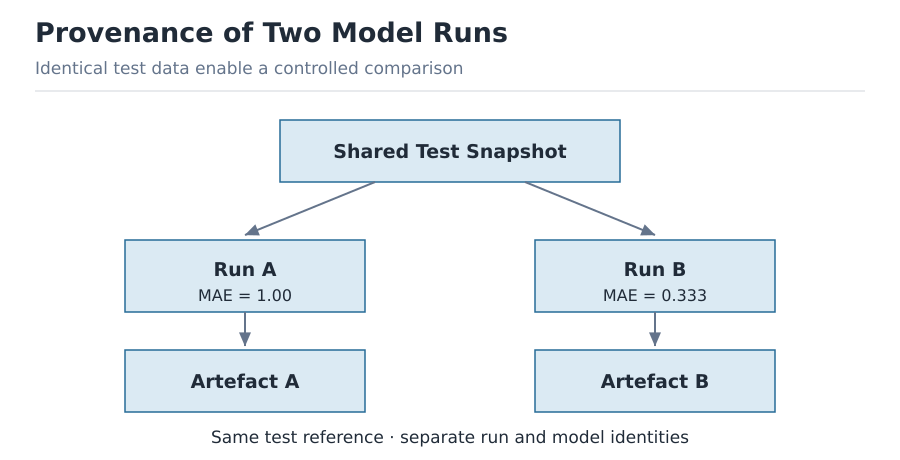

# M27-L1 – Experiment Tracking and Data and Model Versioning {#L1}

**Course area:** M27 – AI Systems Engineering and MLOps

**Level:** Master · Compulsory elective/systems

**Prerequisites:** M7, M14, M19.

**Learning objective:** Reconstruct and compare reproducible model runs using a versioned record of provenance.

## A model is more than a weights file {#S1}

A workshop trains a model to predict spare-parts demand. Two people each save a file called `modell.bin`. Without knowing the training period, feature definitions and software environment, the files are difficult to interpret. Experiment tracking therefore records every training run as a separate event: code commit, data snapshot including its split, preprocessing, parameters, random state, environment, metrics and artefacts such as model weights or error plots. A model registry links selected artefacts to their review status, model ownership and approved versions. Experiment history and operational approval are distinct activities.

A version name is a human-readable reference; a cryptographic hash is a fingerprint of particular bytes. A version must resolve to an immutable reference. When personal data are involved, snapshots should be stored under controlled access rather than copied into a public Git repository. A hash proves neither lawful provenance nor scientific quality. It supports integrity checking, provided the expected hash comes from a trustworthy source.

## Comparing two runs {#S2}




*Figure: Provenance of two model runs.*

Runs A and B are evaluated on identical synthetic test values $(4,6,8)$. A predicts $(3,7,7)$ and B predicts $(4,5,8)$. With $\mathrm{MAE}=n^{-1}\sum_i|y_i-\hat y_i|$, the respective errors are 1 and $1/3$. Such a comparison is meaningful only when selection procedures, test cases and transformations are consistent. In real model selection, a validation set is used; the held-out test set is reserved for final evaluation, not repeated hyperparameter selection. The diagram shows two runs with shared input references but separate result artefacts.

```python
import hashlib, json
snapshot=b'4,6,8\n'
digest=hashlib.sha256(snapshot).hexdigest()
y=[4,6,8]
runs=[]
for name,p in [('A',[3,7,7]),('B',[4,5,8])]:
    runs.append({'run':name,'data_sha256':digest,
                 'mae':sum(abs(a-b) for a,b in zip(y,p))/len(y)})
assert runs[0]['mae']==1 and runs[1]['mae']==1/3
assert runs[0]['data_sha256']==runs[1]['data_sha256']
print(json.dumps(runs,indent=2))
```

## Reproducibility and approval {#S3}

A seed alone cannot guarantee a bit-identical rerun: parallel reductions, library versions, hardware and non-deterministic operations may affect the result. We should distinguish exact reproduction, statistically similar reruns and scientifically independent replication. Every published figure should be linked to its specific run. An alias such as `production` may point to a newly approved version, while the original version must remain identifiable. A rollback must consider data, model and API compatibility. Development and approval permissions should be separated, and logs must not contain access credentials.

## Exercise with solution {#S4}

A run with MAE 0.3 comes from a different test month than a run with MAE 0.4. Can it be selected on that basis alone? No. Differences in demand or case difficulty may affect both figures. Both models should be evaluated on the same sample that was not previously used for selection; for time-dependent data, document the temporal split.

## Sources and further reading {#S5}

- [MLflow: ML Experiment Tracking](https://mlflow.org/docs/latest/ml/tracking/) · documentation consulted
- [Google Cloud: MLOps – Continuous delivery and automation pipelines in machine learning](https://docs.cloud.google.com/architecture/mlops-continuous-delivery-and-automation-pipelines-in-machine-learning) · documentation consulted
