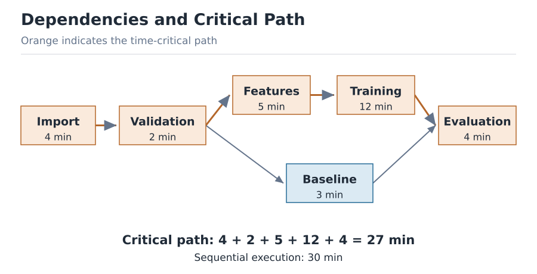

# M27-L2 – Training Pipelines, Orchestration and CI/CD {#L2}

**Course area:** M27 – AI Systems Engineering and MLOps

**Level:** Master · Compulsory elective/systems

**Prerequisites:** M7, M14, M19.

**Learning objective:** Design dependencies in an ML pipeline, validation gates and separate integration, delivery and training processes.

## From a script to a directed workflow {#S1}

A daily forecasting system must ingest new data, check types and timestamps, generate features, train a model and evaluate the outcome. These steps form a directed acyclic graph (DAG). An edge indicates that a downstream step depends on an upstream result. Independent tasks may run in parallel. An orchestrator manages state, dependencies, resources, retries and logs. Scheduling alone does not guarantee scientific correctness.

Continuous Integration (CI) checks changes to code, tests and configuration. Continuous Delivery (CD) prepares a verified software or model artefact for release; fully automatic deployment is a separate decision. Continuous Training (CT) initiates a fresh training run when specified data, time or quality conditions are met. A newly trained model is initially a candidate, not automatically approved for production. A stable interface must also apply the same feature definitions at training and serving time.

## The critical path and approval gate {#S2}




*Figure: Dependencies and critical path in a training pipeline.*

Example: data import takes 4 minutes and validation 2 minutes. Feature preparation then takes 5 minutes and baseline evaluation 3 minutes, with the latter two running in parallel. Training takes 12 minutes and depends on the features; final evaluation requires 4 minutes after both training and baseline have finished. With no resource bottlenecks, the total is 27 minutes because $4+2+\max(5+12,3)+4=27$. Running the tasks serially would take 30 minutes. The baseline is not on the critical path. The diagram illustrates dependencies and durations. Approval is a separate subsequent step.

```python
jobs={'Import':(4,[]),'Validierung':(2,['Import']),
      'Merkmale':(5,['Validierung']),'Baseline':(3,['Validierung']),
      'Training':(12,['Merkmale']),'Bewertung':(4,['Training','Baseline'])}
end={}
for name,(duration,deps) in jobs.items():
    end[name]=duration+max((end[k] for k in deps),default=0)
assert end['Bewertung']==27
assert sum(v[0] for v in jobs.values())==30
print(end)
```

## Handling failures and retries {#S3}

A failed import must not silently cause old data to be reused. Retries must be controlled: an idempotent write produces the same logical state when given the same input, for example by transactionally committing a result under a fixed run key. Cached results are reused only with identical inputs, including code and parameters. Data validation covers value ranges, completeness and temporal plausibility as well as column types. Secrets belong in separate access-control facilities. When error rates or model quality deteriorate, the previously approved service may remain in use only if it is still safe for its intended purpose; otherwise a defined fallback procedure is activated.

## Exercise with solution {#S4}

Baseline evaluation now takes 20 rather than 3 minutes. Total duration rises to $4+2+\max(17,20)+4=30$ minutes. Making training faster would initially have no effect on overall duration, as the baseline is now on the critical path.

## Sources and further reading {#S5}

- [Google Cloud: MLOps – Continuous delivery and automation pipelines in machine learning](https://docs.cloud.google.com/architecture/mlops-continuous-delivery-and-automation-pipelines-in-machine-learning) · documentation consulted
- [MLflow: ML Experiment Tracking](https://mlflow.org/docs/latest/ml/tracking/) · documentation consulted
