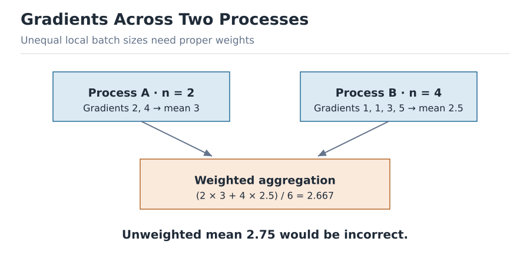

# M27-L3 – Hardware, Parallelism and Distributed Training {#L3}

**Course area:** M27 – AI Systems Engineering and MLOps

**Level:** Master · Compulsory elective/systems

**Prerequisites:** M7, M14, M19.

**Learning objective:** Distinguish data, model and pipeline parallelism and assess synchronisation and scaling numerically.

## Memory and processing units {#S1}

Training neural networks requires storage not only for weights but also for activations, gradients and, where applicable, optimiser states. Accelerators have many processing units, but use them well only with suitable parallel work and sufficient data supply. Data parallelism replicates a model and distributes training examples across processes. Gradients are synchronised after each local backward computation. Model parallelism distributes parameters or tensor operations because a model does not fit in one memory or can be computed more efficiently across devices. Pipeline parallelism assigns layers to stages; several micro-batches fill the pipeline, potentially creating idle time and communication overhead. Modern systems often combine these approaches.

## Gradient aggregation and speed {#S2}




*Figure: Gradients across two processes.*

Process A handles two examples with gradients 2 and 4 for the same scalar parameter. Process B handles four examples with gradients 1, 1, 3 and 5. Their local means are 3 and 2.5. The global mean is $(2\cdot3+4\cdot2.5)/6=8/3$, not the unweighted mean of 2.75. When local batches have equal sizes, averaging their mean gradients yields the global mean. Unequal sizes require appropriately adjusted weights. The diagram shows both process groups and their weighted reduction.

For a fixed problem size with an ideally parallelisable fraction $1-f$, Amdahl's model is $S(p)=1/[f+(1-f)/p]$. With $f=0.2$ and four processes, $S=2.5$ rather than 4, giving efficiency $S/p=62.5\,\%$. Communication would reduce real speedup further.

```python
from fractions import Fraction as F
a,b=[2,4],[1,1,3,5]
g=F(sum(a)+sum(b),len(a)+len(b))
wrong=(F(sum(a),len(a))+F(sum(b),len(b)))/2
s=1/(F(1,5)+F(4,5)/4)
assert g==F(8,3) and wrong==F(11,4) and s==F(5,2)
print(float(g),float(wrong),float(s),float(s/4))
```

## Communication and practical scaling limits {#S3}

All-reduce makes the aggregated result available to every participating process. Between machines, exchanging large gradients may dominate a training step. Doubling the global batch size also changes optimisation conditions: fewer updates per epoch, potentially a different learning rate and different generalisation behaviour. Step time, examples per second and time to reach a specified model quality are therefore distinct measures. Gradient accumulation sums contributions from several micro-batches before an update, but needs correct weighting and affects techniques such as batch normalisation differently from one genuinely large batch. Mixed precision reduces some memory and computing requirements, but calls for suitable accumulation precision and numerical checks.

## Exercise with solution {#S4}

For $f=0.1$ and eight processes, $S=1/(0.1+0.9/8)=80/17\approx4.71$. The theoretical limit is 10. Communication, memory bandwidth and uneven workloads are excluded from this simplified model.

## Sources and further reading {#S5}

- [PyTorch: Getting Started with Distributed Data Parallel](https://docs.pytorch.org/tutorials/intermediate/ddp_tutorial.html) · tutorial consulted
- [Bindel: Numerical Methods for Data Science – Performance Basics](https://www.cs.cornell.edu/~bindel/nmds/00-Background/02-Performance.html) · teaching text consulted
