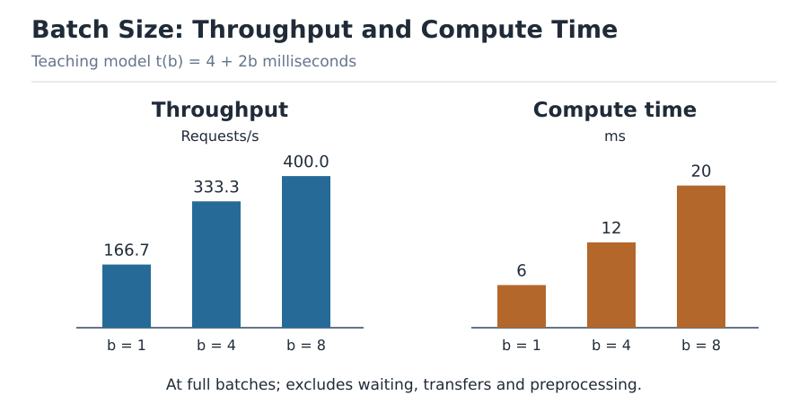

# M27-L4 – Model Serving, Batching, Quantisation and Efficient Inference {#L4}

**Course area:** M27 – AI Systems Engineering and MLOps

**Level:** Master · Compulsory elective/systems

**Prerequisites:** M7, M14, M19.

**Learning objective:** Distinguish throughput, latency and quantisation error, and balance inference efficiency against quality constraints.

## How a model is served depends on its application {#S1}

An hourly forecasting report can process many records together. An interactive service must instead respond quickly to individual requests. Serving includes serialisation, queues, preprocessing, routing and output validation as well as model computation. Throughput measures completed requests per unit time; latency measures the time taken per request. Averages hide slow outliers, so median and 95th-percentile latency, for example, are measured under representative load profiles. For language models, time to first token and output token rate can be separate objectives.

## Batch size and numerical representation {#S2}




*Figure: Batch size, throughput and processing time.*

For a batch of $b$ requests, a synthetic accelerator requires $t(b)=4+2b$ ms. At full utilisation and ignoring other overheads, it can process $1000b/t(b)$ requests per second: approximately 166.7 for $b=1$, 333.3 for $b=4$ and 400 for $b=8$. Pure computation time per batch increases to 6, 12 and 20 ms respectively. The diagram shows this trade-off. Waiting to form batches adds to latency; a maximum batch waiting time does not bound total end-to-end latency.

Linear quantisation approximates real-valued numbers with integers: $q=\operatorname{clip}(\operatorname{round}(x/s)+z,q_{\min},q_{\max})$, $\hat x=s(q-z)$, where $s>0$ and $z$ is an integer zero point. For $s=0.1$, $z=0$, the value $0.26$ maps to 3 and back to $0.3$. The absolute error is 0.04. Without clipping, idealised rounding error is no more than $s/2$. One million weights require 4 MB raw storage in FP32 or 1 MB in INT8 (decimal units); scales, metadata and activations add to this.

```python
import numpy as np
b=np.array([1,4,8]); t=4+2*b; rate=1000*b/t
x=np.array([-.13,.26,1.07]); q=np.clip(np.rint(x/.1),-128,127)
xhat=.1*q
assert np.allclose(rate,[1000/6,4000/12,400])
assert np.max(np.abs(x-xhat))<=.05
print(t,rate,q,xhat)
```

## Selecting a system under real constraints {#S3}

Quantisation may save bandwidth and weight storage, but accelerates computation only with suitable hardware and runtime support. Calibration data must cover relevant value ranges; quality is checked at task level and, when relevant, across subgroups. Dynamic batching collects compatible concurrent requests until a capacity or time limit is reached. Stateful requests need suitable scheduling. Load tests measure throughput, percentiles, timeout rates, memory and quality across different loads and input lengths. An overloaded service requires bounded queues, rejection rules and possibly controlled fallbacks.

## Exercise with solution {#S4}

A batch of four requests waits an additional 7 ms before starting. A request that was present at the start of that wait takes at least 19 ms to complete model computation, excluding transport and preprocessing. It already misses a 15 ms latency target.

## Sources and further reading {#S5}

- [NVIDIA Triton: Batchers](https://docs.nvidia.com/deeplearning/triton-inference-server/user-guide/docs/user_guide/batcher.html) · documentation consulted
- [ONNX Runtime: Quantize ONNX models](https://onnxruntime.ai/docs/performance/model-optimizations/quantization.html) · documentation consulted
