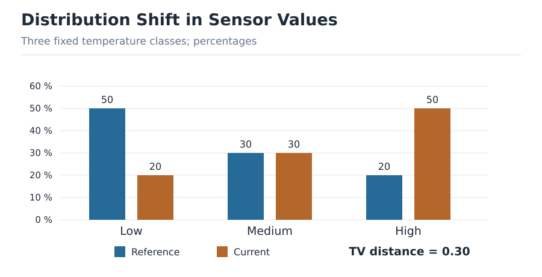

# M27-L5 – Monitoring, Drift and Retraining {#L5}

**Course area:** M27 – AI Systems Engineering and MLOps

**Level:** Master · Compulsory elective/systems

**Prerequisites:** M7, M14, M19.

**Learning objective:** Distinguish changes in data distributions from quality deterioration and justify a supervised retraining process.

## What changes after deployment? {#S1}

A model predicts whether a pump will fail in the next seven days. New pump types may appear, sensors may be calibrated differently, or maintenance rules may change failure probabilities. Covariate shift changes $P(X)$ while assuming stable $P(Y\mid X)$. Label shift describes a change in $P(Y)$ while assuming stable $P(X\mid Y)$. Here, concept drift means a change in the conditional relationship $P(Y\mid X)$. Several shifts may occur together in real data; diagnosis is often ambiguous without observed outcomes.

Monitoring covers system health (errors, latency, utilisation), inputs (schema, missing values and distributions), model behaviour (scores and predictions) and delayed task-specific quality measures. The actual outcomes for a seven-day forecast only become fully available later. An input distribution change is therefore a warning sign, not proof of poor predictions.

## Comparing two sensor distributions {#S2}




*Figure: Distribution shift in sensor measurements.*

Across three fixed temperature categories, reference proportions are $p=(0.5,0.3,0.2)$ and current proportions $q=(0.2,0.3,0.5)$. The total variation distance between discrete distributions is $D_{TV}(p,q)=\tfrac12\sum_i|p_i-q_i|=0.3$. It lies between zero and one and depends on the category boundaries chosen. The figure shows the redistributed frequencies. An internal alert threshold of 0.2, specified in advance for this teaching example, initiates an investigation but does not authorise a model release. Sample size, random variation and seasonal changes also matter.

```python
from fractions import Fraction as F
p=[F(5,10),F(3,10),F(2,10)]
q=[F(2,10),F(3,10),F(5,10)]
d=sum(abs(a-b) for a,b in zip(p,q))/2
assert d==F(3,10)
print(float(d), 'prüfen' if d>F(2,10) else 'weiter beobachten')
```

## From an alert to a decision {#S3}

First check instrumentation, data provenance and timing. A faulty measurement station must not provide a training signal without investigation. Then examine quality metrics for representative subgroups using fully observed labels. Evaluate a new candidate on historical data and an appropriate recent validation window, avoiding temporal leakage. If suitability is demonstrated, use a controlled rollout. If evidence remains insufficient, document the unresolved decision or bridge the situation with a safe fallback. Automated alerts require named owners and clear escalation paths; many simultaneous high-dimensional drift tests can produce numerous false positives.

## Exercise with solution {#S4}

A new production batch gives $q=(0.4,0.3,0.3)$. Its distance to the original reference is 0.1, below the teaching threshold. That does not prove that conditional failure probabilities are stable: a change in maintenance may degrade predictions even if temperature categories remain unchanged.

## Sources and further reading {#S5}

- [Rabanser, Günnemann und Lipton (2019): Failing Loudly: An Empirical Study of Methods for Detecting Dataset Shift](https://arxiv.org/abs/1810.11953) · abstract consulted
- [Google Cloud: MLOps – Continuous delivery and automation pipelines in machine learning](https://docs.cloud.google.com/architecture/mlops-continuous-delivery-and-automation-pipelines-in-machine-learning) · documentation consulted
