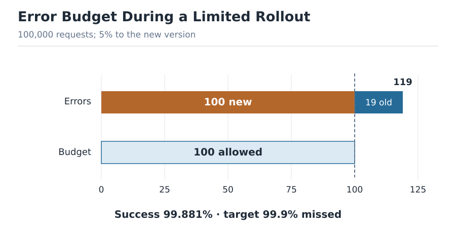

# M27-L6 – Testing Strategies, Rollback and Operational Reliability {#L6}

**Course area:** M27 – AI Systems Engineering and MLOps

**Level:** Master · Compulsory elective/systems

**Prerequisites:** M7, M14, M19.

**Learning objective:** Connect ML-specific tests, service objectives and staged rollouts to an error budget.

## Multiple levels of testing {#S1}

A forecasting service can use correct model weights and still accept incorrect units. Unit tests check individual functions, such as converting grams to kilograms. Integration tests examine the interaction of data source, feature processing, model and output. Contract tests check permissible input types and value ranges. Model tests include quality metrics, comparisons with a baseline, edge cases and appropriate subgroups. Justified tolerances and repeated runs are useful for randomised or numerically approximate systems. Load tests and failure simulations assess operational performance, not just prediction quality.

A Service Level Indicator (SLI) is a measured quantity; a Service Level Objective (SLO) specifies a target for that quantity over a defined window. An error budget quantifies the room between the target and perfect delivery, not permission to cause avoidable failures. Critical safety requirements may demand immediate action regardless of an aggregate SLO.

## A limited rollout {#S2}




*Figure: Error budget during a limited rollout.*

For 100,000 requests a day, a target of 99.9% successful responses permits at most 100 failures in that window. A new version initially receives a randomly selected 5% of traffic and has a 2% error rate; the old version has a 0.02% error rate. Under exactly these teaching assumptions, $5000\cdot0.02=100$ and $95000\cdot0.0002=19$ errors result. The total of 119, equivalent to 99.881% success, misses the objective. The diagram compares error contributions and the budget. An early canary alert could limit the impact. Traffic should be increased only after sufficiently representative measurement.

```python
from fractions import Fraction as F
n=100000; candidate=5000
new=candidate*F(2,100); old=(n-candidate)*F(2,10000)
budget=n*F(1,1000); success=1-(new+old)/n
assert new==100 and old==19 and budget==100
assert success<F(999,1000)
print(new,old,budget,float(success)*100)
```

## Failure handling and recovery {#S3}

Shadow tests send copies of requests passively to a new version without returning its outputs to users; external write side effects must be suppressed. By contrast, a canary receives live traffic. Rollback must restore a known working model version, its preprocessing and compatible interfaces. Data migrations can prevent rollback if older applications can no longer read the new format. Plan backward compatibility, backups, tested restoration and safe abort criteria before rollout. Incident records should document chronology, impact, causes and corrective measures, without unnecessarily logging sensitive inputs.

## Exercise with solution {#S4}

Reducing the new version's share to 1% under the same error rates gives an expected 20 errors from the new version and 19.8 from the old version. The expected total stays below 100, although individual days may differ. Serious task-specific errors must not be ignored even at low traffic shares.

## Sources and further reading {#S5}

- [Google SRE Workbook: Canarying Releases](https://sre.google/workbook/canarying-releases/) · Chapter 16 consulted
- [Google Cloud: MLOps – Continuous delivery and automation pipelines in machine learning](https://docs.cloud.google.com/architecture/mlops-continuous-delivery-and-automation-pipelines-in-machine-learning) · documentation consulted
