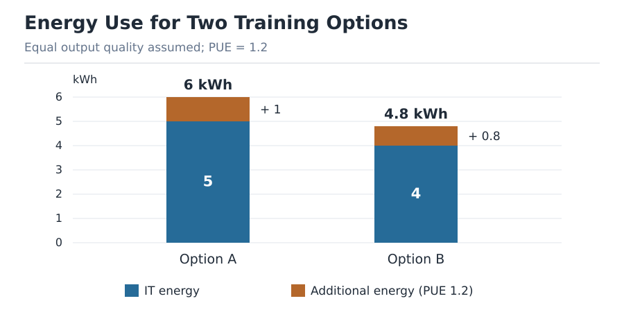

# M27-L7 – Costs, Energy Use and Technical Sustainability {#L7}

**Course area:** M27 – AI Systems Engineering and MLOps

**Level:** Master · Compulsory elective/systems

**Prerequisites:** M7, M14, M19.

**Learning objective:** Calculate energy, costs and operational emissions with transparent system boundaries and evaluate efficiency measures.

## Power is not the same as energy {#S1}

A training task occupies an accelerator for several hours. Electrical power $P(t)$ combined with runtime determines the energy used: $E=\int P(t)\,dt$. For constant average power, multiplying kilowatts by hours yields kilowatt-hours. The measurement boundary must be stated: an individual GPU, a whole machine, all IT infrastructure or a data centre. Power Usage Effectiveness (PUE) is the ratio of total data-centre energy to IT energy within the same accounting boundary. If total energy is already measured, multiplying by PUE again would double-count overhead.

Operational greenhouse-gas emissions also depend on location- and time-appropriate electricity emissions intensity. Manufacturing, transport and disposal of equipment are outside an operating-electricity-only calculation. Depending on how a system is run, costs may include electricity, hardware depreciation, maintenance, networking or an agreed compute-hour tariff. A cloud hourly price often includes a share of these underlying operating costs already.

## Two synthetic training options {#S2}




*Figure: Energy use of two training variants.*

Including CPU and memory, option A draws an average 0.5 kW of IT power for 10 hours and B draws 0.8 kW for 5 hours. Thus $E_A=5$ kWh and $E_B=4$ kWh. With a shared assumed PUE of 1.2, total energy is 6 and 4.8 kWh. At the explicitly assumed electricity emissions intensity of 0.35 kg CO₂e/kWh, emissions are 2.1 and 1.68 kg CO₂e. With an electricity-only price of €0.30/kWh, the energy costs are €1.80 and €1.44 respectively. B saves 20% energy for the same assumed result quality. The figure separates IT and overhead energy. These are not measurements from a real data centre.

```python
from decimal import Decimal as D
it=[D('.5')*10,D('.8')*5]
total=[x*D('1.2') for x in it]
co2=[x*D('.35') for x in total]
price=[x*D('.30') for x in total]
assert total==[D('6'),D('4.8')]
assert co2==[D('2.1'),D('1.68')]
print(it,total,co2,price)
```

## Measure efficiency against the correct objective {#S3}

A model that meets the required quality using less compute may avoid unnecessary work. Yet shorter runtime does not always mean less energy: power and resource utilisation also change. Comparisons must use equivalent task quality, data and service boundaries, such as energy per thousand correct predictions at a specified latency objective. Discarded experimental runs also count. Quantisation, reusing existing models, ending unproductive searches early and choosing suitable hardware can help when testing confirms the quality. If demand rises rapidly, lower energy per request can still coincide with higher total energy use.

## Exercise with solution {#S4}

B is now run in a location with electricity emissions intensity of 0.55 kg CO₂e/kWh. At the same total energy use, it emits 2.64 kg CO₂e, more than A under the original intensity. Energy efficiency and operational emissions must therefore be reported separately.

## Sources and further reading {#S5}

- [Lacoste et al. (2019): Quantifying the Carbon Emissions of Machine Learning](https://arxiv.org/abs/1910.09700) · abstract page consulted
- [Bindel: Numerical Methods for Data Science – Performance Basics](https://www.cs.cornell.edu/~bindel/nmds/00-Background/02-Performance.html) · teaching text consulted
