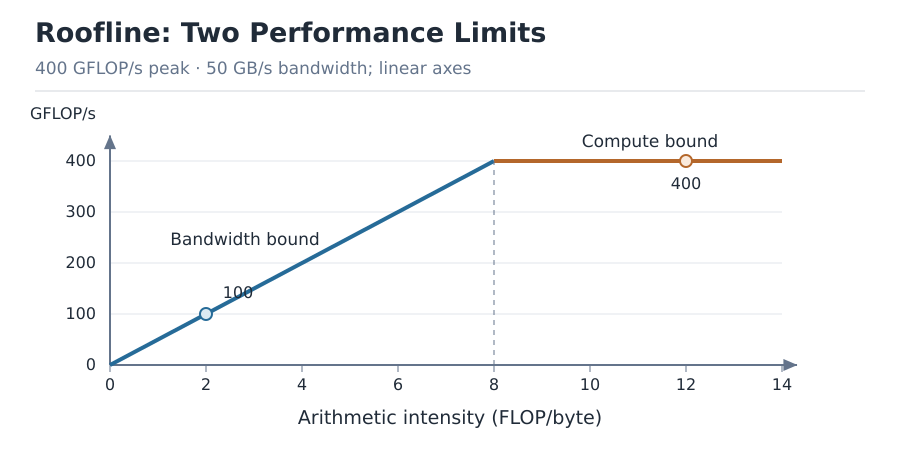

# M27-L8 – High-Performance Data Analytics: Memory Hierarchy and Scaling Limits {#L8}

**Course area:** M27 – AI Systems Engineering and MLOps

**Level:** Master · Optional specialisation

**Prerequisites:** M7, M14, M19.

**Learning objective:** Calculate memory bandwidth and arithmetic intensity and use the roofline bound to investigate performance bottlenecks.

## Why moving data is expensive {#S1}

In numerical computing, a processor accesses several levels of memory. Registers and nearby caches often provide quick access to small amounts of data; main memory and external storage are larger but more constrained per access or transferred byte. Many accelerators also incur transfers between host and device. If a value is needed repeatedly, a suitable data layout may enable reuse in cache. Contiguous accesses and blocked matrix operations can reduce unnecessary transfers under the right conditions. Very large arrays also encounter capacity limits, not just bandwidth limits.

## A theoretical performance bound {#S2}




*Figure: Roofline model with two performance limits.*

Arithmetic intensity $I=W/Q$ is the number of floating-point operations $W$ divided by bytes $Q$ moved across a specified memory boundary. With peak compute performance $P_{max}=400$ GFLOP/s and memory bandwidth $B=50$ GB/s (decimal), the roofline bound is $P\le\min(P_{max},BI)$. At $I=2$ FLOP/byte the bound is 100 GFLOP/s; at $I=12$ peak compute performance limits it to 400 GFLOP/s. The transition occurs at $I^*=P_{max}/B=8$. The original teaching diagram uses linear axes to display the bend directly; actual roofline analyses often use logarithmic axes.

A kernel with $10^9$ FLOP and $5\cdot10^8$ transferred bytes has $I=2$. Its computation takes at least $10^9/(100\cdot10^9)=0.01$ s in this idealised model. Startup costs, synchronisation, transfer protocols and dependent operations are not included.

```python
from fractions import Fraction as F
P=400; B=50
roof=lambda i:min(P,B*i)
assert [roof(i) for i in [2,8,12]]==[100,400,400]
work=10**9; moved=5*10**8
I=F(work,moved); lower=F(work,roof(I)*10**9)
assert lower==F(1,100)
print(P/B,roof(I),float(lower))
```

## From a bound to measurement {#S3}

The model provides an upper bound on throughput, not a guaranteed measurement. Profiling records actual transfers, utilisation and runtime. A kernel operating far below the bound may suffer irregular accesses or inadequate vectorisation, among other problems. Sparse matrices introduce index transfers alongside their values. A denser representation may execute more operations and yet be faster on a particular device; this must be measured. Strong scaling holds problem size constant while adding compute units; weak scaling increases problem size with the number of units. Communication and uneven data partitions limit both. Optimisation must preserve the required numerical accuracy and reproducibility.

## Exercise with solution {#S4}

If memory bandwidth doubles to 100 GB/s with unchanged peak computation, the transition shifts to 4 FLOP/byte. The kernel at intensity 2 can theoretically achieve up to 200 GFLOP/s; the kernel at intensity 12 remains limited to 400 GFLOP/s.

## Sources and further reading {#S5}

- [Bindel: Numerical Methods for Data Science – Performance Basics](https://www.cs.cornell.edu/~bindel/nmds/00-Background/02-Performance.html) · teaching text consulted
- [Berkeley Lab: The Roofline Model: Visualizing and Optimizing Performance](https://amcr.lbl.gov/departments/computer-science-department/ppan/roofline-performance-model/) · specialist page consulted
